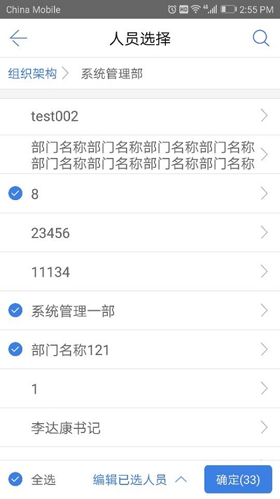

# ejs.contact

## select

选人功能 API，EJS 容器环境由原生组件 API 实现，其他环境由 H5 选人实现

从版本`4.2.0`开始，ejs 不再打包选人组件的代码，H5 端选人由各自框架的选人组件实现。

开发者仍然可以通过 ejs 调用各框架的选人组件，调用前请确保已正确引入对应框架的选人组件代码。

M8 框架的 H5 选人组件传参与 M7 框架有差异，且在跨端框架中调用 H5 选人时，需要在页面上添加选人组件的节点，具体请参照对应框架选人组件的文档。

以下仅列出 M7 框架 H5 选人组件传参说明。

参数与 EJS 原生选人组件 API 一致

**平台差异**

| ejs（H5 应用) | ejs（新点小程序） |  H5  | 钉钉 | 微信小程序 | 支付宝小程序 |
| :------------ | :---------------: | :--: | :--- | :--------- | :----------- |
| 支持(3.2.0)   |    支持(3.2.0)    | 支持 | 支持 | 不支持     | 不支持       |

**使用示例**

### 选择人员

注：

1. 返回选择的人员数据，若选择了部门，返回参数包含部门数据及部门下所有人员数据
2. 实际返回数据跟接口返回的数据有关
3. 若需设置已选人员或禁选人员，userguid 字段必传

```js
ejs.contact.select({
    // h5选人功能需要手动传入地址和token
    url: 'http://218.4.136.126:1443/oa9_v7/rest/oa9/',
    token: 'f3fc7dc48fccb6638bcab36ad513df88',
    // 已选人员
    selectedusers: [
        {
            username: '张三',
            userguid: '73bee7b8-068c-4b11-9d2a-b16fcbba5119'
        }
    ],
    // 禁选人员
    unableselectusers: [
        {
            username: '李四',
            userguid: '3248760a-e4a3-430e-837e-11519d56090f'
        }
    ],
    issingle: '0',
    isgroupenable: '0',
    maxchoosecount: 500,
    success: function (result) {
        /**
         * {
            resultCode: -1,
            resultData: [{
                "userguid":"73bee7b8-068c-4b11-9d2a-b16fcbba5119",
                "displayname":"张三",
                ...
                }, ...],
            ouData: [{
                "ouguid": "ffa0252c-4bba-4bd6-8d0c-3bc6340a6605",
                "ouname": "总部职能部门",
                ...
            }, ...]
           }
         */
    },
    error: function (error) {}
});
```

### 只选部门

注：

1. 只返回选择的部门数据
2. 实际返回数据跟接口返回的数据有关
3. 若需设置已选部门，ouname 和 ouguid 字段必传，且返回结果中已选部门的数据与传入数据有关

```js
ejs.contact.select({
    // h5选人功能需要手动传入地址和token
    url: 'http://218.4.136.126:1443/oa9_v7/rest/oa9/',
    token: 'f3fc7dc48fccb6638bcab36ad513df88',
    // 已选部门
    selectedous: [
        {
            ouname: '总部职能部门',
            ouguid: 'ffa0252c-4bba-4bd6-8d0c-3bc6340a6605'
        }
    ],
    issingle: '0',
    isouonly: '1',
    success: function (result) {
        /**
         * {
            resultCode: -1,
            resultData: [],
            ouData: [{
                "ouguid": "ffa0252c-4bba-4bd6-8d0c-3bc6340a6605",
                "ouname": "总部职能部门",
                ...
            }, ...]
           }
         */
    },
    error: function (error) {}
});
```

### 选择范围

注：

1. 实际返回数据跟 custom 传入的数据有关
2. 以下示例中 custom 参数列出的字段都是必传的

```js
ejs.contact.select({
    issingle: '0',
    // 已选人员
    selectedusers: [
        {
            username: '张三',
            userguid: '2b540caa-2571-4062-a608-683325743f18'
        }
    ],
    // 禁选人员
    unableselectusers: [
        {
            username: '李四',
            userguid: '3248760a-e4a3-430e-837e-11519d56090f'
        }
    ],
    // 已选部门
    selectedous: [
        {
            ouname: '现金管理部',
            ouguid: 'd07d4916-ed90-47d0-82f6-4313bcbf7725'
        }
    ],
    // 选择范围
    custom: {
        ounum: '',
        oulist: [
            {
                ouguid: '491c9e1f-77c9-4e9e-b724-f9d0df1f3e78',
                ouname: '客户服务中心',
                parentouguid: 'root',
                haschildou: '1',
                haschilduser: '1',
                userlist: [
                    {
                        userguid: '2b540caa-2571-4062-a608-683325743f18',
                        username: '张三',
                        ouguid: '491c9e1f-77c9-4e9e-b724-f9d0df1f3e78',
                        photourl:
                            'rest/readpictureaction/getUserPicture?isCommondto=true&userGuid=2b540caa-2571-4062-a608-683325743f18&isMobile=true&md5=60f5e34d897312c4d89ad213934a82e1'
                    }
                ],
                oulist: [
                    {
                        ouguid: '1353dfc7-c3bc-4bc3-bf65-3c0611bcb3a9',
                        ouname: '客服1部',
                        parentouguid: '491c9e1f-77c9-4e9e-b724-f9d0df1f3e78',
                        haschildou: '0',
                        haschilduser: '1',
                        userlist: [
                            {
                                userguid: '3248760a-e4a3-430e-837e-11519d56090f',
                                username: '李四',
                                ouguid: '1353dfc7-c3bc-4bc3-bf65-3c0611bcb3a9',
                                photourl:
                                    'rest/readpictureaction/getUserPicture?isCommondto=true&userGuid=3248760a-e4a3-430e-837e-11519d56090f&isMobile=true&md5=203c4f0bb3efea12bfbbcfca16039487'
                            }
                        ]
                    }
                ]
            },
            {
                ouguid: 'd07d4916-ed90-47d0-82f6-4313bcbf7725',
                ouname: '现金管理部',
                parentouguid: 'root',
                haschildou: '0',
                haschilduser: '0'
            }
        ],
        userlist: [
            {
                userguid: 'ddf347c2-ba4a-41fc-8367-fa74794d230d',
                username: '曹六',
                ouguid: 'root',
                photourl:
                    'lest/readpictureaction/getUserPicture?isCommondto=true&userGuid=ddf347c2-ba4a-41fc-8367-fa74794d230d&isMobile=true&md5=b6caaa28319c5e26d6f57ea2efc58800'
            }
        ]
    },
    success: function (result) {
        /**
         * {
            resultCode: -1,
            resultData: [{
                "userguid":"73bee7b8-068c-4b11-9d2a-b16fcbba5119",
                "displayname":"张三",
                ...
                }, ...],
            ouData: [{
                "ouguid": "d07d4916-ed90-47d0-82f6-4313bcbf7725",
                "ouname": "现金管理部",
                ...
            }, ...]
           }
         */
    },
    error: function (error) {}
});
```

**参数说明**

| 参数                     |    参数类型     | 说明                                                                                                                                                                       |
| :----------------------- | :-------------: | :------------------------------------------------------------------------------------------------------------------------------------------------------------------------- |
| url                      |     String      | h5 选人功能需要手动传入地址                                                                                                                                                |
| token                    |     String      | h5 选人功能需要手动传入 token                                                                                                                                              |
| selectedusers            |  Array[Object]  | 已选人员数组，格式参考原生选人组件，只选部门模式下无效                                                                                                                     |
| unableselectusers        |  Array[Object]  | 禁选人员数组，格式参考原生选人组件，只选部门模式下无效                                                                                                                     |
| selectedous              |  Array[Object]  | 已选部门数组，格式参考原生选人组件，只选部门和选择范围模式下生效                                                                                                           |
| issingle                 |     String      | 是否单选，'0'为多选，'1'为单选，默认为'0'                                                                                                                                  |
| isouonly                 |     String      | 是否只选部门，'0'为否，'1'为只选部门，默认为'0'                                                                                                                            |
| isgroupenable            |     String      | 是否允许选择群组，'0'为不支持，'1'为支持，默认为'0'，h5 不支持此功能                                                                                                       |
| maxchoosecount           | Number / String | 选择人数最大数量，默认为 500                                                                                                                                               |
| searchOuUrl `v4.0.3-a`   |     String      | 部门搜索接口完整地址，在 h5 环境下，若此参数不为空，则只选部门时，选人界面存在搜索框，可搜索部门                                                                           |
| custom                   |     Object      | 选择范围，格式参考原生选人组件                                                                                                                                             |
| alwaysUseNetData `4.1.9` |     Boolean     | 是否总是通过网络请求获取下一层级，设置为`true`时，点击部门不再判断 `haschildou` 和 `haschilduser`，而是直接去获取下一层级数据。H5 环境默认为`false`，ejs 环境默认为 `true` |
| bizRootPath `4.1.9`      |     String      | 用于添加`mui`资源所在的根路径，当 `mui` 资源不在框架默认路径中时，可通过该参数设置对应根路径                                                                               |

**返回说明**

| 参数       |   参数类型    | 说明                   |
| :--------- | :-----------: | :--------------------- |
| resultData | Array[Object] | 返回选择人员的数组数据 |
| ouData     | Array[Object] | 返回选择部门的数组数据 |

## choose

调用原生的通讯录选人功能

**注意：** 不推荐使用此 API 未来版本可能会废弃此 API，推荐使用`ejs.contact.select`调用选人 API。

**平台差异**

| ejs（H5 应用) |   ejs（新点小程序）    |   H5   | 钉钉   | 微信小程序 | 支付宝小程序 |
| :------------ | :--------------------: | :----: | :----- | :--------- | :----------- |
| 支持          | 支持 (ejs-weex 不支持) | 不支持 | 不支持 | 不支持     | 不支持       |

**使用示例**

```js
ejs.contact.choose({
    userguids: ['userguid01', 'userguid02'],
    success: function (result) {
        /**
         * {
                resultData: [{"userguid":"73bee7b8-068c-4b11-9d2a-b16fcbba5119","username":"zjftest-1234"},{"userguid":"4c3df176-cf65-4727-a004-0138b9f96e34","username":"qq"},{"userguid":"d6dc7773-11b4-4270-8c10-97c4c85647a4","username":"admin1111"}]
           }
         */
    },
    error: function (error) {}
});
```



**参数说明**

| 参数      |   参数类型    | 说明                     |
| :-------- | :-----------: | :----------------------- |
| userguids | Array[String] | 已选人员的用户 guid 列表 |

**返回说明**

| 参数       |   参数类型    | 说明                   |
| :--------- | :-----------: | :--------------------- |
| resultData | Array[Object] | 返回选择人员的数组数据 |

**resultData 中的字段说明**

| 字段名   | 参数类型 | 说明        |
| :------- | :------: | :---------- |
| userguid |  String  | 用户唯一 id |
| username |  String  | 用户姓名    |
