# ejs.navigator

该模块针对 EJS 原生导航栏提供系列 API，供 H5 开发使用。而在非 EJS 环境中，只兼容了很小一部分功能，`ejs-weex` 环境不支持。

对于其他平台修改导航栏标题样式，在跨端框架中，可以通过配置[pages.json](https://uniapp.dcloud.io/collocation/pages.html#style)或者使用页面配置节点[navigation-bar](https://uniapp.dcloud.io/component/navigation-bar.html)来进行修改，也可以隐藏原生导航栏（支付宝小程序不支持隐藏导航栏），自定义导航栏来完成更复杂的样式功能。

## setTitle

设置导航栏标题

注意，页面初始化时会默认读取页面的`title`并自动设置。

在跨端框架中，如果需要在页面进入时设置标题，可以在 onReady 内执行，以避免被框架内的修改所覆盖。如果必须在 onShow 内执行需要延迟一小段时间。

**平台差异**

| ejs（H5 应用) |        ejs（新点小程序）        |      H5      | 钉钉 | 微信小程序 | 支付宝小程序 |
| :------------ | :-----------------------------: | :----------: | :--- | :--------- | :----------- |
| 支持          | 支持<br>（ejs-weex 环境不支持） | 跨端框架支持 | 支持 | 支持       | 支持         |

**使用示例**

```js
ejs.navigator.setTitle({
    title: '测试标题',
    subTitle: '',
    clickable: 0,
    direction: 'bottom',
    success: function (result) {},
    error: function (error) {}
});

// 兼容快速调用
ejs.navigator.setTitle('测试标题');
```

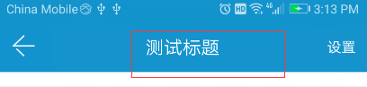

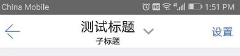

**参数说明**

| 参数      |    参数类型     | 说明                                                                                                                          | 平台差异说明 |
| :-------- | :-------------: | :---------------------------------------------------------------------------------------------------------------------------- | :----------: |
| title     |     String      | 需要被设置的标题                                                                                                              |              |
| subTitle  |     String      | 需要被设置的子标题                                                                                                            | 仅 ejs 支持  |
| clickable | Number / String | 是否可点击，如果为`1`，代表可点击，会在标题右侧出现一个下拉图标，并且能被点击监听，如果为`0`，永远不会走到回调函数，默认为`0` | 仅 ejs 支持  |
| direction |     String      | 箭头的朝向，默认为`bottom`朝下，使用`top`时朝上                                                                               | 仅 ejs 支持  |

## setMultiTitle

设置多个标题（会覆盖原有的标题）

**平台差异**

| ejs（H5 应用) | ejs（新点小程序） |   H5   | 钉钉   | 微信小程序 | 支付宝小程序 |
| :------------ | :---------------: | :----: | :----- | :--------- | :----------- |
| 支持          |      不支持       | 不支持 | 不支持 | 不支持     | 不支持       |

**使用示例**

```js
ejs.navigator.setMultiTitle({
    titles: ['tab1', 'tab2'],
    titleWidth: '50',
    success: function (result) {
        /**
         * 每一次点击tab都会触发
         * {
                which: 0
           }
         */
    },
    error: function (error) {}
});
```

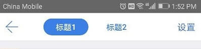

**参数说明**

| 参数       |   参数类型    | 说明                           | 平台差异说明                             |
| :--------- | :-----------: | :----------------------------- | :--------------------------------------- |
| titles     | Array[String] | 需要被设置的标题数组           |                                          |
| titleWidth |    String     | 每个标题的宽度，单位默认为`px` | ejs >= 4.0.3-a 支持，`android`暂时不支持 |

**返回说明**

| 参数  |    参数类型     | 说明                                                     |
| :---- | :-------------: | :------------------------------------------------------- |
| which | Number / String | 当前被点击的是哪一个标题，譬如`0`是第`1`个，`1`是第`2`个 |

## show

显示原生导航栏

**平台差异**

| ejs（H5 应用) | ejs（新点小程序） |   H5   | 钉钉   | 微信小程序 | 支付宝小程序 |
| :------------ | :---------------: | :----: | :----- | :--------- | :----------- |
| 支持          |      不支持       | 不支持 | 不支持 | 不支持     | 不支持       |

**使用示例**

```js
ejs.navigator.show({
    success: function (result) {},
    error: function (error) {}
});
```

## hide

隐藏原生导航栏

**平台差异**

| ejs（H5 应用) | ejs（新点小程序） |   H5   | 钉钉   | 微信小程序 | 支付宝小程序 |
| :------------ | :---------------: | :----: | :----- | :--------- | :----------- |
| 支持          |      不支持       | 不支持 | 不支持 | 不支持     | 不支持       |

**使用示例**

```js
ejs.navigator.hide({
    success: function (result) {},
    error: function (error) {}
});
```

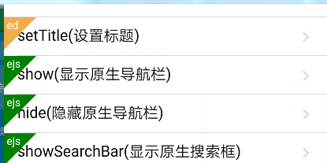

**注意**

在微信小程序平台需要隐藏导航栏时，可在`router.js`中对应页面的`style`配置项下，设置`navigationStyle`为`custom`，可查看官方文档说明：[style](https://uniapp.dcloud.io/collocation/pages.html#style)

## showStatusBar

显示状态栏

**平台差异**

| ejs（H5 应用) | ejs（新点小程序） |   H5   | 钉钉   | 微信小程序 | 支付宝小程序 |
| :------------ | :---------------: | :----: | :----- | :--------- | :----------- |
| 支持          |      不支持       | 不支持 | 不支持 | 不支持     | 不支持       |

**使用示例**

```js
ejs.navigator.showStatusBar({
    success: function (result) {},
    error: function (error) {}
});
```

## hideStatusBar

隐藏状态栏

**平台差异**

| ejs（H5 应用) | ejs（新点小程序） |   H5   | 钉钉   | 微信小程序 | 支付宝小程序 |
| :------------ | :---------------: | :----: | :----- | :--------- | :----------- |
| 支持          |      不支持       | 不支持 | 不支持 | 不支持     | 不支持       |

**使用示例**

```js
ejs.navigator.hideStatusBar({
    success: function (result) {},
    error: function (error) {}
});
```

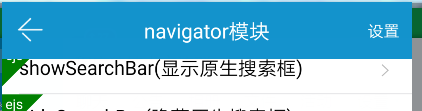

## showSearchBar

**注意 ⚠️: `EJS版本 >= 3.2.2` 及以上不建议使用此 API，推荐使用 `setSearchBar`**

显示 EJS 原生搜索栏

**平台差异**

| ejs（H5 应用) | ejs（新点小程序） |   H5   | 钉钉   | 微信小程序 | 支付宝小程序 |
| :------------ | :---------------: | :----: | :----- | :--------- | :----------- |
| 支持          |      不支持       | 不支持 | 不支持 | 不支持     | 不支持       |

**使用示例**

```js
ejs.navigator.showSearchBar({
    success: function (result) {
        /**
         * 每一次触发搜索栏的搜索功能都会回调
         * {
                keyword: 'ss' // 搜索的值
           }
         */
    },
    error: function (error) {}
});
```

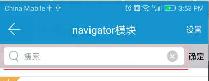

## hideSearchBar

**注意 ⚠️: `EJS版本 >= 3.2.2` 及以上不建议使用此 API，推荐使用 `setSearchBar`**

隐藏 EJS 原生搜索栏

**平台差异**

| ejs（H5 应用) | ejs（新点小程序） |   H5   | 钉钉   | 微信小程序 | 支付宝小程序 |
| :------------ | :---------------: | :----: | :----- | :--------- | :----------- |
| 支持          |      不支持       | 不支持 | 不支持 | 不支持     | 不支持       |

**使用示例**

```js
ejs.navigator.hideSearchBar({
    success: function (result) {},
    error: function (error) {}
});
```

## hookSysBack

拦截`Android`中的系统返回，拦截后原有返回功能不再有

**平台差异**

| ejs（H5 应用) |        ejs（新点小程序）        |   H5   | 钉钉   | 微信小程序 | 支付宝小程序 |
| :------------ | :-----------------------------: | :----: | :----- | :--------- | :----------- |
| 支持          | 支持<br>（ejs-weex 环境不支持） | 不支持 | 不支持 | 不支持     | 不支持       |

**使用示例**

```js
ejs.navigator.hookSysBack({
    success: function (result) {
        /**
         * Android中每一次按下系统返回就会触发回调
         */
    },
    error: function (error) {}
});
```

## hookBackBtn

拦截导航栏左侧的返回按钮，拦截后原有返回功能不再有

**平台差异**

| ejs（H5 应用) |        ejs（新点小程序）        |   H5   | 钉钉   | 微信小程序 | 支付宝小程序 |
| :------------ | :-----------------------------: | :----: | :----- | :--------- | :----------- |
| 支持          | 支持<br>（ejs-weex 环境不支持） | 不支持 | 不支持 | 不支持     | 不支持       |

**使用示例**

```js
ejs.navigator.hookBackBtn({
    success: function (result) {
        /**
         * 每一次按下导航栏左侧返回就会触发回调
         */
    },
    error: function (error) {}
});
```

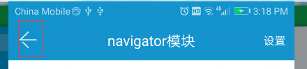

**注意**

在跨端框架中，在 H5 和支付宝小程序端需要拦截页面返回按钮时，可以使用`onBackPress`生命周期函数，具体请看[uni-app 自定义返回逻辑教程](https://ask.dcloud.net.cn/article/35120)。若不满足要求，也可以通过生命周期函数 onUnload 来监听离开该页面事件。

## setRightBtn

设置右侧第`which`个按钮，并且监听

**平台差异**

| ejs（H5 应用) | ejs（新点小程序） |   H5   | 钉钉 | 微信小程序 | 支付宝小程序 |
| :------------ | :---------------: | :----: | :--- | :--------- | :----------- |
| 支持          |      不支持       | 不支持 | 支持 | 不支持     | 不支持       |

**使用示例**

```js
ejs.navigator.setRightBtn({
    isShow: 1,
    text: '按钮右1',
    // 设置图片的优先级会较高
    //imageUrl: 'http://app.epoint.com.cn/staticResource/testicon2.png',
    which: 0, // 每一个按钮的回调是独立返回
    success: function (result) {
        /**
         * 按钮点击后回调，result回调不需要判断result.which返回值
         */
    },
    error: function (error) {}
});
```

**注意：result 回调不需要判断 result.which 返回值。iOS EJS3.2.6e 组件版本之前没有返回 which 字段**

右侧第一个

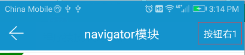

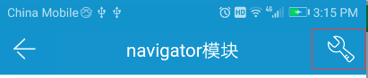

右侧第二个

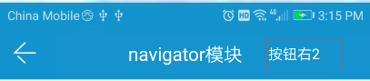

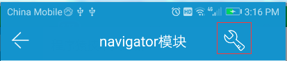

**参数说明**

| 参数                  |    参数类型     | 说明                                                                       |                     平台差异说明                     |
| :-------------------- | :-------------: | :------------------------------------------------------------------------- | :--------------------------------------------------: |
| isShow                | Number / String | 是否显示，`1`代表显示，`0`代表隐藏，默认为`1`                              |                                                      |
| text                  |     String      | 按钮的文本（最多设置 3 个中文或者 6 个英文字符）                           |                                                      |
| imageUrl              |     String      | 按钮的图片，如果设置图片了，会优先显示(覆盖原有的文本)                     |                                                      |
| which                 | Number / String | 默认为`0`，代表需要操作的是右侧第几个按钮，从最右侧开始算                  |                                                      |
| btnWidth              | Number / String | 按钮宽度，例如：`100`、`98.5`                                              | `ejs(Andriod) >= 4.2.2-sp12` `ejs(iOS) >= 4.2.2-sp7` |
| textColor             |     String      | 按钮文本颜色，例如：`#FF0000`  或者  `FF0000`  可以选择不带  `#`           | `ejs(Andriod) >= 4.2.2-sp12` `ejs(iOS) >= 4.2.2-sp7` |
| isImageAlwaysOriginal | Number / String | 图片是否保持原始特性, 1  或者  0，默认  0  不保持                          | `ejs(Andriod) >= 4.2.2-sp12` `ejs(iOS) >= 4.2.2-sp7` |
| maxCount              | Number / String | 允许的最大英文字符数，默认值为 6，即按钮最多允许 6 个英文字符，或 3 个中文 |                        `ejs`                         |

## setLeftBtn

设置左侧按钮，并且监听

根据[钉钉导航栏设计规范](https://open-doc.dingtalk.com/docs/doc.htm?spm=a219a.7629140.0.0.Y9Lijn&treeId=171&articleId=104928&docType=1#setTitle)，
钉钉中左侧按钮只在`iOS`中有效

**平台差异**

| ejs（H5 应用) | ejs（新点小程序） |   H5   | 钉钉   | 微信小程序 | 支付宝小程序 |
| :------------ | :---------------: | :----: | :----- | :--------- | :----------- |
| 支持          |      不支持       | 不支持 | 不支持 | 不支持     | 不支持       |

**使用示例**

```js
ejs.navigator.setLeftBtn({
    isShow: 1,
    text: '按钮左',
    // 设置图片的优先级会较高
    //imageUrl: 'http://app.epoint.com.cn/staticResource/testicon2.png',
    // 是否显示下拉箭头,如果带箭头，它会占两个位置，同时覆盖左侧按钮和左侧返回按钮
    isShowArrow: 0,
    // 箭头图标
    // direction: 'bottom',
    success: function (result) {
        /**
         * 按钮点击后回调
         */
    },
    error: function (error) {}
});
```

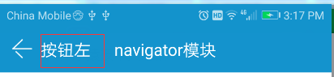

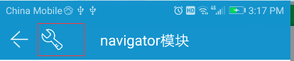

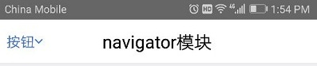

**参数说明**

| 参数        |    参数类型     | 说明                                                                                                                  |
| :---------- | :-------------: | :-------------------------------------------------------------------------------------------------------------------- |
| isShow      | Number / String | 是否显示，`1`代表显示，`0`代表隐藏，默认为`1`                                                                         |
| text        |     String      | 按钮的文本 （最多设置 3 个中文或者 6 个英文字符）                                                                     |
| imageUrl    |     String      | 按钮的图片，如果设置图片了，会优先显示(覆盖原有的文本)                                                                |
| isShowArrow | Number / String | 默认为`0`，是否显示下拉图标，如果显示(`1`)代表是主操作键，会同时占有左侧按钮和左侧返回按钮的位置                      |
| direction   |     String      | ejs3.4.0 新增 在 isShowArrow 为 1 的情况下有效，direction 参数值支持：“bottom（箭头向下，默认值）”，“top（箭头向上）” |

## setRightMenu

设置右侧下拉菜单，并且监听

注意，会覆盖右侧按钮`1`

`DD`中的`iconItems`必须是[官方指定的 ICON 索引值](https://open-doc.dingtalk.com/docs/doc.htm?spm=a219a.7629140.0.0.Y9Lijn&treeId=171&articleId=104928&docType=1#iconIndex)

**平台差异**

| ejs（H5 应用) | ejs（新点小程序） |   H5   | 钉钉 | 微信小程序 | 支付宝小程序 |
| :------------ | :---------------: | :----: | :--- | :--------- | :----------- |
| 支持          |      不支持       | 不支持 | 支持 | 不支持     | 不支持       |

**使用示例**

```js
var iconSrc = 'http://app.epoint.com.cn/staticResource/img_head.png';

ejs.navigator.setRightMenu({
    isShow: 1,
    text: '下拉',
    // 设置图片的优先级会较高
    //imageUrl: 'http://app.epoint.com.cn/staticResource/testicon2.png',
    titleItems: ['按钮1', '按纽2'],
    iconItems: [iconSrc, iconSrc],
    success: function (result) {
        /**
         * 按钮点击后回调
         * {
                which: 0, // 点击的下拉按钮index，从0开始
                content: '按钮1' // 点击的按钮的对应文本
           }
         */
    },
    error: function (error) {}
});
```

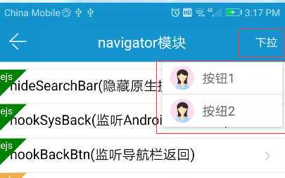

**参数说明**

| 参数       |    参数类型     | 说明                                                       |
| :--------- | :-------------: | :--------------------------------------------------------- |
| isShow     | Number / String | 是否显示，`1`代表显示，`0`代表隐藏，默认为`1`              |
| text       |     String      | 定位按钮的文本                                             |
| imageUrl   |     String      | 定位按钮的图片，如果设置图片了，会优先显示(覆盖原有的文本) |
| titleItems |  Array[String]  | 下拉按钮的文本数组                                         |
| iconItems  |  Array[String]  | 下拉按钮的图片数组                                         |

**返回说明**

| 参数    |    参数类型     | 说明                          |
| :------ | :-------------: | :---------------------------- |
| which   | Number / String | 被点击按钮的索引值，从 0 开始 |
| content |     String      | 按钮对应的文本                |

## setSearchWord

搜索页面设置搜索关键字

**平台差异**

| ejs（H5 应用) | ejs（新点小程序） |   H5   | 钉钉   | 微信小程序 | 支付宝小程序 |
| :------------ | :---------------: | :----: | :----- | :--------- | :----------- |
| 支持（3.1.9） |      不支持       | 不支持 | 不支持 | 不支持     | 不支持       |

**使用示例**

```js
ejs.navigator.setSearchWord({
    keyword: 'epoint',
    success: function () {},
    error: function () {}
});

// 兼容快速调用
ejs.navigator.setSearchWord('epoint');
```

**参数说明**

| 参数    | 参数类型 | 说明       |
| :------ | :------: | :--------- |
| keyword |  String  | 搜索关键字 |

## getSearchWord

搜索页面获取搜索关键字

**平台差异**

| ejs（H5 应用) | ejs（新点小程序） |   H5   | 钉钉   | 微信小程序 | 支付宝小程序 |
| :------------ | :---------------: | :----: | :----- | :--------- | :----------- |
| 支持（3.1.9） |      不支持       | 不支持 | 不支持 | 不支持     | 不支持       |

**使用示例**

```js
ejs.navigator.getSearchWord({
    success: function (result) {
        /**
         * {
         *   keyword: ''
         * }
         */
    },
    error: function () {}
});
```

**返回说明**

| 参数    | 参数类型 | 说明         |
| :------ | :------: | :----------- |
| keyword |  String  | 搜索的关键字 |

## setSearchBar

原生搜索栏

**平台差异**

| ejs（H5 应用) | ejs（新点小程序） |   H5   | 钉钉   | 微信小程序 | 支付宝小程序 |
| :------------ | :---------------: | :----: | :----- | :--------- | :----------- |
| 支持（3.2.2） |      不支持       | 不支持 | 不支持 | 不支持     | 不支持       |

**使用示例**

```js
ejs.navigator.setSearchBar({
    isShow: 1,
    isSearchable: 1,
    placeholder: '',
    keyword: '',
    cancelOnSearchBarAndNotRefresh: 0, //3.2.7.e 新增
    hideBottomLine: 0, //3.4.2.a 新增
    success: function (result) {
        /**
         * {
         *   keyword: ''
         * }
         * 当 isSearchable 为 0 的时候，会返回 isShowSpeech 是否显示语音搜索 1是0否
         */
    },
    error: function () {}
});
```

**返回说明**

| 参数                           |    参数类型     | 说明                                                                                                                                                                                               | EJS 支持版本          |
| :----------------------------- | :-------------: | :------------------------------------------------------------------------------------------------------------------------------------------------------------------------------------------------- | :-------------------- |
| isShow                         | Number / String | 是否显示搜索框，`1` 为显示，`0` 为隐藏，默认值为 `0`，仅支持设置导航栏下面的 `searchBar`，导航栏上的 `searchBar` 通过 `openPage` Api 中参数 `pageStyle` 控制显示                                   |                       |
| isSearchable                   | Number / String | `0` 表示 `searchBar` 不支持点击输入关键字或语音搜索，点击之后执行 `success` 回调，`1` 表示 `searchBar` 支持输入关键字或语音进行搜索。默认值为`0`。**注意该参数仅支持设置导航栏下面的 searchBar**。 |                       |
| placeholder                    |     String      | 设置搜索提示语, 兼容两个 `searchBar`, 原生默认值为 `请输入搜索关键字`。                                                                                                                            |                       |
| keyword                        |     String      | 设置搜索关键字,兼容两个 `searchBar`，原生默认值为空字符串                                                                                                                                          |                       |
| cancelOnSearchBarAndNotRefresh | Number / String | 是否点击导航栏下面的 searchBar 上的取消按钮自动刷新页面，仅 iOS 支持，0 刷新，1 不刷新，默认为 0。                                                                                                 | ejs(native) > 3.2.7.e |
| hideBottomLine                 | Number / String | 支持隐藏原生搜索栏底部分割线。 0 不隐藏，1 隐藏，默认为 0                                                                                                                                          | ejs(native) > 3.4.2.a |

## 修改导航栏颜色

在 EJS 环境中，打开页面时，URL 中传入导航栏颜色字段` ejs_nav_bgcolor=000000`

**平台差异**

| ejs（H5 应用)  | ejs（新点小程序） |   H5   | 钉钉   | 微信小程序 | 支付宝小程序 |
| :------------- | :---------------: | :----: | :----- | :--------- | :----------- |
| 支持（3.2.3a） |      不支持       | 不支持 | 不支持 | 不支持     | 不支持       |

**使用示例**

```js
// 兼容快速调用
ejs.page.open('./ejs_demo_v3_simple.html', {
    ejs_nav_bgcolor: '000000'
});
```

**参数说明**

| 参数            | 参数类型 | 说明                         |
| :-------------- | :------: | :--------------------------- |
| ejs_nav_bgcolor |  String  | 决定将要打开页面的导航栏颜色 |

在跨端框架中，ejs 封装了 uni 的设置导航栏颜色的 API，可以通过该 API 在 H5 端或微信小程序端设置导航栏颜色。

**平台差异**

| ejs（H5 应用) | ejs（新点小程序） |      H5      | 钉钉   | 微信小程序 | 支付宝小程序 |
| :------------ | :---------------: | :----------: | :----- | :--------- | :----------- |
| 不支持        |      不支持       | 跨端框架支持 | 不支持 | 支持       | 支持         |

**使用示例**

```js
ejs.navigator.setNavigationBarColor({
    frontColor: '#ffffff',
    backgroundColor: '#ff0000',
    animation: {
        duration: 400,
        timingFunc: 'easeIn'
    },
    success: function () {},
    error: function () {}
});
```

**参数说明**

| 参数            | 参数类型 | 说明                                              |                          平台差异说明                           |
| :-------------- | :------: | :------------------------------------------------ | :-------------------------------------------------------------: |
| frontColor      |  String  | 前景颜色值，包括按钮、标题、状态栏的颜色          | 微信小程序平台仅支持 `#ffffff` 和 `#000000`，支付宝小程序不支持 |
| backgroundColor |  String  | 背景颜色值，有效值为十六进制颜色                  |                                                                 |
| animation       |  Object  | 动画效果，{duration,timingFunc}，仅微信小程序支持 |                                                                 |

**animation 结构**

| 参数       |    参数类型     | 说明                                                                 |
| :--------- | :-------------: | :------------------------------------------------------------------- |
| duration   | Number / String | 动画变化时间，单位 ms，默认为 0                                      |
| timingFunc |     String      | 动画变化方式，默认为`linear`, 可选值为`easeIn` `easeOut` `easeInOut` |

## 隐藏导航栏下划线

打开页面时，URL 中传入导航栏下划线显隐字段 `ejs_nav_line` ，为`0`时隐藏，默认为`1`。

**平台差异**

| ejs（H5 应用)  | ejs（新点小程序） |   H5   | 钉钉   | 微信小程序 | 支付宝小程序 |
| :------------- | :---------------: | :----: | :----- | :--------- | :----------- |
| 支持（3.2.6f） |      不支持       | 不支持 | 不支持 | 不支持     | 不支持       |

**使用示例**

```js
// 兼容快速调用
ejs.page.open('./ejs_demo_v3_simple.html', {
    ejs_nav_line: '0'
});
```

**返回说明**

| 参数         | 参数类型 | 说明                                                                 |
| :----------- | :------: | :------------------------------------------------------------------- |
| ejs_nav_line |  String  | 导航栏下划线显隐字段 `Android`生效版本`3.2.6f` `iOS`生效版本`3.2.7b` |

## hideBackBtn

隐藏导航栏左上角返回按钮

**平台差异**

| ejs（H5 应用)  |            ejs（新点小程序）             |   H5   | 钉钉   | 微信小程序 | 支付宝小程序 |
| :------------- | :--------------------------------------: | :----: | :----- | :--------- | :----------- |
| 支持 （3.4.1） | 支持（3.4.1）<br>（ejs-weex 环境不支持） | 不支持 | 不支持 | 不支持     | 不支持       |

**使用示例**

```js
ejs.navigator.hideBackBtn({
    success: function () {},
    error: function () {}
});

// 兼容快速调用
ejs.navigator.hideBackBtn();
```
