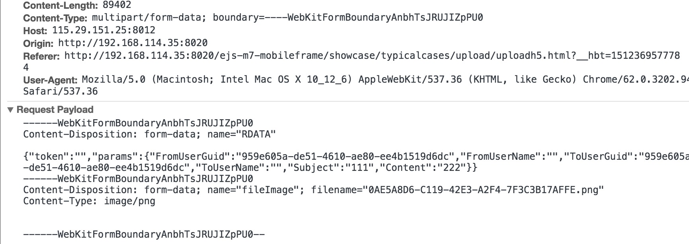

# ejs.stream

## fetch

原生代理请求接口

**平台差异**

| ejs（H5 应用) | ejs（新点小程序） |   H5   | 钉钉   | 微信小程序 | 支付宝小程序 | 官方 weex 端 |
| :------------ | :---------------: | :----: | :----- | :--------- | :----------- | :----------- |
| 支持          |       支持        | 不支持 | 不支持 | 不支持     | 不支持       | 支持         |

**使用示例**

```js
ejs.stream.fetch({
    url: "http://www.xx.sh.cn/WebBuilderMobileService_URL/appservice/getheadnewslist",
    method: 'POST',
    type: 'json',
    body: {
        params: JSON.stringify({
            pageindex: currPage,
            pagesize: 10,
            keyword: 'type1'
        })
    }
    headers: {
        'Content-Type': 'application/x-www-form-urlencoded'
    },
    success: function(result) {
        /**
         * 请求成功后返回
         * {
                data: '返回的数据'
           }
         */
    },
    error: function(error) {}
});
```

**参数说明**

| 参数    | 参数类型 | 说明                                                                                                                                                                   |
| :------ | :------: | :--------------------------------------------------------------------------------------------------------------------------------------------------------------------- |
| url     |  String  | `必填`，请求的 URL                                                                                                                                                     |
| method  |  String  | `必填`，请求的方法，`GET`或`POST`                                                                                                                                      |
| type    |  String  | 设置响应的`result.data`的类型，`json`或`text`，为`json`时会自动将请求结果转为`json`对象。小程序 2.0(安卓`2.0.5-sp1`，iOS`2.0.5-sp2`)支持：设置`auto`、默认调整为`text` |
| headers |  Object  | HTTP 请求头                                                                                                                                                            |
| body    |  String  | HTTP 请求体                                                                                                                                                            |

注意

-   `type`默认属性在小程序 2.0(安卓`2.0.5-sp1`，iOS`2.0.5-sp2`)之前：安卓为`text`、iOS 为`json`。小程序 2.0(安卓`2.0.5-sp1`，iOS`2.0.5-sp2`)后保持统一为`text`

-   默认`Content-Type`为`application/x-www-form-urlencoded`

-   如果需要通过 `POST` `json` ， 需要将 `Content-Type` 设为 `application/json`

**成功返回说明**

| 参数 |     参数类型     | 说明                                                                                                                                                                                                 |
| :--- | :--------------: | :--------------------------------------------------------------------------------------------------------------------------------------------------------------------------------------------------- |
| data | Object 或 String | 返回的数据。如果请求的`type`参数是 `json`，则它就是一个 `object`类型；如果是`text`，则它就是一个`string`类型；如果是`auto`，则尝试解析 json 并返回`object`类型，如果返回不了，就以`string`类型返回。 |

**错误返回说明**

| 参数       |     参数类型     | 说明                                         |
| :--------- | :--------------: | :------------------------------------------- |
| status     | Number / String  | 返回的状态码，失败情况下，需要通过状态码判断 |
| statusText |      String      | 状态描述文本                                 |
| error      | Object 或 String | 详细的错误信息                               |

## uploadMultipartFile

原生容器代理上传文件(标准的表单上传)

**平台差异**

| ejs（H5 应用) | ejs（新点小程序） |   H5   | 钉钉   | 微信小程序 | 支付宝小程序 |
| :------------ | :---------------: | :----: | :----- | :--------- | :----------- |
| 支持          |       支持        | 不支持 | 不支持 | 不支持     | 不支持       |

**使用示例**

```js
ejs.stream.uploadMultipartFile({
    // 目前如果有额外参数，请拼接到url中
    url: 'http://115.29.151.25:8012/webUploaderServer/testupload.php',
    file: {
        path: 'xxxx.jpg',
        name: 'test'
    },
    // 多附件上传。支持版本：小程序2.0（安卓`2.0.5-sp1`，iOS`2.0.5-sp2`）。注意：不支持同时设置 file 和 files两个字段，如果同时存在，则忽略 files 字段
    files: [
        {
            path: 'xxxx1.jpg',
            name: 'file1'
        },
        {
            path: 'xxxx2.jpg',
            name: 'file2'
        }
    ],
    // 设置响应的result.data类型。支持版本：小程序2.0（安卓`2.0.5-sp1`，iOS`2.0.5-sp2`）
    type: 'text',
    headers: {
        'X-Requested-With': 'XMLHttpRequest'
    },
    dataForm: {
        // 额外的表单参数
        test: 'testValue'
    },
    success: function (result) {
        /**
         * 成功上传后返回
         * {
                data: '返回的数据'
           }
         */
    },
    error: function (error) {}
});
```



**参数说明**

| 参数             | 参数类型 | 说明                                                                                                                                |
| :--------------- | :------: | :---------------------------------------------------------------------------------------------------------------------------------- |
| url              |  String  | `必填`，请求的 URL                                                                                                                  |
| dataForm         |  Object  | 除了上传文件外需要额外上传的参数，`json`键值对形式                                                                                  |
| file             |  Object  | 上传的单个文件，每一个元素中的`name`为文件名，`path`为文件的本地路径                                                                |
| files            |  Array   | 多附件上传。多附件上传的成功回调为对象数组，每个元素对应该位置文件的上传结果。支持版本：小程序 2.0，安卓`2.0.5-sp1`，iOS`2.0.5-sp2` |
| headers          |  Object  | HTTP 请求头，注意，请不要传`Content-Type`，因为上传时这个字段不能被改变                                                             |
| quality `v4.0.3` |  String  | 原生压缩图片效果，范围`0-100`。 安卓默认`70`（安卓存在设置`100`不压缩部分手机闪退问题）；iOS 默认`100`                              |
| type             |  String  | 设置响应的`result.data`类型，默认为`text`。支持`json`、`text`、`auto`。支持版本：小程序 2.0，安卓`2.0.5-sp1`，iOS`2.0.5-sp2`        |

**成功返回说明**

| 参数 |     参数类型     | 说明                                                                                                                                                                                                 |
| :--- | :--------------: | :--------------------------------------------------------------------------------------------------------------------------------------------------------------------------------------------------- |
| data | Object 或 String | 返回的数据。如果请求的`type`参数是 `json`，则它就是一个 `object`类型；如果是`text`，则它就是一个`string`类型；如果是`auto`，则尝试解析 json 并返回`object`类型，如果返回不了，就以`string`类型返回。 |

**失败返回说明**

| 参数       |     参数类型     | 说明                                         |
| :--------- | :--------------: | :------------------------------------------- |
| status     | Number / String  | 返回的状态码，失败情况下，需要通过状态码判断 |
| statusText |      String      | 状态描述文本                                 |
| error      | Object 或 String | 详细的错误信息                               |
