# ejs.ui

该模块传递参数`h5UI: true`时需要引入包含 H5 环境的库。

**注意：在跨端框架中 UI 模块调用的是跨端组件，请不要在 beforeCreate、created、beforeMount、onLoad 等生命周期中调用该模块 API，此时页面节点未渲染，必须在 mounted 及其之后中调用**

## toast

**平台差异**

| ejs（H5 应用) | ejs（新点小程序） |  H5  | 钉钉 | 微信小程序 | 支付宝小程序 | 官方 weex 端 |
| :------------ | :---------------: | :--: | :--- | :--------- | :----------- | :----------- |
| 支持          |       支持        | 支持 | 支持 | 支持       | 支持         | 支持         |

**使用示例**

```js
ejs.ui.toast({
    message: 'sd#ddd测试',
    h5UI: false, // 是否强制使用H5-UI效果，默认false
    success: function (result) {},
    error: function (err) {}
});

// 兼容快速调用
ejs.ui.toast(message);
```

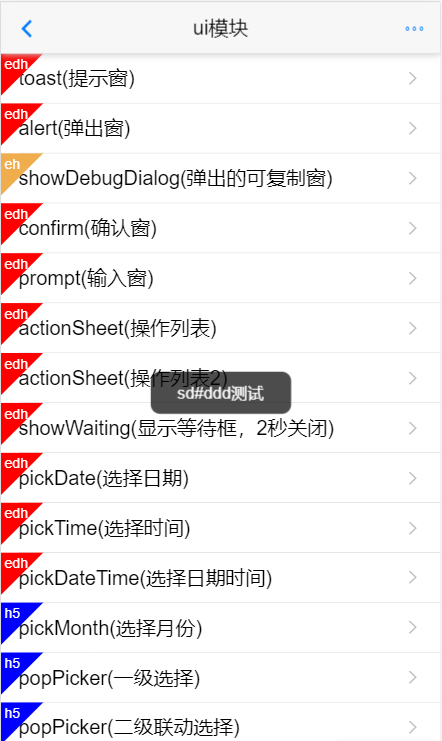

**参数说明**

| 参数    | 参数类型 | 说明                                 | 平台差异说明                                         |
| :------ | :------: | :----------------------------------- | :--------------------------------------------------- |
| message |  String  | 消息内容                             |                                                      |
| h5UI    | Boolean  | 是否强制使用 H5-UI 效果，默认`false` | 仅 ejs > 3.4.2a 支持，`ejs-weex`及官方`weex`端不支持 |

## toastAndEvent

**平台差异**

| ejs（H5 应用) | ejs（新点小程序） |   H5   | 钉钉   | 微信小程序 | 支付宝小程序 |
| :------------ | :---------------: | :----: | :----- | :--------- | :----------- |
| 支持（4.0.3） |   支持（4.0.3）   | 不支持 | 不支持 | 不支持     | 不支持       |

**使用示例**

```js
ejs.ui.toastAndEvent({
    message: 'sd#ddd测试',
    buttonName: '收藏设置',
    iconType: '0', // 0无图标，1成功图标，2失败图标
    duration: '2000', // 弹框持续时间，不传默认2000，单位ms
    position: 'bottom', // 弹出位置，可选值为 top(距离顶部1/3) bottom（中间） center（距离底部1/3）
    success: function (result) {}, // 成功回调表示点击了按钮
    error: function (err) {}
});
```

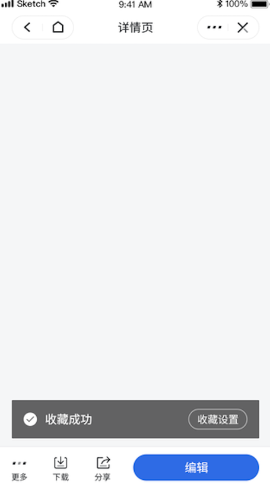

**参数说明**

| 参数       | 参数类型 | 说明                                                                            |
| :--------- | :------: | :------------------------------------------------------------------------------ |
| message    |  String  | 消息内容                                                                        |
| buttonName |  String  | 按钮显示文字                                                                    |
| iconType   |  String  | `0`无图标，`1`成功图标，`2`失败图标                                             |
| duration   |  String  | 弹框持续时间，不传默认 2000，单位 ms                                            |
| position   |  String  | 弹出位置，可选值为 `top`(距离顶部 1/3) `center`（中间）`bottom`（距离底部 1/3） |

## showDebugDialog

原生容器中，弹出一个有复制按钮的弹窗，可以快速复制弹出信息

在`ejs`以外的环境中兼容成了普通的`alert`形式

**平台差异**

| ejs（H5 应用) | ejs（新点小程序） |  H5  | 钉钉 | 微信小程序 | 支付宝小程序 | 官方 weex 端 |
| :------------ | :---------------: | :--: | :--- | :--------- | :----------- | :----------- |
| 支持          |       支持        | 支持 | 支持 | 支持       | 支持         | 支持         |

**使用示例**

```js
ejs.ui.showDebugDialog({
    debugInfo: '信息',
    // 调用成功后立马回调
    success: function (result) {},
    error: function (err) {}
});

// 兼容快速调用
ejs.ui.showDebugDialog(message);
```

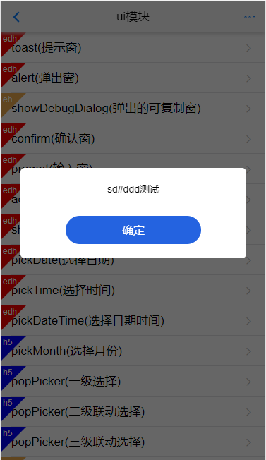

**参数说明**

| 参数      | 参数类型 | 说明     |
| :-------- | :------: | :------- |
| debugInfo |  String  | 消息内容 |

## alert

**平台差异**

| ejs（H5 应用) | ejs（新点小程序） |  H5  | 钉钉 | 微信小程序 | 支付宝小程序 | 官方 weex 端 |
| :------------ | :---------------: | :--: | :--- | :--------- | :----------- | :----------- |
| 支持          |       支持        | 支持 | 支持 | 支持       | 支持         | 支持         |

**使用示例**

```js
ejs.ui.alert({
    title: '标题',
    message: '信息',
    buttonName: '确定',
    cancelable: 1,
    h5UI: false, // 是否强制使用H5-UI效果，默认false
    success: function (result) {
        // 点击 alert的按钮后回调
    },
    error: function (err) {}
});

// 兼容快速调用
ejs.ui.alert(message, title, buttonName);
```

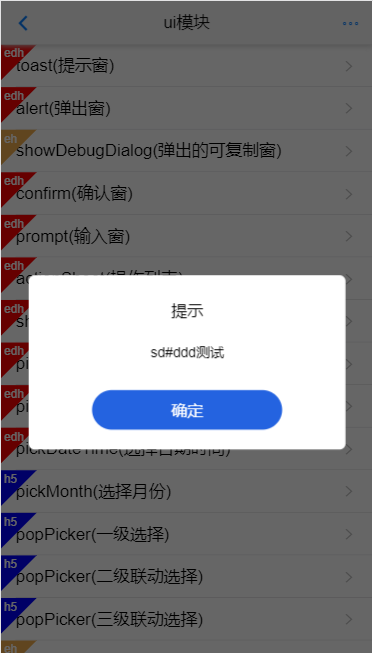

**参数说明**

| 参数       |    参数类型     | 说明                                         | 平台差异说明                                         |
| :--------- | :-------------: | :------------------------------------------- | :--------------------------------------------------- |
| title      |     String      | 消息标题                                     |                                                      |
| message    |     String      | 消息内容                                     |                                                      |
| buttonName |     String      | 确定按钮的文字                               |                                                      |
| cancelable | Number / String | 点击遮罩是否可取消，为`1`为可取消，默认为`1` | 官方 weex 端不支持                                   |
| h5UI       |     Boolean     | 是否强制使用 H5-UI 效果，默认`false`         | 仅 ejs > 3.4.2a 支持，`ejs-weex`及官方`weex`端不支持 |

## confirm

**平台差异**

| ejs（H5 应用) | ejs（新点小程序） |  H5  | 钉钉 | 微信小程序 | 支付宝小程序 | 官方 weex 端 |
| :------------ | :---------------: | :--: | :--- | :--------- | :----------- | :----------- |
| 支持          |       支持        | 支持 | 支持 | 支持       | 支持         | 支持         |

**使用示例**

```js
ejs.ui.confirm({
    title: '是否选择',
    message: 'sd#ddd测试',
    buttonLabels: ['取消', '确定'],
    cancelable: 1,
    h5UI: false, // 是否强制使用H5-UI效果，默认false
    success: function (result) {
        // 点击任意一个按钮都会回调
        /*
        {
            which: 0 //被点击按钮的索引值，Number类型，从0开始
        }
        */
    },
    error: function (err) {}
});
```

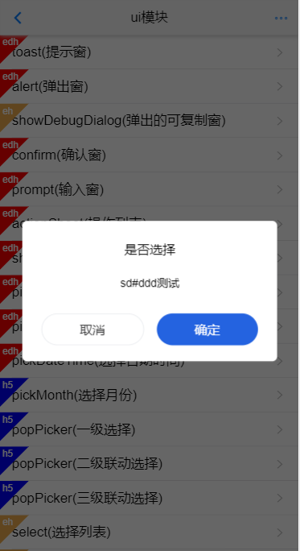

**参数说明**

| 参数         |    参数类型     | 说明                                         | 平台差异说明                                         |
| :----------- | :-------------: | :------------------------------------------- | :--------------------------------------------------- |
| title        |     String      | 标题                                         |                                                      |
| message      |     String      | 消息说明                                     |                                                      |
| buttonLabels |  Array[String]  | 按钮名称                                     |                                                      |
| cancelable   | Number / String | 点击遮罩是否可取消，为`1`为可取消，默认为`1` | 官方 weex 端不支持                                   |
| h5UI         |     Boolean     | 是否强制使用 H5-UI 效果，默认`false`         | 仅 ejs > 3.4.2a 支持，`ejs-weex`及官方`weex`端不支持 |

**返回说明**

| 参数  |    参数类型     | 说明                          |
| :---- | :-------------: | :---------------------------- |
| which | Number / String | 被点击按钮的索引值，从 0 开始 |

## prompt

**平台差异**

| ejs（H5 应用) | ejs（新点小程序） |  H5  | 钉钉 | 微信小程序 | 支付宝小程序 | 官方 weex 端 |
| :------------ | :---------------: | :--: | :--- | :--------- | :----------- | :----------- |
| 支持          |       支持        | 支持 | 支持 | 支持       | 支持         | 支持         |

**使用示例**

```js
ejs.ui.prompt({
    title: '测试输入',
    hint: '',
    text: '',
    lines: 1,
    maxLength: 10000,
    buttonLabels: ['取消', '确定'],
    cancelable: 1,
    h5UI: false, // 是否强制使用H5-UI效果，默认false
    success: function (result) {
        // 点击任意一个按钮都会回调
        /*
        {
            which: 0， //被点击按钮的索引值，Number类型，从0开始
            content: '' // 输入的内容
        }
        */
    },
    error: function (err) {}
});
```

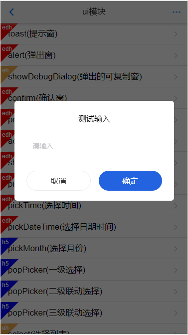

**参数说明**

| 参数         |    参数类型     | 说明                                                            | 平台差异说明                                                       |
| :----------- | :-------------: | :-------------------------------------------------------------- | :----------------------------------------------------------------- |
| title        |     String      | 标题                                                            | 官方 weex 端不支持                                                 |
| hint         |     String      | 输入框提示                                                      | 官方 weex 端不支持                                                 |
| text         |     String      | 输入框默认的文本，默认为空                                      |                                                                    |
| lines        | Number / String | 最多允许的输入行数，默认为`1`，仅在 h5 环境下用来限制输入框高度 | 官方 weex 端不支持                                                 |
| maxLength    | Number / String | 最多允许的输入字符个数，默认为`10000`                           | 官方 weex 端不支持                                                 |
| buttonLabels |  Array[String]  | 按钮名称数组                                                    |                                                                    |
| cancelable   | Number / String | 点击遮罩是否可取消，为`1`为可取消，默认为`1`，                  | `ejs`环境下仅在 `android` 中有效，`ios` 下无效，官方 weex 端不支持 |
| h5UI         |     Boolean     | 是否强制使用 H5-UI 效果，默认`false`                            | 仅 ejs > 3.4.2a 支持，`ejs-weex`及官方`weex`端不支持               |

**返回说明**

| 参数    |    参数类型     | 说明                          |
| :------ | :-------------: | :---------------------------- |
| which   | Number / String | 被点击按钮的索引值，从 0 开始 |
| content |     String      | 输入的内容                    |

## showWaiting

显示等待对话框

注意，同时只会存在一个等待对话框

**平台差异**

| ejs（H5 应用) | ejs（新点小程序） |  H5  | 钉钉 | 微信小程序 | 支付宝小程序 |
| :------------ | :---------------: | :--: | :--- | :--------- | :----------- |
| 支持          |       支持        | 支持 | 支持 | 支持       | 支持         |

**使用示例**

```js
ejs.ui.showWaiting({
    message: '正在加载...'
    h5UI: false, // 是否强制使用H5-UI效果，默认false
    success: function(result) {},
    error: function(err) {}
});

// 兼容快速调用
ejs.ui.showWaiting('正在加载...');
```

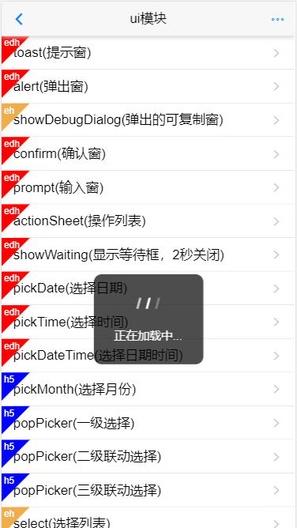

**参数说明**

| 参数    | 参数类型 | 说明                                         | 平台差异说明                                         |
| :------ | :------: | :------------------------------------------- | :--------------------------------------------------- |
| message |  String  | 显示的信息，默认为`加载中...`                |                                                      |
| padlock | Boolean  | 是否锁定点击空白处取消等待框，默认值为`true` | 仅 ejs(H5) > 4.0.3-c-beta2 支持                      |
| h5UI    | Boolean  | 是否强制使用 H5-UI 效果，默认`false`         | 仅 ejs > 3.4.2a 支持，`ejs-weex`及官方`weex`端不支持 |

## closeWaiting

关闭等待对话框

**平台差异**

| ejs（H5 应用) | ejs（新点小程序） |  H5  | 钉钉 | 微信小程序 | 支付宝小程序 |
| :------------ | :---------------: | :--: | :--- | :--------- | :----------- |
| 支持          |       支持        | 支持 | 支持 | 支持       | 支持         |

**使用示例**

```js
ejs.ui.closeWaiting({
    h5UI: false, // 是否关闭H5-UI效果的showWaiting，默认false
    success: function (result) {},
    error: function (err) {}
});
```

**参数说明**

| 参数 | 参数类型 | 说明                                           | 平台差异说明                                     |
| :--- | :------: | :--------------------------------------------- | :----------------------------------------------- |
| h5UI | Boolean  | 是否关闭 H5-UI 效果的 showWaiting，默认`false` | ejs(H5) > 3.4.2a，`ejs-weex`及官方`weex`端不支持 |

## actionSheet

操作列表

在小程序平台中调用的是原生提供的弹出框，所以不同平台的样式不同。

**平台差异**

| ejs（H5 应用) | ejs（新点小程序） |  H5  | 钉钉 | 微信小程序 | 支付宝小程序 |
| :------------ | :---------------: | :--: | :--- | :--------- | :----------- |
| 支持          |       支持        | 支持 | 支持 | 支持       | 支持         |

**使用示例**

```js
ejs.ui.actionSheet({
    items: ['远野贵树', '篠原明里', '澄田花苗', '立花泷', '宫水三叶'],
    h5UI: false, // 是否强制使用H5-UI效果，默认false
    success: function (result) {
        // 点击任意一个按钮都会回调
        /*
        {
            which: 0， //被点击按钮的索引值，Number类型，从0开始，如果是-1代表点击了取消按钮
            content: '' // 对应的内容
        }
        */
    },
    error: function (err) {}
});
```

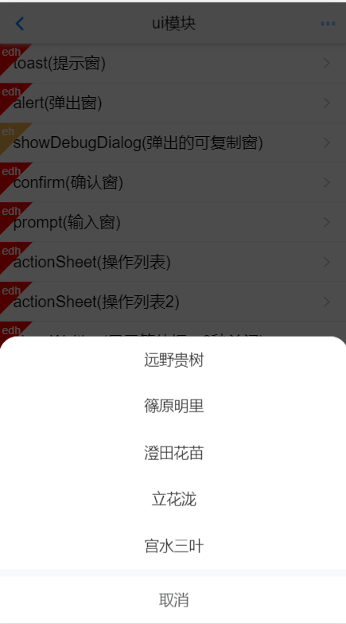

**参数说明**

| 参数  |   参数类型    | 说明                                 | 支持版本                                             |
| :---- | :-----------: | :----------------------------------- | :--------------------------------------------------- |
| items | Array[String] | 内容数组                             |                                                      |
| h5UI  |    Boolean    | 是否强制使用 H5-UI 效果，默认`false` | 仅 ejs > 3.4.2a 支持，`ejs-weex`及官方`weex`端不支持 |

**返回说明**

| 参数    |    参数类型     | 说明                                                        |
| :------ | :-------------: | :---------------------------------------------------------- |
| which   | Number / String | 被点击按钮的索引值，从 0 开始 ,如果是`-1`代表点击了取消按钮 |
| content |     String      | 选择的内容                                                  |

## pickDate

选择日期

`v4.2.4`版本开始支持跨端框架

**平台差异**

| ejs（H5 应用) | ejs（新点小程序） |  H5  | 钉钉 | 微信小程序 | 支付宝小程序 | 官方 weex 端 |
| :------------ | :---------------: | :--: | :--- | :--------- | :----------- | :----------- |
| 支持          |       支持        | 支持 | 支持 | 支持       | 支持         | 支持         |

**使用示例**

```js
ejs.ui.pickDate({
    title: 'pickDate',
    datetime: '2016-12-05',
    // h5中的开始日期
    minDate: '2010-12-01',
    // h5中的结束日期
    maxDate: '2020-12-01',
    h5UI: false, // 是否强制使用H5-UI效果，默认false
    success: function (result) {
        /*
        {
            date: '2016-12-05'
        }
        */
    },
    error: function (err) {}
});
```

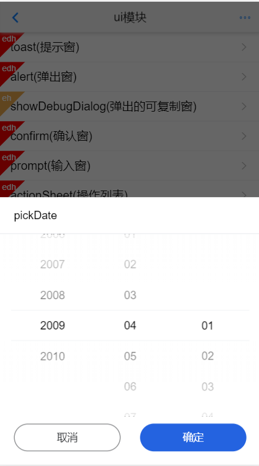

**参数说明**

| 参数     | 参数类型 | 说明                                              | 平台差异说明                                         |
| :------- | :------: | :------------------------------------------------ | :--------------------------------------------------- |
| title    |  String  | 标题，部分设备上设置标题后遮挡控件可不设置标题    | 官方 weex 端不支持                                   |
| datetime |  String  | 默认的时间，默认值为当前时间，格式为`yyyy-MM-dd`  |                                                      |
| minDate  |  String  | h5 模式下，可选时间的开始日期，格式为`yyyy-MM-dd` |                                                      |
| maxDate  |  String  | h5 模式下，可选时间的结束日期，格式为`yyyy-MM-dd` |                                                      |
| h5UI     | Boolean  | 是否强制使用 H5-UI 效果，默认`false`              | 仅 ejs > 3.4.2a 支持，`ejs-weex`及官方`weex`端不支持 |

**返回说明**

| 参数 | 参数类型 | 说明       |
| :--- | :------: | :--------- |
| date |  String  | 选择的日期 |

## pickTime

选择时间

`v4.2.4`版本开始支持跨端框架

**平台差异**

| ejs（H5 应用) | ejs（新点小程序） |  H5  | 钉钉 | 微信小程序 | 支付宝小程序 | 官方 weex 端 |
| :------------ | :---------------: | :--: | :--- | :--------- | :----------- | :----------- |
| 支持          |       支持        | 支持 | 支持 | 支持       | 支持         | 支持         |

**使用示例**

```js
ejs.ui.pickTime({
    title: 'pickTime',
    datetime: '10:20',
    minHour: 0,
    maxHour: 23,
    minMinute: 0,
    maxMinute: 59,
    h5UI: false, // 是否强制使用H5-UI效果，默认false
    success: function (result) {
        /*
        {
            time: '10:20'
        }
        */
    },
    error: function (err) {}
});
```

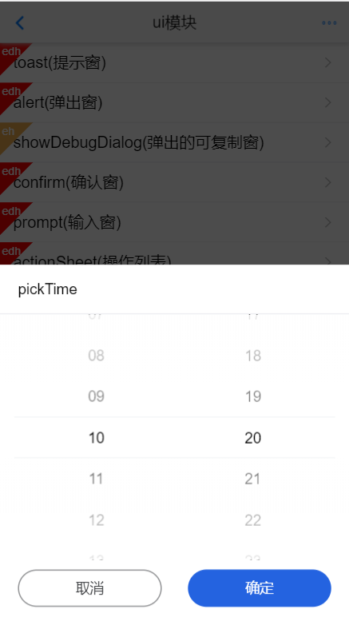

**参数说明**

| 参数      |    参数类型     | 说明                                           | 平台差异说明                                         |
| :-------- | :-------------: | :--------------------------------------------- | :--------------------------------------------------- |
| title     |     String      | 标题，部分设备上设置标题后遮挡控件可不设置标题 | 官方 weex 端不支持                                   |
| datetime  |     String      | 默认的时间，默认值为当前时间，格式为`HH:mm`    |                                                      |
| minHour   | Number / String | h5 模式下，可选时间的开始时                    | 官方 weex 端不支持                                   |
| maxHour   | Number / String | h5 模式下，可选时间的结束时                    | 官方 weex 端不支持                                   |
| minMinute | Number / String | h5 模式下，可选时间的开始分钟                  | 官方 weex 端不支持                                   |
| maxMinute | Number / String | h5 模式下，可选时间的结束分钟                  | 官方 weex 端不支持                                   |
| h5UI      |     Boolean     | 是否强制使用 H5-UI 效果，默认`false`           | 仅 ejs > 3.4.2a 支持，`ejs-weex`及官方`weex`端不支持 |

**返回说明**

| 参数 | 参数类型 | 说明       |
| :--- | :------: | :--------- |
| time |  String  | 选择的时间 |

## pickDateTime

选择日期时间

`v4.2.4`版本开始支持跨端框架

**平台差异**

| ejs（H5 应用) | ejs（新点小程序） |  H5  | 钉钉 | 微信小程序 | 支付宝小程序 |
| :------------ | :---------------: | :--: | :--- | :--------- | :----------- |
| 支持          |       支持        | 支持 | 支持 | 支持       | 支持         |

**使用示例**

```js
ejs.ui.pickDateTime({
    title: '选择日期时间',
    datetime: '2016-12-05 10:20',
    // h5中的开始年份
    minDate: '',
    // h5中的结束年份
    maxDate: '',
    h5UI: false, // 是否强制使用H5-UI效果，默认false
    success: function (result) {
        /*
        {
            datetime: '2016-12-05 10:20'
            week: '周一'
        }
        */
    },
    error: function (err) {}
});
```

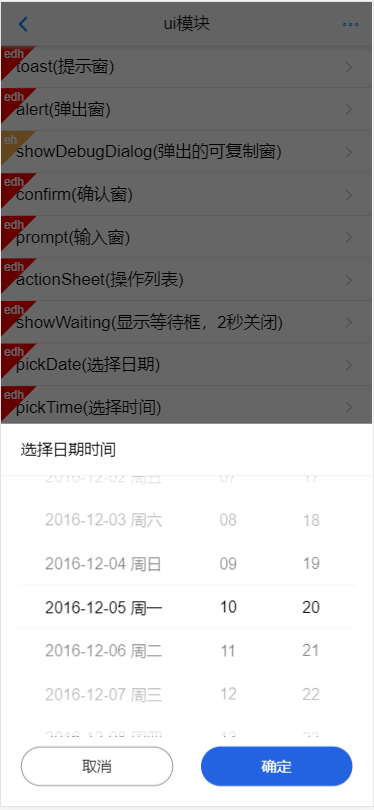

**参数说明**

| 参数       | 参数类型 | 说明                                                    | 平台差异说明                                             |
| :--------- | :------: | :------------------------------------------------------ | :------------------------------------------------------- |
| title      |  String  | 选择日期时间的标题，`h5`环境下可用                      |                                                          |
| minDate    |  String  | h5 模式下，可选时间的开始日期，格式为`yyyy-MM-dd HH:mm` |                                                          |
| maxDate    |  String  | h5 模式下，可选时间的结束日期，格式为`yyyy-MM-dd HH:mm` |                                                          |
| datetime   |  String  | 默认的时间，默认值为当前时间，格式为`yyyy-MM-dd HH:mm`  |                                                          |
| h5UI       | Boolean  | 是否强制使用 H5-UI 效果，默认`false`                    | 仅 ejs > 3.4.2a 支持                                     |
| showSecond | Boolean  | 是否显示秒，默认`false`，仅`h5`环境下可用               | 仅 ejs >= 4.1.1-sp4 支持，`ejs-weex`及官方`weex`端不支持 |

**返回说明**

| 参数     | 参数类型 | 说明                            |
| :------- | :------: | :------------------------------ |
| datetime |  String  | 选择的日期时间                  |
| week     |  String  | 选择的星期数，h5 模式下才会返回 |

## pickMonth

选择月份

`v4.2.4`版本开始支持跨端框架

**平台差异**

| ejs（H5 应用) | ejs（新点小程序） |  H5  | 钉钉 | 微信小程序 | 支付宝小程序 |
| :------------ | :---------------: | :--: | :--- | :--------- | :----------- |
| 不支持        |      不支持       | 支持 | 支持 | 支持       | 支持         |

**使用示例**

```js
ejs.ui.pickMonth({
    title: '选择月份',
    datetime: '2017-06',
    // h5中的开始年月
    minDate: '',
    // h5中的结束年月
    maxDate: '',
    success: function (result) {
        /*
        {
            month: '2016-06'
        }
        */
    },
    error: function (err) {}
});
```

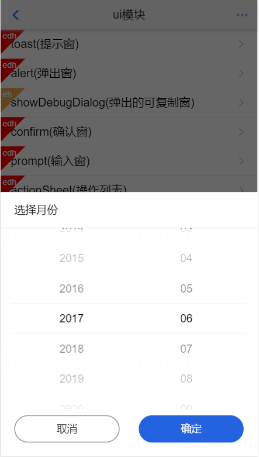

**参数说明**

| 参数     | 参数类型 | 说明                                           |
| :------- | :------: | :--------------------------------------------- |
| title    |  String  | 标题，部分设备上设置标题后遮挡控件可不设置标题 |
| datetime |  String  | 默认的时间，默认值为当前时间，格式为`yyyy-MM`  |
| minDate  |  String  | h5 模式下，可选时间的开始年月，格式为`yyyy-MM` |
| maxDate  |  String  | h5 模式下，可选时间的结束年月，格式为`yyyy-MM` |

**返回说明**

| 参数  | 参数类型 | 说明       |
| :---- | :------: | :--------- |
| month |  String  | 选择的月份 |

## popPicker

选择器，目前支持`1-3`级别的选择

ejs 环境下调用实际使用的是 H5 的实现，所以需要引入 H5 端的 ejs 库。

`ejs-weex`端用不了 H5 的实现，所以不支持该 API。

**平台差异**

| ejs（H5 应用) | ejs（新点小程序） |  H5  | 钉钉 | 微信小程序 | 支付宝小程序 |
| :------------ | :---------------: | :--: | :--- | :--------- | :----------- |
| 不支持        |      不支持       | 支持 | 支持 | 支持       | 支持         |

**使用示例**

**一级选择**

```js
ejs.ui.popPicker({
    layer: 1,
    data: [
        {
            value: 'value1',
            text: 'text1'
        },
        {
            value: 'value2',
            text: 'text2'
        }
    ],
    success: function (result) {
        /*
        {
            // 选择的对象
            items: [{text: "text1", value: "value1"}]
        }
        */
    },
    error: function (err) {}
});
```

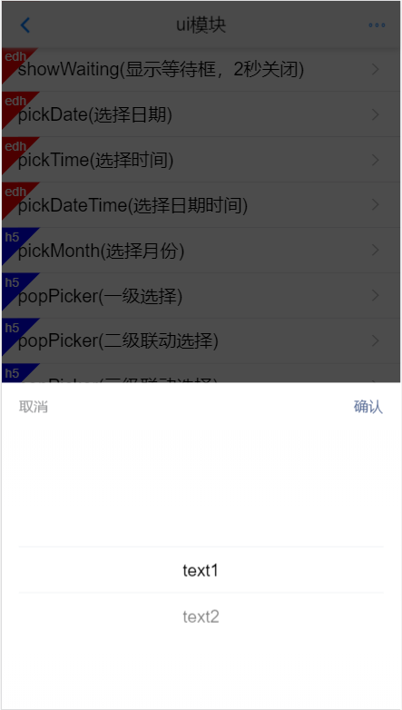

**二级选择**

```js
ejs.ui.popPicker({
    layer: 2,
    data: [
        {
            value: 'value111',
            text: 'text111',
            children: [
                {
                    value: 'value11',
                    text: 'text11'
                },
                {
                    value: 'value12',
                    text: 'text12'
                }
            ]
        },
        {
            value: 'value222',
            text: 'text222',
            children: [
                {
                    value: 'value21',
                    text: 'text21'
                },
                {
                    value: 'value22',
                    text: 'text22'
                }
            ]
        }
    ],
    success: function (result) {
        /*
        {
            // 选择的对象
            items: [{text: 一级xxx, value: 一级xxx}, {text: 二级xxx, value: 二级xxx}]
        }
        */
    },
    error: function (err) {}
});
```

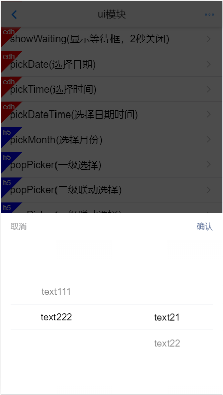

**三级选择**

由于数据较多，不再演示，使用和上述类似，只不过`data`变成三级数组

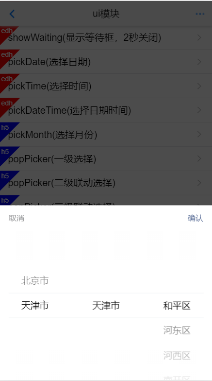

**参数说明**

| 参数  |    参数类型     | 说明                                   |
| :---- | :-------------: | :------------------------------------- |
| layer | Number / String | 层级，默认为`1`                        |
| data  |  Array[String]  | 选择器的数据，不同层次的数据格式不一样 |

**返回说明**

| 参数  | 参数类型 | 说明                                                                                        |
| :---- | :------: | :------------------------------------------------------------------------------------------ |
| items |  String  | 选择的对象，格式为 `[{text: 一级xxx, value: 一级xxx}, ..., {text: N级xxx, value: n级xxx}] ` |

## select

选择列表

**平台差异**

| ejs（H5 应用) | ejs（新点小程序） |  H5  | 钉钉 | 微信小程序 | 支付宝小程序 | 官方 weex 端 |
| :------------ | :---------------: | :--: | :--- | :--------- | :----------- | :----------- |
| 支持          |       支持        | 支持 | 支持 | 支持       | 支持         | 支持         |

**使用示例**

**普通单选**

```js
ejs.ui.select({
    title: '',
    items: ['远野贵树', '篠原明里', '澄田花苗', '立花泷', '宫水三叶'],
    cancelable: 1,
    h5UI: false, // 是否强制使用H5-UI效果，默认false
    success: function (result) {
        /*
        {
            which: 0, // 选择的index，从 0开始
            content: '' //选择的内容
        }
        */
    },
    error: function (err) {}
});
```

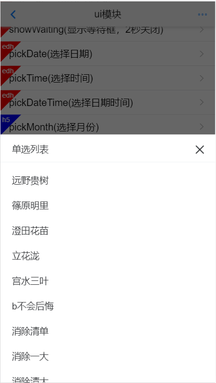

**多选**

```js
ejs.ui.select({
    title: '',
    items: ['远野贵树', '篠原明里', '澄田花苗', '立花泷', '宫水三叶'],
    choiceState: ['0', '0', '0', '1', '1'],
    isMultiSelect: 1,
    cancelable: 1,
    h5UI: false, // 是否强制使用H5-UI效果，默认false
    success: function (result) {
        /*
        {
            choiceState: ['0', '0', '0', '1', '1'], // 每一个item的选择状态
            choiceContent: ['立花泷', '宫水三叶'] // 选择的内容数组
        }
        */
    },
    error: function (err) {}
});
```

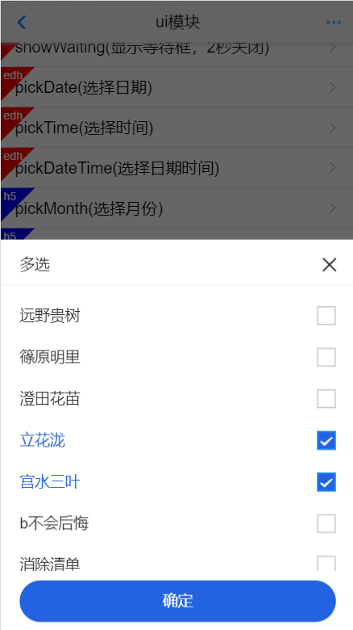

**九宫格单选**

```js
ejs.ui.select({
    title: '',
    items: ['远野贵树', '篠原明里', '澄田花苗', '立花泷', '宫水三叶'],
    type: 1,
    columns: 2,
    cancelable: 1,
    h5UI: false, // 是否强制使用H5-UI效果，默认false
    success: function (result) {
        /*
        {
            which: 0, // 选择的index，从 0开始
            content: '' //选择的内容
        }
        */
    },
    error: function (err) {}
});
```

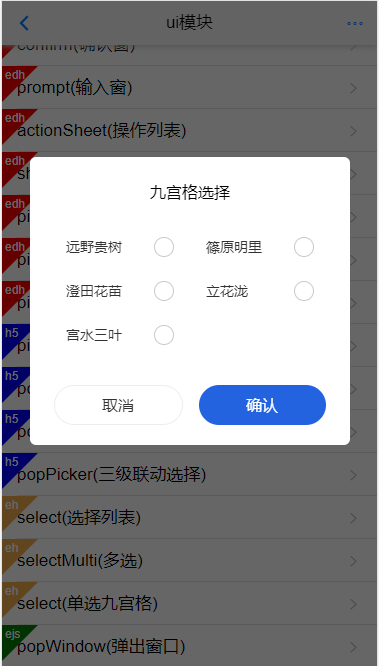

**参数说明**

| 参数            |    参数类型     | 说明                                                                                                                       | 平台差异说明                                                        |
| :-------------- | :-------------: | :------------------------------------------------------------------------------------------------------------------------- | :------------------------------------------------------------------ |
| title           |     String      | 标题                                                                                                                       |                                                                     |
| items           |  Array[String]  | 内容数组                                                                                                                   |                                                                     |
| choiceState     |  Array[String]  | 多选时的选中状态，只有多选时生效                                                                                           | 官方 weex 端不支持                                                  |
| isMultiSelect   | Number / String | 是否是多选，`1`为多选，默认为`0`                                                                                           | 官方 weex 端不支持                                                  |
| type            | Number / String | 选择类别，默认为 0。0：单列表样式；1：九宫格样式(九宫格目前只支持单选，新点小程序 2.0 不支持九宫格, ejs-weex 端同样不支持) | 新点小程序 2.0 及 ejs-weex 端不支持九宫格, 官方 weex 端不支持该字段 |
| isShowSelectAll | Number / String | 多选模式下，是否展示全选，默认为 0。0：不展示全选；1：展示全选                                                             | 支持版本号 `>= 4.2.2`，官方 weex 端不支持                           |
| columns         | Number / String | 九宫格样式时的每一行的列数，默认为`2`                                                                                      | 官方 weex 端不支持                                                  |
| cancelable      | Number / String | 点击遮罩是否可取消，为`1`为可取消，默认为`1`                                                                               | 官方 weex 端不支持                                                  |
| h5UI            |     Boolean     | 是否强制使用 H5-UI 效果，默认`false`                                                                                       | 仅 ejs > 3.4.2a 支持，`ejs-weex`及官方`weex`端不支持                |

**单选返回说明**

| 参数    |    参数类型     | 说明                          |
| :------ | :-------------: | :---------------------------- |
| which   | Number / String | 被点击按钮的索引值，从 0 开始 |
| content |     String      | 选择的内容                    |

**多选返回说明**

| 参数          |   参数类型    | 说明                                         |
| :------------ | :-----------: | :------------------------------------------- |
| choiceState   | Array[String] | 每一个 item 的选择状态                       |
| choiceContent |    String     | 选择的内容数组，例如`['立花泷', '宫水三叶']` |

## popWindow

弹出窗口

**平台差异**

| ejs（H5 应用) | ejs（新点小程序） |   H5   | 钉钉   | 微信小程序 | 支付宝小程序 |
| :------------ | :---------------: | :----: | :----- | :--------- | :----------- |
| 支持          |      不支持       | 不支持 | 不支持 | 不支持     | 不支持       |

**使用示例**

```js
var iconSrc = 'http://app.epoint.com.cn/staticResource/img_head.png';

ejs.ui.popWindow({
    titleItems: ['立花泷', '宫水三叶'],
    iconItems: [iconSrc, iconSrc],
    iconFilterColor: '',
    success: function (result) {
        /*
        {
            which: 0, // 选择的index，从 0开始
            content: '' //选择的内容
        }
        */
    },
    error: function (err) {}
});
```

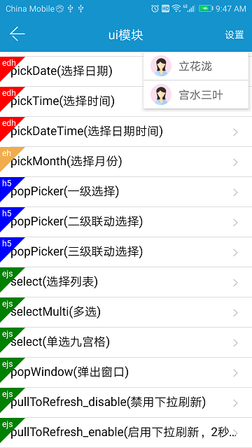

**参数说明**

| 参数            |   参数类型    | 说明                                                             |
| :-------------- | :-----------: | :--------------------------------------------------------------- |
| titleItems      | Array[String] | 标题数组                                                         |
| iconItems       | Array[String] | 图片数组，只支持网络图片                                         |
| iconFilterColor |    String     | 过滤色，默认为空，填写过滤色后，图片中非透明的地方都会变为过滤色 |

**返回说明**

| 参数    |    参数类型     | 说明                          |
| :------ | :-------------: | :---------------------------- |
| which   | Number / String | 被点击按钮的索引值，从 0 开始 |
| content |     String      | 选择的内容                    |
