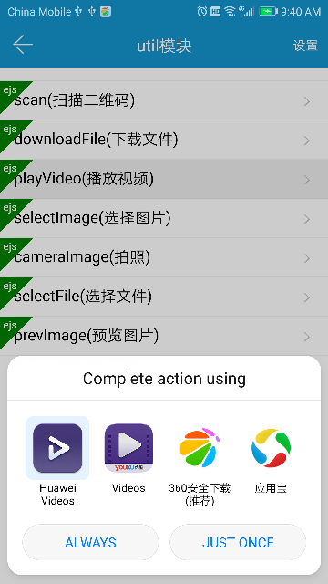
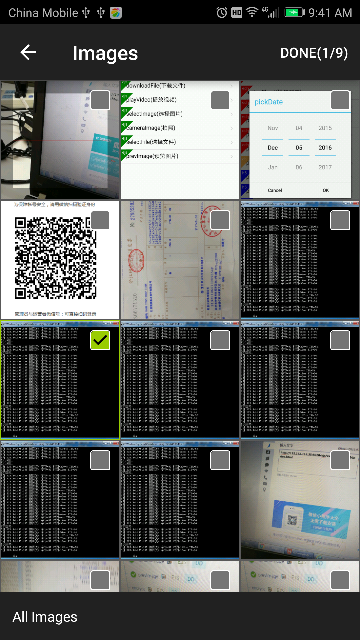

# ejs.util

## scan

打开二维码扫描

**平台差异**

| ejs（H5 应用) | ejs（新点小程序） |   H5   | 钉钉   | 微信小程序 | 支付宝小程序 |
| :------------ | :---------------: | :----: | :----- | :--------- | :----------- |
| 支持          |       支持        | 不支持 | 不支持 | 支持       | 支持         |

**使用示例**

```js
ejs.util.scan({
    showHistory: 0,
    success: function (result) {
        /**
         * 扫描成功后返回
         * {
                resultData: '二维码扫描后的字符串'
           }
         */
    },
    error: function (error) {}
});
```

**参数说明**

| 参数        |    参数类型     | 说明                                               | EJS 原生支持版本                  | 平台差异说明                         |
| :---------- | :-------------: | :------------------------------------------------- | :-------------------------------- | :----------------------------------- |
| showHistory | Number / String | `0`不显示历史记录，`1`显示历史记录，默认`0`        | `v7.4 >= 3.4.0`                   | 仅 ejs 支持，新点小程序 2.0 不再支持 |
| needResult  | Number / String | `0`底座处理扫描结果， `1`H5 处理扫描结果，默认 `1` | `v7.4 >= 3.4.2` `v7.3 >= 3.2.9.a` | 仅 ejs 支持，新点小程序 2.0 不再支持 |

**返回说明**

| 参数       | 参数类型 | 说明                       |
| :--------- | :------: | :------------------------- |
| resultData |  String  | 二维码扫描后解析出的字符串 |

## playVideo

采用原生播放器播放视频

需要跨端播放视频时，建议使用 video 组件，及 Util.createVideoContext 方法进行视频播放。

**平台差异**

| ejs（H5 应用） | ejs（新点小程序） |   H5   | 钉钉   | 微信小程序 | 支付宝小程序 |
| :------------- | :---------------: | :----: | :----- | :--------- | :----------- |
| 支持           |       支持        | 不支持 | 不支持 | 不支持     | 不支持       |

**使用示例**

```js
ejs.util.playVideo({
    videoUrl: 'http://app.epoint.com.cn/staticResource/video_demo.mp4',
    success: function (result) {},
    error: function (error) {}
});
```

注意： `videoUrl` 的值必须为设备本机地址或者带后缀的视频地址，无法播放接口请求的附件地址



**参数说明**

| 参数     | 参数类型 | 说明             |
| :------- | :------: | :--------------- |
| videoUrl |  String  | `必填`，视频地址 |

## selectImage

从相册中选择图片

**平台差异**

| ejs（H5 应用) | ejs（新点小程序） |      H5      | 钉钉   | 微信小程序 | 支付宝小程序 |
| :------------ | :---------------: | :----------: | :----- | :--------- | :----------- |
| 支持          |       支持        | 跨端框架支持 | 不支持 | 支持       | 支持         |

**使用示例**

```js
ejs.util.selectImage({
    photoCount: 9,
    showGif: 0,
    previewEnabled: 1,
    selectedPhotos: ['/storage/emulated/0/DCIM/Camera/IMG_20170703_133717.jpg'],
    showCamera: 0,
    success: function (result) {
        /**
         * 选择完图片后返回
         * {
                resultData: ["/storage/emulated/0/DCIM/Camera/IMG_20170703_133717.jpg"] // 返回图片的本地路径数组
           }
         */
    },
    error: function (error) {}
});
```



**参数说明**

| 参数           |    参数类型     | 说明                                                                                        |               平台差异说明                |
| :------------- | :-------------: | :------------------------------------------------------------------------------------------ | :---------------------------------------: |
| photoCount     | Number / String | 选择图片的最大允许数量，默认为`9`                                                           |                                           |
| showGif        | Number / String | 是否允许选择`gif`图，`1`为显示，`0`为不显示，默认为`0`                                      |                仅 ejs 支持                |
| previewEnabled | Number / String | 是否允许预览图片，`1`为允许，`0`为不允许，默认为`1` ，仅在`Android`中生效，iOS 默认预览图片 |                仅 ejs 支持                |
| selectedPhotos |  Array[String]  | 已选的图片数组(本地路径)，传了后，对应路径的图片会变为选择状态                              | EJS-Android 支持(新点小程序 2.0 暂不支持) |
| showCamera     | Number / String | EJS`3.4.0`新增参数 是否允许拍照，`1`为允许，`0`为不允许，默认为`0`                          |                                           |

注：

-   photoCount 值在 H5 平台的表现，基于浏览器本身的规范。目前测试的结果来看，只能限制单选/多选，并不能限制数量。并且，在实际的手机浏览器很少有能够支持多选的。

-   showCamera 值在 H5 平台根据浏览器的不同而表现不同，一般不可限制仅使用相册，部分浏览器也无法限制是否使用相机。

**返回说明**

| 参数       |   参数类型    | 说明                                       |             平台差异说明              |
| :--------- | :-----------: | :----------------------------------------- | :-----------------------------------: |
| resultData | Array[String] | 返回图片的本地路径数组                     | H5 端及其他小程序平台返回的是临时路径 |
| tempFiles  | Array[Object] | 图片的本地文件列表，每一项是一个 File 对象 | 仅 H5 、微信小程序、支付宝小程序支持  |

## cameraImage

拍照获取图片

**平台差异**

| ejs（H5 应用) | ejs（新点小程序） |      H5      | 钉钉   | 微信小程序 | 支付宝小程序 |
| :------------ | :---------------: | :----------: | :----- | :--------- | :----------- |
| 支持          |       支持        | 跨端框架支持 | 不支持 | 支持       | 支持         |

**使用示例**

```js
ejs.util.cameraImage({
    width: 720,
    quality: 70,
    defaultCamera: '0',
    success: function (result) {
        /**
         * 拍完照后返回
         * {
                resultData: "/storage/emulated/0/DCIM/Camera/IMG_20170703_133717.jpg" // 返回图片的本地路径
           }
         */
    },
    error: function (error) {}
});
```

**参数说明**

| 参数          |    参数类型     | 说明                                                               |     平台差异说明      |
| :------------ | :-------------: | :----------------------------------------------------------------- | :-------------------: |
| width         | Number / String | 照片的宽度，默认为`720`                                            | 仅 ejs 支持，安卓无效 |
| quality       | Number / String | 照片的压缩质量，百分比，默认为`70`                                 | 仅 ejs 支持，安卓无效 |
| defaultCamera |     String      | 拍照时默认打开后置摄像头，`'1'`表示默认打开前置摄像头，默认为`'0'` | 仅`ejs >= 3.2.7`支持  |

**返回说明**

| 参数       | 参数类型 | 说明                   | 平台差异说明                      |
| :--------- | :------: | :--------------------- | :-------------------------------- |
| resultData |  String  | 返回图片的本地路径     | H5 及其他小程序端返回的是临时路径 |
| tempFile   |  Object  | 返回图片的本地文件对象 | 仅 H5 及其他小程序端支持          |

## recordVideo

录制视频

**平台差异**

| ejs（H5 应用) | ejs（新点小程序） |      H5      | 钉钉   | 微信小程序 | 支付宝小程序 |
| :------------ | :---------------: | :----------: | :----- | :--------- | :----------- |
| 支持（3.1.2） |   支持（3.1.2）   | 跨端框架支持 | 不支持 | 支持       | 支持         |

**使用示例**

```js
ejs.util.recordVideo({
    // 最大时长，单位为秒
    maxDuration: 120,
    success: function (result) {
        /**
         * 拍完照后返回
         * {
                resultData: "/storage/emulated/0/com.epoint.workplatform/kfld/Temp/20171215112129.mp4" // 返回视频的本地路径
           }
         */
    },
    error: function (error) {}
});
```

**参数说明**

| 参数        |    参数类型     | 说明                             |                                    平台差异说明                                     |
| :---------- | :-------------: | :------------------------------- | :---------------------------------------------------------------------------------: |
| maxDuration | Number / String | 视频录制允许的最大长度，单位为秒 | 仅 ejs、微信小程序、支付宝小程序端支持，ejs 端最大可为 120 秒，微信端最大可为 60 秒 |

**返回说明**

| 参数       | 参数类型 | 说明               | 平台差异说明                         |
| :--------- | :------: | :----------------- | :----------------------------------- |
| resultData |  String  | 返回视频的本地路径 | H5、微信和支付宝端返回的都是临时路径 |

## prevImage

预览图片

**平台差异**

| ejs（H5 应用) | ejs（新点小程序） |      H5      | 钉钉         | 微信小程序 | 支付宝小程序 |
| :------------ | :---------------: | :----------: | :----------- | :--------- | :----------- |
| 支持          |       支持        | 跨端框架支持 | 跨端框架支持 | 支持       | 支持         |

**使用示例**

```js
ejs.util.prevImage({
    index: 0,
    selectedPhotos: [
        'http://img4.duitang.com/uploads/item/201508/10/20150810161432_5ujhU.thumb.224_0.jpeg',
        'http://img4.duitang.com/uploads/item/201508/10/20150810161432_5ujhU.thumb.224_0.jpeg'
    ],
    success: function (result) {},
    error: function (error) {}
});
```


**参数说明**

| 参数           |    参数类型     | 说明                                               |
| :------------- | :-------------: | :------------------------------------------------- |
| index          | Number / String | 初始显示的图片序号，默认为`0`代表显示第一张图片    |
| selectedPhotos |  Array[String]  | 需要被预览的图片数组，只支持网络路径(`http`等开头) |

## getPreviewUrl

获取在线预览的地址头部

一个第三方在线预览插件的 http 地址头部，每一个项目可能都不一样

**平台差异**

| ejs（H5 应用) | ejs（新点小程序） |   H5   | 钉钉   | 微信小程序 | 支付宝小程序 |
| :------------ | :---------------: | :----: | :----- | :--------- | :----------- |
| 支持          |       支持        | 不支持 | 不支持 | 不支持     | 不支持       |

**使用示例**

```js
ejs.util.getPreviewUrl({
    success: function (result) {
        /**
         * previewUrl: xxx,
         * previebnwurl: xxx,
         * repalceurl: xxx,
         */
    },
    error: function (error) {}
});
```

`3.2.7`版本新增内网预览:

如果 repalceurl 有值，则 previewUrl 字符串中将 repalceurl 部分替换成 previebnwurl

**返回说明**

| 参数         | 参数类型 | 说明                                  |
| :----------- | :------: | :------------------------------------ |
| previewUrl   |  String  | 预览地址                              |
| repalceurl   |  String  | 需要被替换掉的地址字符串              |
| previebnwurl |  String  | 将 repalceurl 部分替换成 previebnwurl |

## goSearch

进入通用搜索页面

会打开一个原生页面，搜索完毕后，回到本页面时触发回调（类似于`openLocal`）

**平台差异**

| ejs（H5 应用) | ejs（新点小程序） |   H5   | 钉钉   | 微信小程序 | 支付宝小程序 |
| :------------ | :---------------: | :----: | :----- | :--------- | :----------- |
| 支持          |       支持        | 不支持 | 不支持 | 不支持     | 不支持       |

**使用示例**

```js
ejs.util.goSearch({
    searchType: '',
    conditions: '',
    success: function (result) {
        /**
         * resultData: xxx
         */
    },
    error: function (error) {}
});
```

**参数说明**

| 参数       | 参数类型 | 说明     |
| :--------- | :------: | :------- |
| searchType |  String  | 搜索类别 |
| conditions |  String  | 搜索条件 |

## createQRCode

字符串生成二维码

**平台差异**

| ejs（H5 应用) | ejs（新点小程序） |   H5   | 钉钉   | 微信小程序 | 支付宝小程序 |
| :------------ | :---------------: | :----: | :----- | :--------- | :----------- |
| 支持（3.1.8） |   支持（3.1.8）   | 不支持 | 不支持 | 不支持     | 不支持       |

**使用示例**

```js
ejs.util.createQRCode({
    qrCodeStr: 'https://fe.epoint.com.cn/ejsdoc/index/index.php#page=changelog',
    size: 200,
    success: function (result) {
        /**
         * img: xxx
         */
    },
    error: function (error) {}
});
```

**参数说明**

| 参数      |    参数类型     | 说明                                                                                       |
| :-------- | :-------------: | :----------------------------------------------------------------------------------------- |
| qrCodeStr |     String      | `必填`，要生成二维码的字符串                                                               |
| size      | Number / String | 生成二维码的大小，范围在`200`-`2000`，默认值为 `200`, 注意：100 的倍数生成的二维码无白边框 |

**返回说明**

| 参数 | 参数类型 | 说明                    |
| :--- | :------: | :---------------------- |
| img  |  String  | 生成的二维码图片 Base64 |

## recognizeQRCode

将二维码图片的 `base64` 或 `本地路径` 或 `图片网络路径`解析成字符串

**平台差异**

| ejs（H5 应用) | ejs（新点小程序） |   H5   | 钉钉   | 微信小程序 | 支付宝小程序 |
| :------------ | :---------------: | :----: | :----- | :--------- | :----------- |
| 支持（3.1.8） |   支持（3.1.8）   | 不支持 | 不支持 | 不支持     | 不支持       |

**使用示例**

```js
ejs.util.recognizeQRCode({
    imgPath: '',
    imgBase64: '',
    success: function (result) {
        /**
         * corePath: xxx
         */
    },
    error: function (error) {}
});
```

**参数说明**

| 参数      | 参数类型 | 说明                                                                                                    |
| :-------- | :------: | :------------------------------------------------------------------------------------------------------ |
| imgPath   |  String  | `选填`，二维码图片的 `本地路径`。iOSEJS 组件`3.2.6e`、安卓 EJS 组件`3.2.6g`版本支持传参图片为`网络路径` |
| imgBase64 |  String  | `选填`，二维码图片的 `base64`                                                                           |

**返回说明**

| 参数     | 参数类型 | 说明           |
| :------- | :------: | :------------- |
| corePath |  String  | 解析后的字符串 |

## invokePluginApi

调用组件 API

[原生组件 API 文档](https://fdoc.epoint.com.cn/onlinedoc/rest/d/MZbEb2)

**平台差异**

| ejs（H5 应用) | ejs（新点小程序） |   H5   | 钉钉   | 微信小程序 | 支付宝小程序 |
| :------------ | :---------------: | :----: | :----- | :--------- | :----------- |
| 支持（3.2.0） |   支持（3.2.0）   | 不支持 | 不支持 | 不支持     | 不支持       |

**使用示例**

```js
ejs.util.invokePluginApi({
    path: 'contact.provider.localOperation',
    dataMap: {
        method: 'getOUAndUserList',
        ouguid: ouguid
    },
    appVersion: '',
    success: function (result) {
        // result 返回数据
    },
    error: function (err) {
        // err 错误信息
    }
});
```

**参数说明**

| 参数               |    参数类型    | 说明                                                                                                       |
| :----------------- | :------------: | :--------------------------------------------------------------------------------------------------------- |
| path               |     String     | `必填`，调用 `API` 的 `PATH`，参考 [原生组件 API 文档](https://fdoc.epoint.com.cn/onlinedoc/rest/d/MZbEb2) |
| dataMap            | String[Object] | `必填`，`API` 的调用参数，参考 [原生组件 API 文档](https://fdoc.epoint.com.cn/onlinedoc/rest/d/MZbEb2)     |
| appVersion         |     String     | `选填`，用于容器组件版本校验                                                                               |
| isLongCb `v4.2.20` |    Boolean     | `选填`，调用的组件需要长期回调时需要设置为 `true`                                                          |

## encrypt

对字符串进行框架默认加密

除 EJS 平台外使用该 API 前，需引入 crypto-js 库。跨端框架需将其设为全局函数。

**平台差异**

| ejs（H5 应用) | ejs（新点小程序） |     H5      | 钉钉        | 微信小程序 | 支付宝小程序 |
| :------------ | :---------------: | :---------: | :---------- | :--------- | :----------- |
| 支持（3.2.3） |   支持（3.2.3）   | 支持(3.2.3) | 支持(3.2.3) | 支持       | 支持         |

**使用示例**

```js
ejs.util.encrypt({
    type: '1',
    keys: ['qnbpwgttcfv96fgwq8ya0hj5sm50e1f0', '1234567890123456'],
    text: 'epoint12345',
    success: function (result) {
        /**
         * text 加密过后的密文
         */
    },
    error: function () {}
});
```

**参数说明**

| 参数 |   参数类型    | 说明                                                                        |
| :--- | :-----------: | :-------------------------------------------------------------------------- |
| type |    String     | `可选`，值为 `1` 使用 AES 加密，`0` 为不使用加密， 默认根据原生系统配置逻辑 |
| keys | Array[String] | `可选`，加密参数                                                            |
| text |    String     | `必填`，需要加密的字符串                                                    |

注意：

当传入 `type` 时，对应的 `keys` 也必须传值，否则加密无效，同样，当传入 `keys` 时，`type` 也必须传值。

H5 端 AES 加密需要 EJS 版本`>3.2.6c`，必须传参`type`和`keys`参数，H5 页面需要自行引用 [aes.js](http://app.epoint.com.cn/ejsdoc/js/libs/aes.js#) 文件

**返回说明**

| 参数 | 参数类型 | 说明           |
| :--- | :------: | :------------- |
| text |  String  | 加密过后的密文 |

## decrypt

对字符串进行框架默认解密

**平台差异**

| ejs（H5 应用) | ejs（新点小程序） |   H5   | 钉钉   | 微信小程序 | 支付宝小程序 |
| :------------ | :---------------: | :----: | :----- | :--------- | :----------- |
| 支持（3.4.0） |   支持（3.4.0）   | 不支持 | 不支持 | 不支持     | 不支持       |

**使用示例**

```js
ejs.util.decrypt({
    type: '1',
    keys: ['qnbpwgttcfv96fgwq8ya0hj5sm50e1f0', '1234567890123456'],
    text: 'voxzdeEdmlw+jSoFuGB8Ww==',
    success: function (result) {
        /**
         * text 解密过后的密文
         */
    },
    error: function () {}
});
```

**参数说明**

| 参数 |   参数类型    | 说明                                                        |
| :--- | :-----------: | :---------------------------------------------------------- |
| type |    String     | `可选`，值为 `1` 使用框架解密，`0` 为不使用解密，默认为 `1` |
| keys | Array[String] | `可选`，解密参数                                            |
| text |    String     | `必填`，需要解密的字符串                                    |

注意：当传入 `type` 时，对应的 `keys` 也必须传值，否则解密无效，同样，当传入 `keys` 时，`type` 也必须传值。

**返回说明**

| 参数 | 参数类型 | 说明           |
| :--- | :------: | :------------- |
| text |  String  | 解密过后的密文 |

## selectVideo

从相册中选择视频

EJS 前端支持版本为`>= 3.4.1b`, EJS 原生支持版本为`Android && iOS >= 3.2.8.a`

**平台差异**

| ejs（H5 应用) | ejs（新点小程序） |  H5  | 钉钉 | 微信小程序 | 支付宝小程序 |
| :------------ | :---------------: | :--: | :--- | :--------- | :----------- |
| 支持          |       支持        | 支持 | 支持 | 支持       | 支持         |

**使用示例**

```js
ejs.util.selectVideo({
    videoCount: 1, // 选择视频的最大允许数量，默认为1
    success: function (result) {
        /**
         * resultData: ["/storage/emulated/0/DCIM/ScreenRecorder/Screenrecorder-2019-11-13-19-10-15-424.mp4"] // 返回视频的本地路径数组
         */
    },
    error: function () {}
});
```

**参数说明**

| 参数       |    参数类型     | 说明                                       | 平台差异说明 |
| :--------- | :-------------: | :----------------------------------------- | :----------: |
| videoCount | Number / String | `可选`， 选择视频的最大允许数量，默认为`1` | 仅 ejs 支持  |

**返回说明**

| 参数       | 参数类型 | 说明               | 平台差异说明                         |
| :--------- | :------: | :----------------- | :----------------------------------- |
| resultData |  Array   | 返回视频的本地路径 | H5、微信和支付宝端返回的都是临时路径 |

## saveImageToPhotosAlbum

保存图片至系统相册

**平台差异**

| ejs（H5 应用) | ejs（新点小程序） |   H5   | 钉钉   | 微信小程序 | 支付宝小程序 |
| :------------ | :---------------: | :----: | :----- | :--------- | :----------- |
| 不支持        |      不支持       | 不支持 | 不支持 | 支持       | 支持         |

**使用示例**

```js
ejs.util.saveImageToPhotosAlbum({
    filePath: '/storage/emulated/0/DCIM/Camera/IMG_20170703_133717.jpg', // 需要保存的图片路径
    success: function () {},
    error: function () {}
});
```

**参数说明**

| 参数     | 参数类型 | 说明                                                                             |
| :------- | :------: | :------------------------------------------------------------------------------- |
| filePath |  String  | `必填`，图片文件路径，可以是临时文件路径也可以是永久文件路径，不支持网络图片路径 |

## saveVideoToPhotosAlbum

保存视频至系统相册

**平台差异**

| ejs（H5 应用) | ejs（新点小程序） |   H5   | 钉钉   | 微信小程序 | 支付宝小程序 |
| :------------ | :---------------: | :----: | :----- | :--------- | :----------- |
| 不支持        |      不支持       | 不支持 | 不支持 | 支持       | 支持         |

**使用示例**

```js
ejs.util.saveVideoToPhotosAlbum({
    filePath: '/storage/emulated/0/com.epoint.workplatform/kfld/Temp/20171215112129.mp4', // 需要保存的图片路径
    success: function () {},
    error: function () {}
});
```

**参数说明**

| 参数     | 参数类型 | 说明                                                         |
| :------- | :------: | :----------------------------------------------------------- |
| filePath |  String  | `必填`，视频文件路径，可以是临时文件路径也可以是永久文件路径 |
