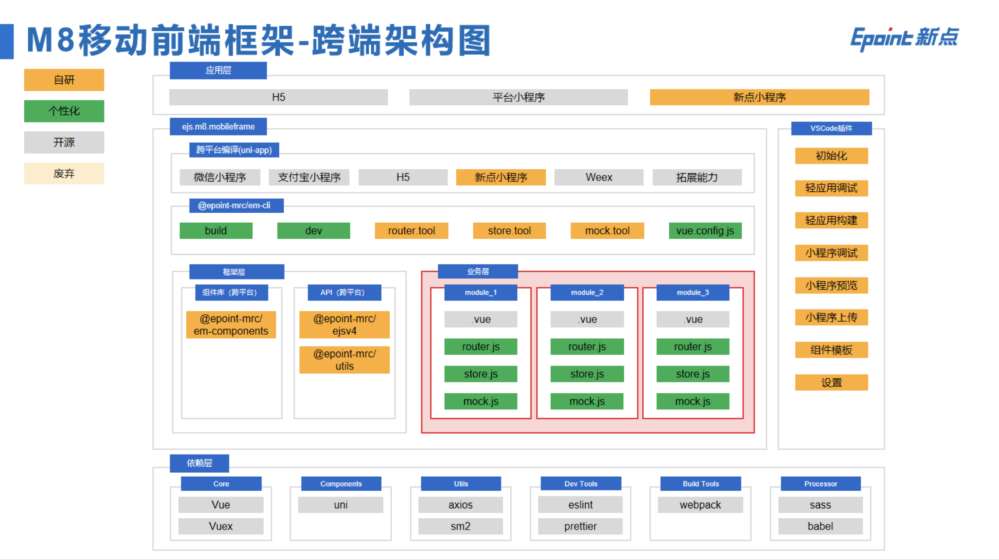

# 框架架构

## 架构图

## 分层说明

### 应用层

包括：

- 通过跨端构建的H5应用

- 通过跨端构建的新点小程序应用

- 通过跨端构建的平台小程序应用

### 框架核心层

包括：

- 通过npm依赖管理框架核心功能
  - `@epoint-mrc/components`提供UI组件库，提供跨端组件。
  - `@epoint-mrc/utils`提供Util工具库，提供跨端工具。
  - `@epoint-mrc/ejsv4`提供JSSDK工具库，提供跨端JSSDK工具。

- 全局开发相关配置`Config`

- 统一资源引用`boot`

- 通用样式

### 业务层

开发人员主要关注部分，包括：

- 不同模块的`.vue`单应用文件

- 模块的`router.js`路由配置文件

- 模块的`store.js`状态管理配置文件

- 模块的`mock.js`数据模拟文件

## VSCode插件

包括：

- 工程初始化

- 移动应用调试、构建、上传

- 低码组件调试、构建、上传

- 集成开发平台组件模板拉取

## 依赖层

框架依赖的主要开源库。