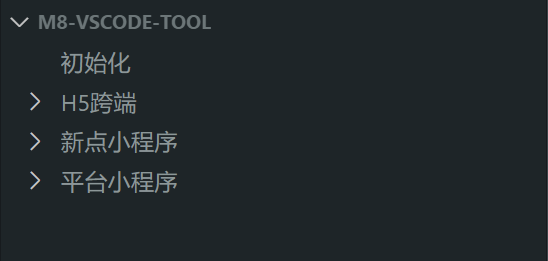

# VSCode 插件安装

## 插件安装

> -   `M8 移动前端框架插件` 是我们为公司开发者提供的移动前端开发插件，便于开发者能在 VSCode 下开发 移动跨平台应用。

### M8 移动前端框架插件安装

1、安装开发插件 `M8-VSCODE-TOOl`

在 VSCode 左侧列表点击扩展模块，在应用中心搜索扩展：


搜索 `M8移动前端框架` 安装`M8移动前端框架插件` 插件


2、安装成功后，打开 M8 移动前端框架项目即可看到 M8-VSCODE-TOOl 目录。




-   插件会识别如果为跨端框架(version>=8.3.0)，展示针对跨端工程的构建命令，如：H5跨端、新点小程序、平台小程序下的运行调试和构建命令。

**注意：**

安装好插件后需要用 VSCode 打开模板项目根目录，才可以正常显示插件按钮。插件识别 M8 移动前端框架项目模板后，点击初始化安装项目依赖，请耐心等待。

### 常用 VSCode 插件介绍

-   `Chinese (Simplified) Language`

    介绍： 适用于 VS Code 的中文（简体）语言包

-   `ESLint`

    介绍： ESLint 检测工具

-   `Live Server`

    介绍： 启动本地环境实时预览页面

-   `Prettier - Code formatter`

    介绍： 代码统一格式化工具

-   `koroFileHeader`

    介绍： 根据配置文件生成头部注释,保存时自动修改 修改时间 与 最后修改作者

    

    `koroFileHeader`配置方式：

    -   进入设置

    

    -   查看 json 文件

    

    新增关于头部注释代码：

    ```json
    {
        //...

        "fileheader.configObj": {
        "createFileTime": true,
        "language": {
            "languagetest": {
                "head": "/$$",
                "middle": " $ @",
                "end": " $/"
            }
        },
        "autoAdd": false,
        "autoAlready": false,
        "annotationStr": {
            "head": "/*",
            "middle": " * @",
            "end": " */",
            "use": false
        },
        "headInsertLine": {
            "php": 2
        },
        "beforeAnnotation": {},
        "afterAnnotation": {},
        "specialOptions": {
            "Date": "创建时间",
            "LastEditTime": "修改时间",
        },
        "switch": {
            "newlineAddAnnotation": true
        },
        "prohibitAutoAdd": [
            "json"
        ],
        "moveCursor": true,
        "dateFormat": "YYYY-MM-DD HH:mm:ss",
        "atSymbol": "@",
        "atSymbolObj": {
            "js": "",
        },
        "colon": ": ",
        "colonObj": {},
        "wideSame": true,
        "wideNum": 2
        },
        "fileheader.customMade": {
            "作者": "XXX",
            "Date": "",
            "LastEditTime": "",
            "版本": "[1.0]",
            "版权": "国泰新点软件股份有限公司",
            "描述": "",
        }

    //...
    }

    ```
