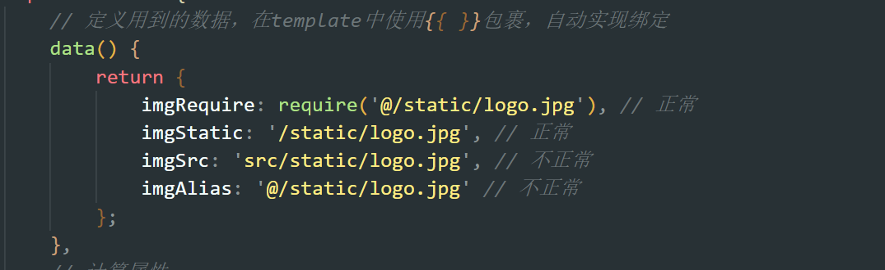

# 引用静态资源

使用前注意：

- 静态资源：如图片，需要放置到`src/static`目录中，否则平台小程序下无法生成图片。这是`uniapp`的规则。

- 由于平台小程序不支持css设置背景图（background-image）为本地文件，解决方案：
    - 使用image组件，在布局下面盖上一层图片。缺点：布局结构可读性不高。
    - 将图片通过在线转化网站，转化成base64格式。缺点：base64内容太长了，影响样式代码阅读。
    - 通过行内样式解决。缺点：代码看上去不够优雅，需要使用../../static/引用方式引用。（最简单）
    - 使用网络图片。缺点：需要放到服务器上。（最灵活）
  

### 模板内引入静态资源

> `template`内引入静态资源，如`image`、`video`等标签的`src`属性时，可以使用相对路径或者绝对路径，形式如下

```html
<!-- 绝对路径，/static指根目录下的static目录，在cli项目中/static指src目录下的static目录 -->
<image class="logo" src="/static/logo.png"></image>
<image class="logo" src="@/static/logo.png"></image>
<!-- 相对路径 -->
<image class="logo" src="../../static/logo.png"></image>
```

**注意**

- `@`开头的绝对路径以及相对路径会经过 base64 转换规则校验
- 引入的静态资源在非 h5 平台，均不转为 base64。
- H5 平台，小于 4kb 的资源会被转换成 base64，其余不转。
- 支付宝小程序组件内 image 标签不可使用相对路径

**注意**
- 填写在template内属性上的字符串路径，会默认使用require引用。
- data中定义的字符串变量路径需要符合层级关系，static内的资源构建后不存在src节点，所以带src找不到图片。或者使用require引用




### css 引入静态资源

> `css`文件或`style标签`内引入`css`文件时（scss、less 文件同理），可以使用相对路径或绝对路径

```css
/* 绝对路径 */
@import url('/common/uni.css');
@import url('@/common/uni.css');
/* 相对路径 */
@import url('../../common/uni.css');
```

**注意**

> `css`文件或`style标签`内引用的图片路径可以使用相对路径也可以使用绝对路径，需要注意的是，有些小程序端 css 文件不允许引用本地文件。

```css
/* 绝对路径 */
background-image: url(/static/logo.png);
background-image: url(@/static/logo.png);
/* 相对路径 */
background-image: url(../../static/logo.png);
```

**Tips**

- `@`开头的绝对路径以及相对路径会经过 base64 转换规则校验
- 不支持本地图片的平台，小于 40kb，一定会转 base64。（平台：MP-WEIXIN）
- h5 平台，小于 4kb 会转 base64，超出 4kb 时不转。
- 其余平台不会转 base64
