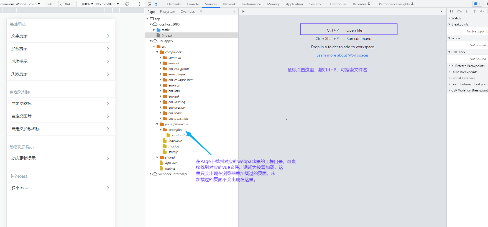
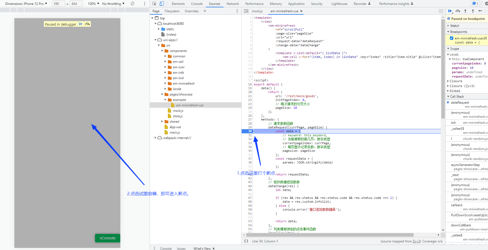

# 调试

### H5调试
 
构建成功后可以在浏览器里看到H5运行结果，通过F12或点右键打开控制台调试。

修改保存工程源码时，右边的浏览器内容可以自动刷新。

在浏览器控制台里，可以直接看到内置浏览器打印的日志。

打开内置浏览器的控制台的 `Sources` 栏，可以给 js 打断点调试。

在 `Page` 下找到 `webpack` 里的工程目录，可直接找到对应的 `vue` 页面进行断点调试；或按 `Ctrl+P` 搜文件名，进入页面调试；也可点击控制台的 `log` 信息，进入对应的页面进行调试。

### 使用各家小程序开发工具调试

`M8` 运行到微信 web 开发者工具等平台小程序开发工具里，可在这些工具的控制台查看 `console` 信息，网络请求等信息等。

页面样式调试和一般的`web`项目一样，通过调试的箭头选中元素即可查看相应的节点和样式，如下图：

调试 `js` 时需要切换到 `Sources` 栏，根据 sourcemap，找到 `webpack` 里正确的目录，选中想要调试的那个页面的`js`，进行调试（如果`js`代码是压缩过的，点击右下角的{}可格式化代码），如下图：

