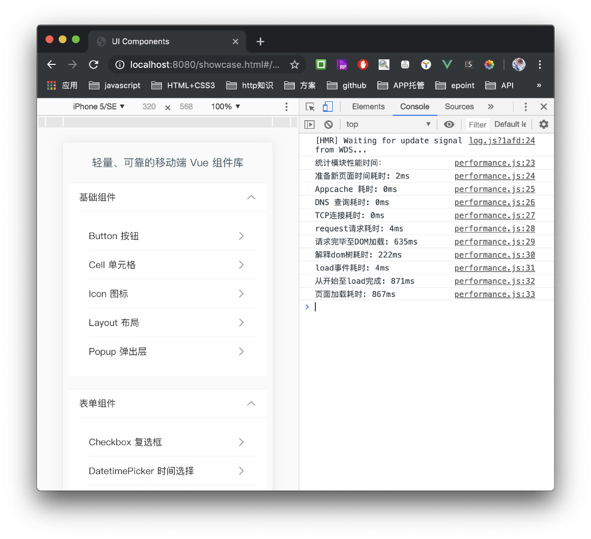

# Config 配置

## 前言

这里是一些移动前端工程相关的配置项，默认全局引用，模块无需单独 import 引用，可以直接使用 Config 变量。

## 文件位置

M8 跨端框架 config.js 文件路径在框架 `ejs.m8.project -> src -> shared -> config.js`

## 配置内容

### ajax 请求配置

```js
/**
* 请求配置
*/
ajax: {
    // 是否开启错误状态码自动弹窗提示
    isAutoErrToast: false,
    // v8.3.13开始，当开启isAutoErrToast后，根据对应错误关键字toast提示文字
    // 低于v8.3.13的版本，需要更新 @epoint-mrc/utils至8.3.13版本，然后在该文件中添加以下 ajax.errMsg 字段
    errMsg: {
        'fail': '请求失败',
        'timeout': '请求超时',
        'abort': '请求中断'
    },
    // 每次 ajax时，也可以增加isAutoProxy:false，来让本次请求不代理
    // 是否自动代理，如果开启，所有的请求会默认带上用户相关信息，h5是cookie中，app是headers中
    // 如果非新点标准后台，请关闭，否则会影响正常请求
    isAutoProxy: true,
    // v8.3.14开始，只有 isAutoProxy 开启时才会生效
    // 每次 ajax时，也可以增加isAutoFingerprint:false，来让本次请求不添加染色体
    // 是否添加染色体，如果开启，会在所有ajax请求的请求头中增加User-Token请求头
    // 如果非新点标准后台，请关闭，否则会影响正常请求
    // 该配置开启会去请求token，如果请求无需token请关闭
    isAutoFingerprint: true,
    // 锁定token的时长，单位ms
    // ajax两次请求间隔小于该时长，第二次请求不会去请求token，而是直接使用上一次请求的token
    // 每次 ajax时，也可以传递 lockTokenDuration，修改上一次请求token锁定时长
    // 支持版本：M83 >= v8.3.22-beta.0、M84 >= v8.4.0-beta.6
    lockTokenDuration: 1000
},
```

注：开启染色请求后，会在 ajax 请求头上携带 User-Token 和 MobileFrame-Info 请求头。

需要关注如果跨域的情况下，需要服务端允许 User-Token 和 MobileFrame-Info 请求头。http://app.epoint.com.cn/h5/sdoc/dist/index.html#/guide_chapter3

### token 用户身份配置

```js
/**
 * token 用户身份配置
 */
token: {
    // 是否使用自定义token，可以用于非ejs环境下的token赋值刷新，影响到所有Util.ajax与下拉刷新请求
    isUseSelfToken: false,
    // 可以是字符串，也可以是方法
    // 非ejs环境下有效，ejs下默认就是容器的token，不容改变
    // 非ejs环境环境下isUseSelfToken为true生效
    getToken() {
        return Promise.resolve('a4bf8be66c4e45a3ccb79634aff575d8');
    },
    //非ejs环境下isUseSelfToken为true生效
    refreshToken: function () {
        // 自定义刷新token之后，请求的token仍然是从自定义getToken中获取token。
        return new Promise((resolve) => {
            setTimeout(() => {
                // 更新存储在本地的token
                // ...
                resolve();
            }, 1000);
        });
    },
    // 自定义刷新失败处理
    // 非ejs环境下isUseSelfToken为true生效
    // 超过允许最大刷新token次数后请求接口的响应状态码仍然403|401触发，可以在这里进行处理后续逻辑
    // 该配置项从框架`v8.3.11`版本开始支持
    refreshTokenCountExceeded: function () {
        ejs.ui.alert({
            title: '提醒',
            message: '用户身份失效，请重新登录',
            buttonName: '确定',
            success() {
                // ...
            }
        });
    }
},
```

注意： 在 config.js 中无法直接使用 Util 相关 API，因为 Util 库需要依赖 config.js 文件，无法互相依赖使用。如果需要在 config.js 中使用 Util，需要将 Util 和相关方法逻辑提取出来，在 config.js 中 require 引入，然后使用。

### isDebugPanel 调试面板

```js
/**
 * 是否开启 调试面板， 开启可以在移动端捕获log
 * 仅在H5端生效
 */
isDebugPanel: 1,
```

### Mock 模拟数据

```js
/**
 * 是否进行mock模拟数据请求
 * isProductionExternalMock 为 true 时仅在 dev 环境生效
 */
isMock: true,
```

### isProductionExternalMock 排除 mockjs 库

```js
/**
 * 是否在生产环境下排除mockjs库
 * 防止构建后带mockjs资源过大
 * isMock: true时生效
 */
isProductionExternalMock: true,
```

### isTestPerformance 性能检测

```js
/**
 * 是否开启性能检测，仅在H5端生效
 */
isTestPerformance: 0,
```

主要对页面以下几项进行性能检测：

-   `准备新页面时间耗时`

-   `Appcache 耗时`

-   `DNS 查询耗时`

-   `TCP连接耗时`

-   `request请求耗时`

-   `请求完毕至DOM加载`

-   `解释dom树耗时`

-   `load事件耗时`

-   `从开始至load完成`

-   `页面加载耗时`

将 `isTestPerformance` 设置为 `1` 后，效果如下图所示：



### isUseEjsFetchAjax 是否使用原生请求代理 ajax 请求

```js
/**
 * 是否使用原生请求代理ajax请求
 */
isUseEjsFetchAjax: false,
```

### isCustomize 是否使用个性化定制目录 [文档](http://app.epoint.com.cn/m8mpdoc/?file=015-%E5%B7%A5%E7%A8%8B%E5%8C%96/customize)

该配置项从框架`v8.3.10`版本开始支持

```js
/**
 * 是否使用个性化定制目录
 * 开启后，代码在构建时将会响应customize目录下的个性化代码
 * 修改后需重启服务或重新构建
 */
isCustomize: false,
```

### isH5Multiple H5 下是否开启多模块构建 [文档](http://app.epoint.com.cn/m8mpdoc/?file=015-%E5%B7%A5%E7%A8%8B%E5%8C%96/multiple)

该配置项从框架`v8.3.11`版本开始支持

```js
/**
 * H5下是否开启多模块构建
 */
isH5Multiple: false,
```

### isExternalConfig 是否在 dist 下独立 config.js 文件，仅 H5 环境生效

该配置项从框架`v8.3.13`版本开始支持

```js
// 是否在dist下独立config.js文件，仅H5环境生效
isExternalConfig: false,
```

### configReady ejs 初始化

```js
/**
 * 统一ejs初始化
 * @param {Array} jsApiList 自定义api列表
 * @param {Function} successCallback 成功回调，非必填
 * @param {Function} errorCallback 失败回调，非必填
 */
configReady: (jsApiList, successCallback, errorCallback) => {
    const tmpApiList = jsApiList || [];
    const isFormal = false;

    ejs.config({
        // 注，jsApiList中key代表模块，其中value为对应类的包名，Android和iOS下有区别
        jsApiList: tmpApiList
    });
    ejs.error((error) => {
        // 说明: 可以捕获相应的错误，例如，验证失败会触发error，安卓原生容器捕获到图片加载异常错误也会触发
        errorCallback && errorCallback(error);
    });
    ejs.ready(() => {
        Config.serverUrl = isFormal ? 'http://ip/rest/' : 'http://127.0.0.1/rest/mock/';
        successCallback && successCallback();
    });
};
```

此配置主要方便产品项目使用 ejs.config 初始化，同时可以定义不同的 Config.serverUrl 环境接口，方便环境切换。

### env 环境参数

```js
/**
 * 开发环境常量，ejs、dingtalk
 * 在编译h5环境下的包时，会根据该参数引入不同环境支持度的ejs库
 */
env: (function () {
    var ENV_H5 = 'uni';
    var ENV_EJS = 'native';
    var ENV_DD = 'dd';
    var ENV_EJS_H5 = 'native_uni';
    var ENV_DD_H5 = 'dd_uni';
    var ENV_ALL = 'native_dd_uni';

    return ENV_EJS_H5;
})();
```

根据 return 的参数不同，ejs 会引入不同的环境 ejs-jssdk。

例如：

`ejs_h5`会引入支持`ejs`环境和支持`h5`环境的跨端库文件；

`ejs_dd_h5`会引入支持`ejs`、`dd`和 `h5`环境的跨端库文件；

### isAsyncPackages 是否使用异步化分包

该配置项从框架`v8.3.5-beta.0`版本开始支持

```js
/**
 * 编译到微信小程序时，是否将框架组件库设置为异步化分包
 * 该配置可用于减小主包大小
 */
isAsyncPackages: 0;
```

该配置开启时，在微信小程序中，会将`node-modules/@epoint-mrc/em-components/src/`下的 `components` 及 `sub_components`目录设置为异步化分包目录。

只有在使用到该目录下的资源时，微信小程序才会去加载该分包。

该配置可用于减小主包大小。

### customAsyncPackages 自定义异步化分包目录

该配置项从框架`v8.3.15-beta.0`版本开始支持

```js
/**
 * 自定义异步化分包目录，isAsyncPackages开启时有效
 * 示例：customAsyncPackages: ['components/custom_components']
 * 注意，默认是src目录下的路径，建议将异步化分包放在 src/components 目录下
 */
customAsyncPackages: []
```

该配置可用于减小主包大小。

### isExternalCommon H5 端是否剥离公共资源

该配置项从框架`v8.3.9-beta.4`版本开始支持

```js
/**
 * H5端打包新点小程序或低码组件时，是否需要剥离公共资源
 */
isExternalCommon: 0;
```

该配置开启后，通过命令`npm run build:common`即可打包 H5 端公共资源。

打包后的公共资源输出路径：`dist/mccommon/mccommon.umd.js`。

H5 端公共资源包含：

1. 跨端组件库

2. `EJS`

3. `Util`

4. `core-js`

5. `@dcloudio/vue-cli-plugin-uni/packages/vue-loader/lib/runtime/componentNormalizer.js`

6. `@dcloudio/vue-cli-plugin-uni/packages/h5-vue-style-loader/lib/addStylesClient.js`

7. `uniapp`框架 H5 端资源

其中 `EJS`、`Util` 放在 `window` 全局供调用，其他资源放在 `window.mccommon` 下供调用。例如跨端选择组件通过 `window.mccommon.emComponents.Picker` 调用。`uniapp`框架 H5 端资源提供 `uni` 全局变量。
