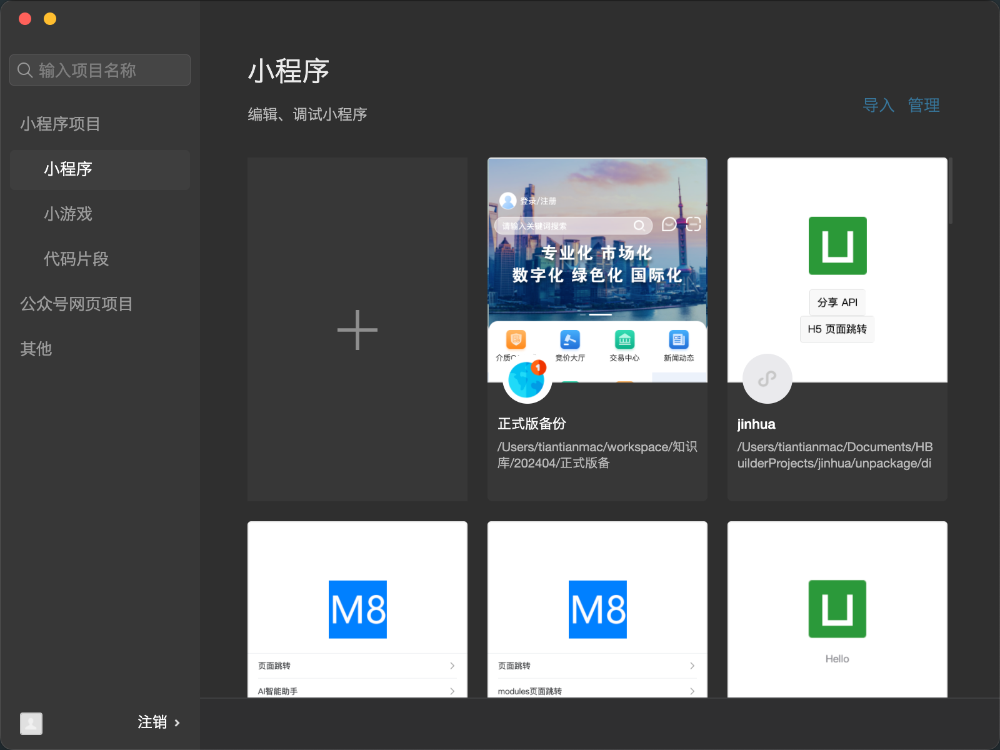
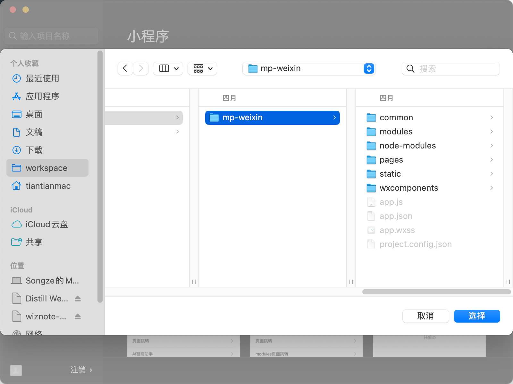
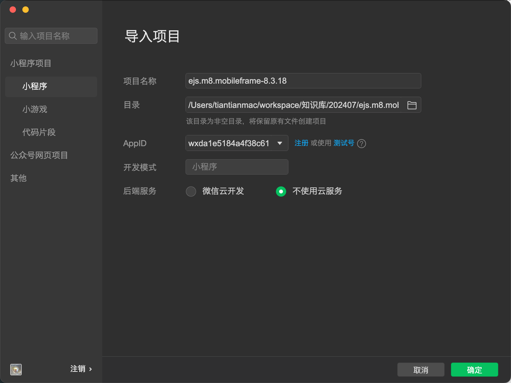
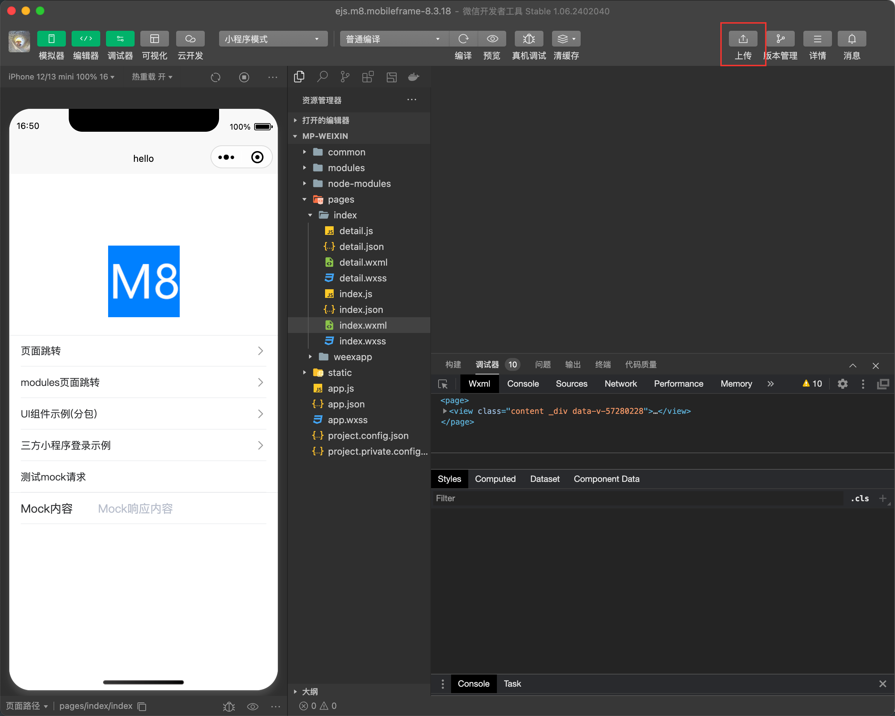
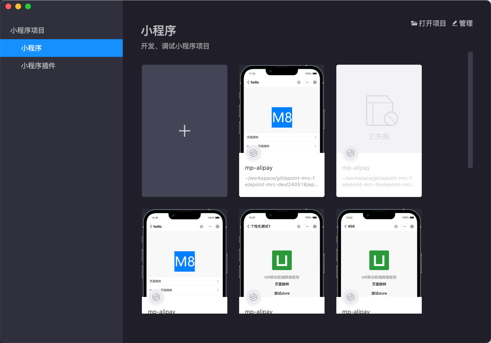
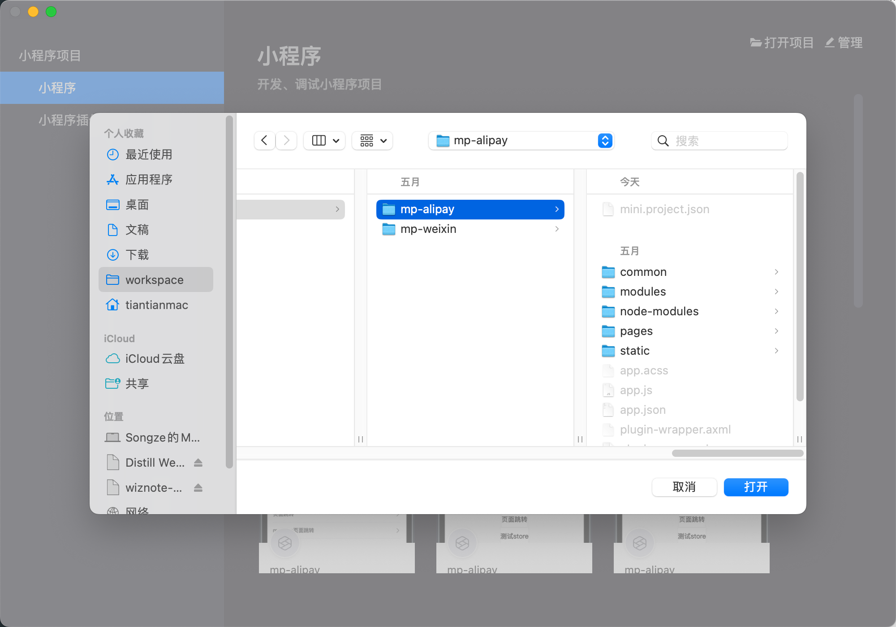
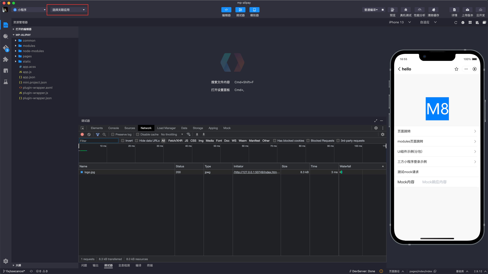
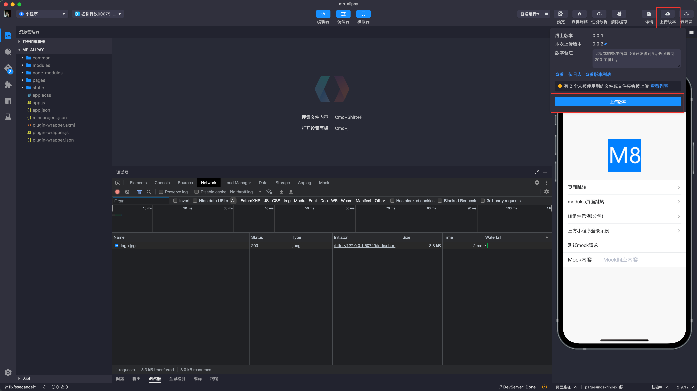

# 多端发布

## H5 发布

H5 应用构建后，H5 资源在框架工程的 `dist/h5/build` 目录下。一般将 H5 资源打包提供给交付人员，由交付人员将 H5 资源上传至服务器，并提供访问地址。

## 微信小程序发布

微信小程序构建后，小程序资源在框架工程的 `dist/build/mp-weixin` 目录下。

打开微信小程序开发者工具

点击 `导入` 按钮，选择 `dist/build/mp-weixin` 目录。

填写项目名称和小程序 APPID，不使用云开发，点击确定。

在打开的微信小程序工具中，测试验证功能正常后，点击上传，发布到微信小程序平台。

## 支付宝小程序发布

支付宝小程序构建后，小程序资源在框架工程的 `dist/build/mp-alipay` 目录下。

打开支付宝小程序开发者工具

点击 `打开项目` 按钮，选择 `dist/build/mp-alipay` 目录，点击打开。

在打开的支付宝小程序开发工具中，选择管理的应用。

测试验证功能正常后，点击上传，发布到支付宝小程序平台。

## 新点小程序发布

参考 新点小程序开发指南：

[新点小程序开发指南](https://app.epoint.com.cn/m8fedoc/?file=010-%E6%96%B0%E7%82%B9%E5%B0%8F%E7%A8%8B%E5%BA%8F/003-%E5%BC%80%E5%8F%91%E5%B0%8F%E7%A8%8B%E5%BA%8F)