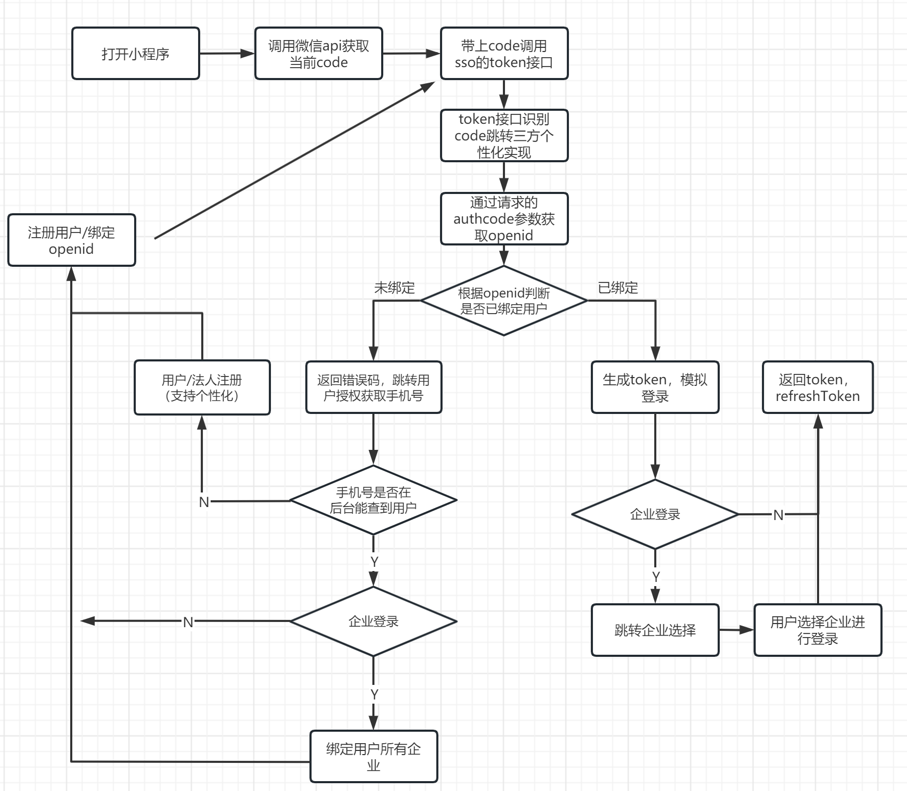
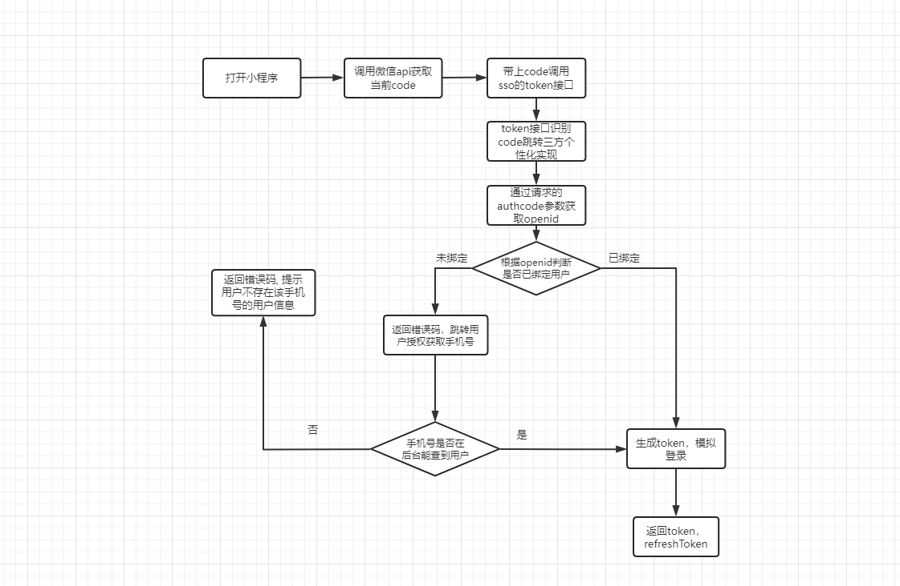
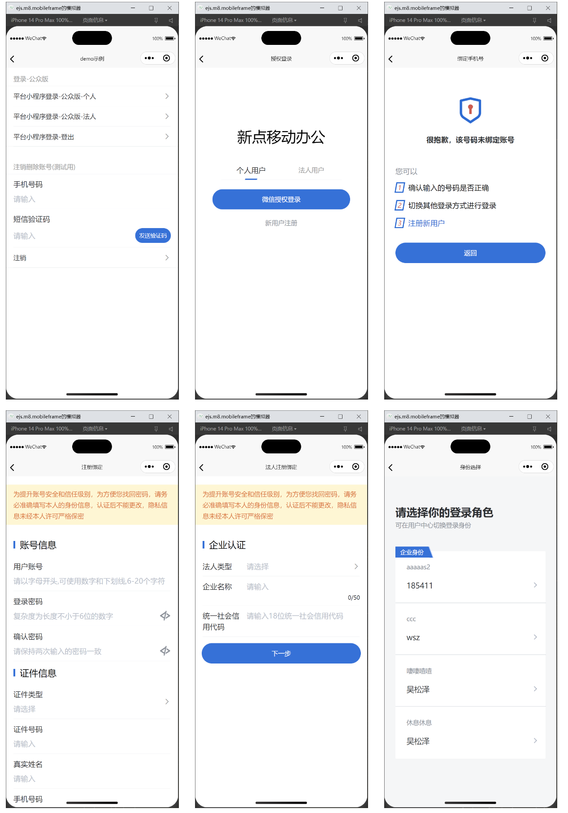

# 三方小程序登录管理器

## 说明：

三方小程序登录管理器，基于框架SSO服务，实现在三方小程序中授权获取手机号码、验证、注册、绑定、登出、注销等功能。

## 支持版本：

#### 移动前端框架：

`ejs.m8.mobileframe@8.3.9`

`@epoint-mrc/utils@1.0.8`

#### 服务端：

内部版：`F9框架版本F9.5.3`

公众版（个人/法人）：`F9框架版本F9.5.3` ，支持迁移到`身份宝v1.1.0-sp1`

## 使用场景：

支持在微信小程序、支付宝小程序（计划）内使用。

支持在公司框架SSO服务公众版（个人/法人）、内部版中使用。

**平台差异**

|  H5   | 新点小程序 | 微信小程序 | 支付宝小程序 |
| :---: | :--------: | :--------: | :----------: |
|   X   |     X      |     √      |   √（计划） |

### 注意

由于使用到了微信获取用户手机号码code，微信限制小程序注册主体需要为企业注册。

开发调试时，开发者工具需要使用该小程序微信管理后台申请的开发人员账号登录，才能在开发者工具内进行提调试。

## API：

### Util.mpVerifyManager.init(object)

初始化三方小程序登录管理器。初始化只需要初始化一次，建议放在main.js里。

__参数说明__

| 参数 |必填| 参数类型 | 可选值 | 说明 |
| :------------- |:-------------:|:-------------:|:-------------|:-------------|
| ssoUrl | 是 | String |  | sso服务地址。例如：`https://domain:port/epoint-shell-member-center-demo/` |
| loginType | 是 | String | `mp`、`ep` | 登录类型：公众版（mp）；内部版（ep） |
| ep3rdAppid | 是 | String |  | 三方系统应用id，通过框架三方集成平台获取 | <!-- TODO补充后端文档 -->
| ep3rdPlatid | 是 | String |  | 三方集成平台id，通过框架三方集成平台获取 |<!-- TODO补充后端文档 -->
| authorizeRouterPath | 否 | String |  | 授权登录页面。用户openId如果sso中未绑定，会跳转到授权登录页面，授权获取手机号。支持其他个性化路由地址。默认为`/modules/innerlogin/index` |
| registerRouterPath | 否 | String |  | 注册页路由地址。授权获取的手机号码如果未在系统中存在，会跳转到注册页面。支持其他个性化路由地址。默认为`/modules/innerlogin/page/register/register` |
| noMobileBindRouterPath | 否 | String |  | 提示未注册手机号页面。默认为`/modules/innerlogin/page/bind/mobilebind` |
| legalPersonRouterPath | 否 | String |  | 法人登录多身份选择路由地址。默认为`/modules/innerlogin/page/register/login_choice_identity` |
| registerLegalRouterPath | 否 | String |  | 法人注册路由地址。默认为`/modules/innerlogin/page/register/register_legal` |
| useManagerToken | 否 | boolean |  | Util.ajax 是否使用登录管理器获取的 token |
| appGuid | 否 | String |  | 当使用内部版登录时，为了展示EMP平台上对应的应用程序的Client_Id的隐私授权页面，需要在隐私授权协议连接中拼接appGuid |
| plugins | 否 | Array |  | 插件，可以进行个性化业务拦截处理 |
| userType | 否 | String |`P`、`L`| 用户登录类型。公众版登录时，需要传参`P`（个人）/ `L`（法人）；内部版登录时可不传。默认为`P` |


**示例**
```js
// 初始化平台小程序用户身份管理器。初始化只需要初始化一次，建议放在main.js里。
Util.mpVerifyManager.init({
    // ssoUrl: sso服务地址
    ssoUrl: 'https://domain:port/epoint-shell-member-center-demo/',
    //  登录类型：公众版（mp）；内部版（ep）
    loginType: 'mp',
    // 三方系统应用id，通过框架三方集成平台获取
    ep3rdAppid: 'applet',
    // 三方集成平台id，通过框架三方集成平台获取
    ep3rdPlatid: 'weixin'
});
```

### Util.mpVerifyManager.login(object)

触发小程序登录流程

__参数说明__

| 参数 |必填| 参数类型 | 可选值 | 说明 |
| :------------- |:-------------:|:-------------:|:-------------:|:-------------|
| userType | 否 | String |`P`、`L`| 用户登录类型。公众版登录时，需要传参`P`（个人）/ `L`（法人）；内部版登录时可不传。默认为`P` |
| useCacheToken | 否 | Boolean | `true`、`false`  | 是否使用缓存的token。默认为`true` |

__返回参数__

| 参数 |参数类型| 说明 |
| :------------- |:-------------:|:-------------|
| login_status | String | 登录状态码 |
| login_text | String | 登录状态描述 |
| access_token | String | 访问令牌 |
| refresh_token | String | 刷新令牌 |
| expires_in | String | 令牌有效期 |
| jsessionid | String | 会话id |


**示例**
```js
// ...
await Util.mpVerifyManager.login({
    // 用户类型：P：个人、L：法人
    userType: 'P'
});
// 登录成功之后的请求会自动携带token
// Util.ajax(...)
// ...
```

### Util.mpVerifyManager.logout()

用户登出，清空用户登录信息

**示例**
```js
Util.mpVerifyManager.logout();
```


### Util.mpVerifyManager.getUserAuth()

获取用户登录信息

__返回参数__

| 参数 |参数类型| 说明 |
| :------------- |:-------------:|:-------------|
| login_status | String | 登录状态码 |
| login_text | String | 登录状态描述 |
| access_token | String | 访问令牌 |
| refresh_token | String | 刷新令牌 |
| expires_in | String | 令牌有效期 |
| jsessionid | String | 会话id |

**示例**
```js
const userAuth = await Util.mpVerifyManager.getUserAuth();
```

## API页面说明

三方小程序登录管理器内置了相关页面，用于授权登录、验证、注册等。如果需要个性化页面，可以在初始化时传入个性化路由地址。

### 目录结构

默认目录结构如下

```
ejs.m8.mobileframe
    |- src
    |   |- modules                                     // 框架集成的业务组件模块
    |   |   |- innerlogin                              // 三方小程序登录管理器内置模块
    |   |   |   |- pages                               // 具体页面
    |   |   |   |   |- bind
    |   |   |   |   |   |- mobilebind.vue              // 号码未绑定账号页面
    |   |   |   |   |- demo
    |   |   |   |   |   |- demo.vue                    // 三方小程序示例页面入口
    |   |   |   |   |   |- internal.vue                // 三方小程序内部版登录示例页面
    |   |   |   |   |   |- public.vue                  // 三方小程序公众版登录示例页面
    |   |   |   |   |- register
    |   |   |   |   |   |- login_choice_identity.vue   // 公众版法人登录多账号选择页面
    |   |   |   |   |   |- privacy_footer.vue          // 通用隐私授权协议
    |   |   |   |   |   |- register_legal.vue          // 公众版法人注册页面
    |   |   |   |   |   |- register.vue                // 公众版个人注册页面
    |   |   |   |   |   |- webview.vue                 // 在线隐私协议webview展示页面
    |   |   |   |- plugin
    |   |   |   |   |- plugin.js                       // 个性化插件示例
    |   |   |   |- index.vue                           // 登录入口，手机号码授权页面

```

## plugin插件说明

三方小程序登录管理器内置了个性化插件，用于个性化业务拦截处理。如果需要在登录流程进行拦截处理，可以在初始化时传入个性化插件。

### 钩子

以下生命周期钩子函数，是由 compiler 暴露， 可以通过如下方式访问：

```js
compiler.hooks.someHook.tap('MyPlugin', () => {
  /* ... */
});
// 或者
compiler.hooks.someHook.tapAsync('MyPlugin', () => {
    return new Promise((resolve) => {
        /* ... */
        resolve();
    });
});
```

目前提供的均为异步钩子，可以通过 tap 或 tapAsync 来注册。

#### beforeLogin

`AsyncHook`

登录前钩子，在执行Util.mpVerifyManager.init前触发。

- 回调参数：`MpVerifyManager`

```js
compiler.hooks.beforeLogin.tap('MyPlugin', () => {
    /* ... */
});
```

#### afterLogin

`AsyncHook`

登录后钩子，从SSO服务或者本地缓存中获取用户登录信息后触发。

- 回调参数：`MpVerifyManager`

```js
compiler.hooks.afterLogin.tap('MyPlugin', () => {
    /* ... */
});
```

#### beforeSaveUserAuth

`AsyncHook`

保存用户登录信息之前触发

- 回调参数：`userAuth`

```js
compiler.hooks.beforeSaveUserAuth.tap('MyPlugin', () => {
    /* ... */
});
```

#### beforeGetUserAuth

`AsyncHook`

获取用户登录信息之前触发

- 回调参数：`userAuth`

```js
compiler.hooks.beforeSaveUserAuth.tap('MyPlugin', () => {
    /* ... */
});
```

#### afterClearUserAuth

`AsyncHook`

清除用户登录信息之后触发

- 回调参数：`userAuth`

```js
compiler.hooks.afterClearUserAuth.tap('MyPlugin', () => {
    /* ... */
});
```

#### beforeLogout

`AsyncHook`

登出之前触发

- 回调参数：`MpVerifyManager`

```js
compiler.hooks.beforeLogout.tap('MyPlugin', () => {
    /* ... */
});
```

#### afterLogout

`AsyncHook`

登出之后触发

- 回调参数：`MpVerifyManager`

```js
compiler.hooks.afterLogout.tap('MyPlugin', () => {
    /* ... */
});
```

#### getMpCode

`AsyncHook`

获取三方小程序code之前触发，适用于非微信、支付宝小程序时，获取对应的code。

- 回调参数：`MpVerifyManager`

```js
compiler.hooks.getMpCode.tapAsync('MyPlugin', (mpVerifyManager) => {
    return new Promise((resolve) => {
        // 模拟api调用
        setTimeout(function() {
            mpVerifyManager.code = 'xxx';
            resolve();
        }, 3000);
    });
});
```

### 注册使用plugin示例

```js
// 定义插件
class PluginDemo {
    constructor() {
        this.name = 'PluginDemo';
    }
    // 插件执行内容定义在apply方法中
    apply(compiler) {
        // 插件示例
        compiler.hooks.beforeLogin.tap('MyPlugin', () => {
            ejs.ui.showWaiting('请稍等');
        });
        // 插件示例带回调
        compiler.hooks.afterLogin.tapAsync('MyPlugin', () => {
            return new Promise((resolve) => {
                ejs.ui.closeWaiting();
                resolve();
            });
        });
    }
}

// 初始化平台小程序用户身份管理器。初始化只需要初始化一次，建议放在main.js里。
Util.mpVerifyManager.init({
    // ...其他配置
    // 初始化时传入个性化插件
    plugins: [new PluginDemo()],
});
```


### 附：小程序登录流程

#### 公众版



#### 内部版



#### 页面相关截图


