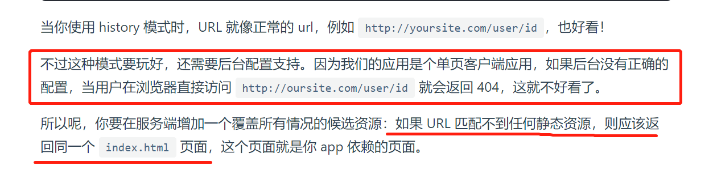

# router.js 的使用说明

## 前言

    M8移动前端跨端框架由于需要兼容各端小程序，页面跳转请使用ejs相关API。请勿直接使用vue-router相关的方法。

模块下的`router.js`的作用主要为定义路由对应的模块，以及改路由页面的style配置。最终会通过框架合并到`src/pages.json`文件中。
## 文件位置

M8 移动前端框架内的 路由配置 文件为每一个模块文件夹下的`router.js`，框架内部已处理好自动引用。

```
ejs.m8.project
    ├── src
    │   ├── pages
    │   │   ├── [module_name]                 // 以模块名命名的文件夹
    │   │   │       ├── [module_name_A].vue
    │   │   │       ├── [module_name_B].vue
    │   │   │       ├── router.js             // 对应此模块的vue-router定义
```
## router.js 说明

`router.js`内无需`import`组件，需要`path`路径与`vue组件`名称保持匹配。

数组下有效参数只有`path`与`style`。

构建时会自动将各模块下的路由配置合并。

**Tips：**

- 应用中新增/减少页面，都需要对 routes 数组进行修改
- 文件名不需要写后缀，框架会自动寻找路径下的页面资源

## router.js 示例

```js
/**
 * router.js无需import组件，需要path路径与vue组件名称保持匹配。
 * routers数组下有效参数只有path与style。
 * 构建时会自动将模块下的路由配置合并到pages.json内。
 */
const routes = [
    {
        // 匹配到pages/index/index时会自动加载pages/index/index组件
        path: 'pages/index/index',
        style: {
            navigationBarTitleText: 'hello'
        }
    }
];

// 导出路由文件
export default routes;

```
## router.js 支持配置
跨端框架在`v8.3.1`之后，router.js支持定义options变量，用于定义模块是否分包与首页模块。

```js
/**
 * router.js无需import组件，需要path路径与vue组件名称保持匹配。
 * routers数组下有效参数只有path与style。
 * 构建时会自动将模块下的路由配置合并到pages.json内。
 */
const routes = [
    {
        // 匹配到pages/index/index时会自动加载pages/index/index组件
        path: 'pages/index/index',
        style: {
            navigationBarTitleText: 'hello'
        }
    }
];

const options = {
    // 该模块是否自动分包处理
    autoSubPackages: true,
    /* 该模块是否为首页模块
     * 开启后路由信息会放在pages.json中的pages数组的第一个位置
     * 定义在routes对象中的第一个模块地址为应用默认首页
     * 所有模块仅支持一个首页模块
     * autoSubPackages为true时，该值无效 */
    isFirstModule: true
};

// 导出路由文件
export default { routes, options };

```
options参数：

|属性|名称|描述|
|:-|:-|:-|
|autoSubPackages|该模块是否自动分包处理|开启后，该模块的路由信息会配置到pages.json中的subPackages分包路由|
|isFirstModule|该模块是否为首页模块| 开启后，该模块路由信息会放在pages.json中的pages数组的第一个位置</br>定义在routes对象中的第一个模块地址为应用默认首页</br>所有模块仅支持一个首页模块</br>`autoSubPackages`为`true`时，该值无效|

## style参数

用于设置每个页面的状态栏、导航条、标题、窗口背景色等。

页面中配置项会覆盖 [globalStyle](/m8mpdoc/index.html?file=0001-前期准备/005-pages#globalStyle) 中相同的配置项

`style`下支持传参配置

|属性|类型|默认值|描述|平台差异说明|
|:-|:-|:-|:-|:-|
|navigationBarBackgroundColor|HexColor|#F7F7F7|导航栏背景颜色（同状态栏背景色）|平台小程序，请参考相应小程序文档|
|navigationBarTextStyle|String|white|导航栏标题颜色及状态栏前景颜色，仅支持 black/white|平台小程序|
|navigationBarTitleText|String||导航栏标题文字内容||
|navigationBarShadow|Object||导航栏阴影，配置参考下方 [导航栏阴影](#navigationBarShadow)|平台小程序|
|navigationStyle|String|default|导航栏样式，仅支持 default/custom。custom即取消默认的原生导航栏|微信小程序|
|disableScroll|Boolean|false|设置为 true 则页面整体不能上下滚动（bounce效果），只在页面配置中有效，在globalStyle中设置无效|微信小程序（iOS）|
|backgroundColor|HexColor|#ffffff|下拉显示出来的窗口的背景色|微信小程序|
|backgroundTextStyle|String|dark|下拉 loading 的样式，仅支持 dark / light|微信小程序|
|mp-alipay|Object||设置编译到 mp-alipay 平台的特定样式，配置项参考下方 [MP-ALIPAY](#mp-alipay)|支付宝小程序|
|mp-weixin|Object||设置编译到 mp-weixin 平台的特定样式|微信小程序|
|maxWidth|Number||单位px，当浏览器可见区域宽度大于maxWidth时，两侧留白，当小于等于maxWidth时，页面铺满；不同页面支持配置不同的maxWidth；maxWidth = leftWindow(可选)+page(页面主体)+rightWindow(可选)|H5|

### navigationBarShadow

|属性|类型|描述|
|:-|:-|:-|
|colorType|String|阴影的颜色，支持：grey、blue、green、orange、red、yellow|

**注意事项：**
- 微信小程序 需要配置: "disableScroll": true
- 支付宝 "mp-alipay": { "allowsBounceVertical": "NO" }

### mp-alipay
配置编译到 MP-ALIPAY 平台时的特定样式

|属性|类型|默认值|描述|
|:-|:-|:-|:-|
|allowsBounceVertical|String|YES|是否允许向下拉拽。支持 YES / NO|
|titleImage|String||导航栏图片地址（替换当前文字标题），内必须使用https的图片链接地址|
|transparentTitle|String|none|导航栏透明设置。支持 always 一直透明 / auto 滑动自适应 / none 不透明|
|titlePenetrate|String|NO|导航栏点击穿透|
|showTitleLoading|String|NO|是否进入时显示导航栏的 loading。支持 YES / NO|
|backgroundImageUrl|String||下拉露出显示的背景图链接|
|backgroundImageColor|HexColor||下拉露出显示的背景图底色|
|gestureBack|String|NO|iOS 用，是否支持手势返回。支持 YES / NO|
|enableScrollBar|String|YES|Android 用，是否显示 WebView 滚动条。支持 YES / NO|

**注意事项**

- `titleImage`仅支持https地址，设置了`titleImage`会替换页面文字标题
- `backgroundImageUrl`支持网络地址和本地地址，尽量使用绝对地址
- 部分配置可能会只在真机运行的时候生效，支付宝未来应该会改善

## vue 文件内使用

单页面跳转支持`ejs`调用

ejs 调用

```js
ejs.page.open({
    pageUrl: './helloworld',
    data: {
        key1: 'value1',
    },
    // 是否使用vue-router跳转
    useRouter: true,
    success: function (result) {},
    error: function (error) {},
});
```

## 监听返回回调

**注意：跨端框架默认前一页面均有keepAlive缓存**

跨端框架的页面返回时，重新显示时将触发`onShow`生命周期。

我们从 A 页面跳转到 B 页面，在 B 页面上修改了内容，关闭时需要传递给 A 页面。我们可以：

在 store.js 内定义变量，B 页面上修改此变量。返回上一页后，在 A 页面的`onShow`生命周期内读取此变量内容。

onShow生命周期

```html
<script>
    export default {
        components: {},
        data() {
            return {};
        },
        // ...
        onShow() {
            // 监听页面显示。页面每次出现在屏幕上都触发，包括从下级页面点返回露出当前页面
            // ...
        },
        // ...
    };
</script>
```
## history模式

在对接部分第三方容器时，不支持url中存在#符合跳转，需要修改为history模式的路由.

### 例如:

页面地址为：https://user.smartwj.net:10007/zhwjappjy/dist/index.html#/delivery/delivery_index

需要修改成：https://user.smartwj.net:10007/zhwjappjy/dist/delivery/delivery_index

___
前后端均需要修改，需要修改以下内容：

### M8移动前端框架：


::: ifdef M83
文件位置： `src\manifest.json`

修改`h5`对象下的`router`和`publicPath`配置

```json
{
    "h5": {
        "router": {
            // 需要注意，此处的`base`路径是实际页面地址从`ip:port`到index.html之间路径。
            "base": "/zhwjappjy/dist/",
            "mode": "history"
        },
        "publicPath": "https://user.smartwj.net:10007/zhwjappjy/dist/"
    }
}
```
::: endif
::: ifdef M84

`M8.4`下，需要修改`src\manifest.json`和`vite.config.ts`配置

文件位置： `src\manifest.json`:

```json
{
    "h5": {
        "router": {
            // 需要注意，此处的`base`路径是实际页面地址从`ip:port`到index.html之间路径。
            "base": "/zhwjappjy/dist/",
            "mode": "history"
        },
    }
}
```
文件位置：M8.4移动前端工程根目录 `vite.config.ts`:

在原有导出的 defineConfig 函数中新增 `base` 配置项

```ts
// ...
export default defineConfig({
    base: 'https://user.smartwj.net:10007/zhwjappjy/dist/', // 新增，此处需要修改为项目资源地址
    ...
})
// ...
```
::: endif
修改后重新构建打包即可。

### 服务端修改：

服务端需要对未匹配的资源请求返回`dist/index.html`响应



#### F9框架修改配置：


#### 其他框架修改配置：

更多后端配置例子参考 官方文档 [HTML5 History 模式](https://router.vuejs.org/zh/guide/essentials/history-mode.html#%E5%90%8E%E7%AB%AF%E9%85%8D%E7%BD%AE%E4%BE%8B%E5%AD%90 'HTML5 History 模式')
