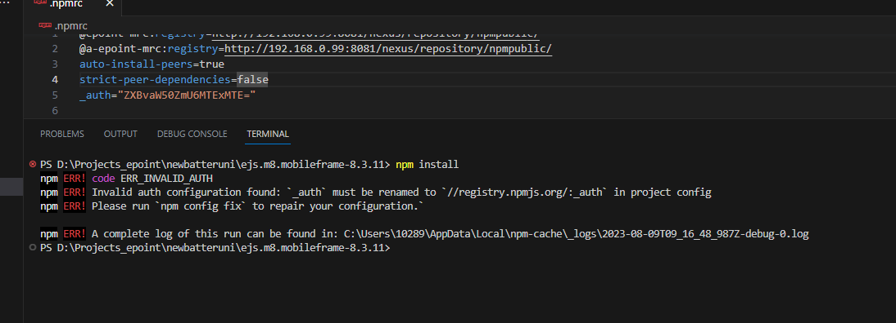
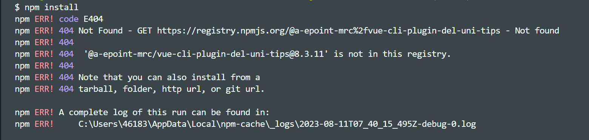
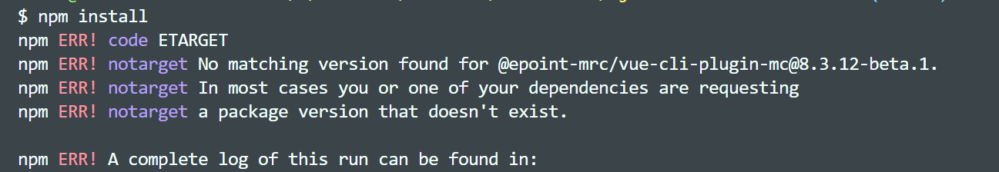
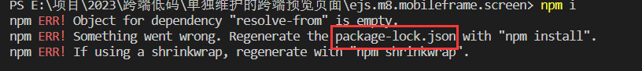
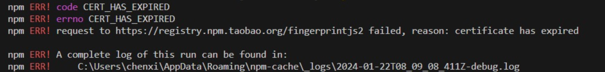
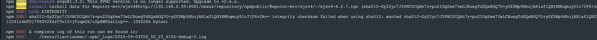

# npm install 依赖安装常见问题

> ⚠️ 本文档为内网文档站镜像。原文中的 `_auth` 凭据与 `NpmToken` 令牌已按知识库红线脱敏，如需实际值请联系内网管理员或在公司内网查看原文。

##### 1. code ERR_INVALID_AUTH



这个报错是在Node-v16下，私有npm源的身份配置需要修改。请将`M8跨端框架`升级到`8.3.12`版本；或者修改工程下的`.npmrc`文件，将
```
_auth = "<已脱敏：base64(内网源用户名:密码)>"
```

修改为：

```
//192.168.0.99:8081/nexus/repository/npmpublic/:_authToken=NpmToken.<已脱敏，请向内网管理员索取>
```

##### 2. npm ERR! code E404



报错为：`@a-epoint-mrc/vue-cli-plugin-del-uni-tips` 未找到。跨端框架工程请升级到`8.3.11`版本；或者在工程下的`.npmrc`文件中增加：

```
@a-epoint-mrc:registry = http://192.168.0.99:8081/nexus/repository/npmpublic/
```

##### 3. npm ERR! code ETARGET



报错为： `@epoint-mrc/xxx@8.3.x`版本未找到，实际已发布的框架工程相关依赖都是已发布的。

此报错需要清除npm cache 缓存，然后重新安装依赖。

```bash
npm cache clean --force # 清除缓存
npm install # 重新安装依赖
```

##### 4. package-lock.json文件报错



报错为`package-lock.json`文件报错，一般出现在升级框架工程后出现。

此报错需要删除`package-lock.json`文件，删除`node_modules`文件夹，然后重新安装依赖。

##### 4. code CERT_HAS_EXPIRED 报错



`/registry.npm.taobao.org`源报错，安装&升级 `nrm` 更换其他npm源。

安装&升级：

```bash
npm install -g nrm --registry=https://registry.npmmirror.com
```

使用：

```bash
nrm ls # 查看所有源
nrm use taobao # 切换到淘宝源
```

##### 5. code EINTEGRITY 报错

`@epoint-mrc/ejsv4` 依赖安装失败，提示校验 sha512 值失败。



原因是 @epoint-mrc/ejsv4 需要给三方开发安装使用，没有发布至公司私有源。由于统一@epoint-mrc前缀包名为私有源安装，所以安装到 ejsv4 时，私有源会从公有源拉到私有源。私有源可能定时清理这类没有发布的仓库包，有人安装时会同步进来，这里可能导致哈希不一致。

如果遇到这种情况，可以先尝试删除 `node_modules` 目录和 `package-lock.json` 文件，然后重新安装依赖。

如果还不行，需要将 `package.json` 文件中的 `@epoint-mrc/ejsv4` 依赖版本号改为版本号对应的私有源地址，然后重新安装依赖。 例如：

将`package.json`中：

```json
"@epoint-mrc/ejsv4": "4.x.x"
```

修改为：

```json
"@epoint-mrc/ejsv4": "http://192.168.0.99:8081/nexus/repository/npmpublic/@epoint-mrc/ejsv4/-/ejsv4-4.x.x.tgz"
```