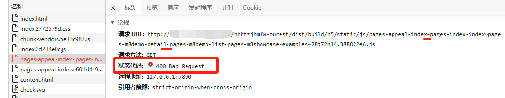
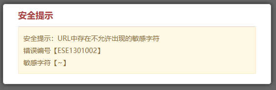

# 构建后文件名存在特殊字符 ~

## 问题说明

在跨端框架`v8.3.9`之前，构建的H5应用存在构建后的js资源存在特殊字符`~`。

当页面加载时，由于存在特殊字符，会被F9框架安全拦截。






## 修复

### v8.3.9之前

在跨端框架`v8.3.9`之前版本，可以通过修改工程个性化构建配置进行修改。

文件位置：

`ejs.m8.mobileframe\build\index.js`

```js
// ...
const webpackChain = (config) => {
    config.optimization.splitChunks({
        automaticNameDelimiter: '-'
    });
};
// ...
```

修改 webpackChain 函数，将默认的分隔符进行修改为`-`。

修改完成之后重新运行构建命令。
### v8.3.9及之后

在跨端框架`v8.3.9`及之后的版本修复，构建不使用默认的特殊字符~进行分割。