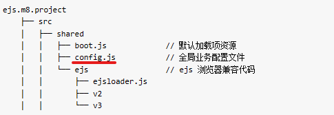
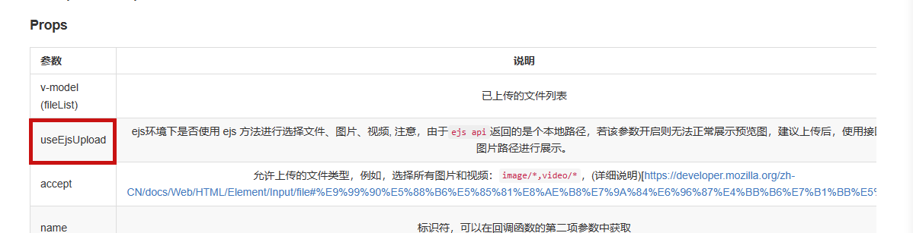
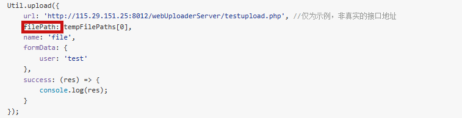

## **处理新点小程序跨域问题**

新点小程序包是一个包含html、js、css等资源的zip压缩包，小程序加载时，小程序容器会先把zip包下载到手机客户端本地，然后解压缩加载，此时 origin为 file:// 导致跨域（浏览器同源安全策略）。

使用原生请求不会携带origin请求头，可将前端请求改为小程序容器原生请求。

1、未使用新点移动前端框架开发新点小程序时，可使用下面俩个小程序API代理为原生请求。

* 原生代理请求接口:ejs.stream.fetch
*  原生容器代理上传文件(标准的表单上传):ejs.stream.uploadMultipartFile

2、使用M8.2新点移动前端框架，可以修改config.js配置项isUseEjsFetchAjax，开启后会自动使用ejs请求代理。但是进行上传附件操作时，需要开发人员对附件的上传单独使用ejs.stream.uploadMultipartFile处理。

 

3、使用M8.3新点移动前端跨端框架，开启config.js配置项isUseEjsFetchAjax，自动使用ejs请求代理。进行上传附件操作使用uploader 组件，将组件属性useEjsUpload设置为true则开启使用ejs方法进行选择文件。使用Util.upload方法进行上传文件。

 

Util.upload上传附件时需使用filePath参数同时兼容H5和ejs平台的附件上传。

 