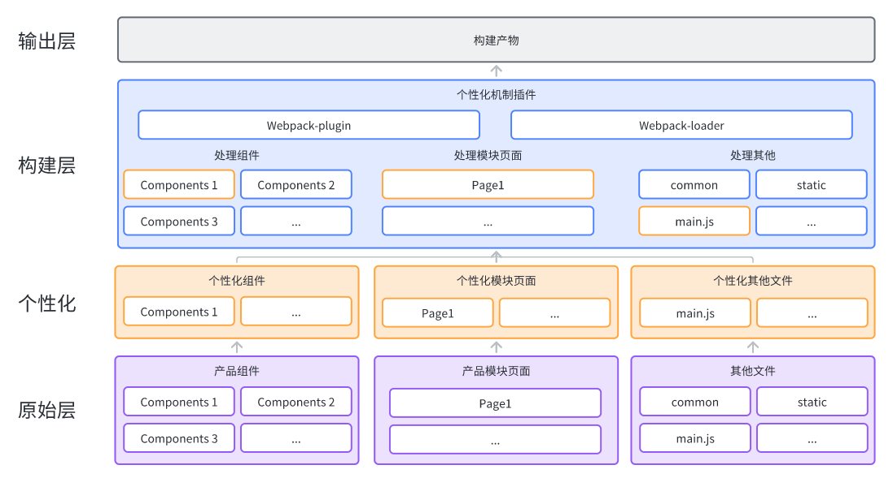

# 移动端二次个性化开发机制


## 背景：

产品与项目开发过程中，会存在一些个性化需求，往往是侵入式修改产品代码，导致产品代码不可维护，升级产品时需要重新修改个性化代码，增加维护成本。

移动前端跨端框架在`v8.3.10`版本之后提供个性化代码隔离方案，可以将个性化代码与产品代码隔离，不侵入产品代码进行个性化修改，便于升级产品时不需要重新修改个性化代码。



::: ifdef M84
## 1.个性化实现路径：

- config.js中提供`isCustomize`配置，配置为`true`时开启个性化功能，默认为`false`

- 移动前端工程下提供`custom`个性化目录，与src目录、node_modules目录同级

- 支持个性化 `src` 目录和 `node_modules/@epoint-mrc` 目录，用于个性化工程代码和框架依赖代码

## 2.个性化功能：

- 代码工程构建时 `src`、`node_modules/@epoint-mrc` 路径下文件与 `custom` 文件匹配，存在同路径同名文件时进行读取 `custom` 文件内容。

## 3.目录结构

```
├── node_modules
│   ├── @epoint-mrc
│   │   ├── em-components
|   │   │   ├── xxx.vue
├── custom                     // 个性化目录
│   ├── src
│   │   ├── pages
│   │   │  ├── index
│   │   │  │   ├── index.vue   // 个性化覆盖代码工程同路径index.vue文件
│   ├── node_modules
│   │   ├── @epoint-mrc
│   │   │  ├── em-components
|   │   │  │   ├── xxx.vue     // 个性化覆盖框架xxx组件
├── src
│   ├── pages
│   │  ├── index
│   │  │   ├── index.vue   // 个性化覆盖代码工程同路径index.vue文件
├── package.json
```


::: endif
::: ifdef M83
## 1.个性化实现路径：

- config.js中提供`isCustomize`配置，配置为`true`时开启个性化功能，默认为`false`

- 移动前端工程下提供`customize`个性化目录，与src目录同级

```bash
ejs.m8.mobileframe
├─build
├─customize   // 新增：个性化开发路径customize
├─public
├─src
├─.editorconfig
├─.eslintignore
├─.eslintrc.js
├─.gitignore
├─plugin.json
├─package.json
├─README.md
└─vue.config.js
```

- 代码工程构建加载src路径下文件时会与`customize`文件进行匹配，存在同路径同名文件时进行**构建过程处理**，不对原始文件进行修改，无需变动页面路由。

<!-- img -->


## 2.个性化文件类型支持功能：

### 2.1 vue文件：

- 支持全局替换

- script支持替换、方法支持重写

- template支持替换

- style支持替换、插入


### 2.2 js文件：

- 支持全局替换

- 支持导入源文件继承修改后导出

### 2.3 css文件：

- 全局替换

- 支持插入


### 2.4 其他文件：

- 全局替换

## 3.个性化文件代码开发：

### 3.1 js文件：

#### 3.1.1 全局替换

默认会将个性化文件替换原始文件。

#### 3.1.2 继承：

支持`import`或`require`源文件，使用`{{@originalFilePath}}`，在构建时框架会将`{{@originalFilePath}}`替换为源文件路径，例如：

```js
// 使用{{@originalFilePath}}，在构建时框架会将{{@originalFilePath}}替换为源文件路径
import  routerDefault from '{{@originalFilePath}}';

routerDefault.routes.push({
    path: 'pages/xxx/xxx', // 注意个性化文件的路径定义仍然为src下的路径
    style: {
        navigationBarTitleText: 'xxx'
    }
});

// 导出路由文件
export default routerDefault;
```

### 3.2 css文件：

在个性化css文件头部添加注释，明确个性化类型。例如全局替换还是插入等。

#### 3.2.1 全局替换

```css
/* {'customMixType': 'global'} */
```

#### 3.2.2 插入

```css
/* {'customMixType': 'append'} */
```

插入类型时，会将个性化css文件插入到原始css文件后面。

### 3.3 vue文件：

#### 3.3.1 全局替换

按照正常开发vue组件，框架会将个性化vue组件替换原始文件。

#### 3.3.2 部分替换

可以单独只写需要替换的SFC部分，只替换对应部分。

例如：

1. 只需要替换template部分，script、style部分不需要修改，无需写script、style部分

```html
<template>
<!-- xxx -->
</template>
```

2. 只需要替换script部分，template、style部分不需要修改，无需写template、style部分

```html
<script>
// xxx
</script>
```

script部分支持重写方法，例如：

```html
<script>
// {{@originalFilePath}}会被替换为源文件路径
import origin from '{{@originalFilePath}}';

export default {
    // 先将原有属性方法继承
    ...origin,
    data() {
        return {
            ...origin.data(),
            // 重写data.title
            title: '页面跳转2'
        };
    },
    methods: {
        ...origin.methods,
        // 重写click方法
        click() {
            // xxx
        }
    }
    // 其他重写类似，对原有属性进行重写
};
</script>
```

3. 只需要替换style部分，script、template部分不需要修改，无需写script、template部分

style部分默认为替换原始css。支持`customMixType`为`append`的属性，`append`会将个性化css插入到原始css后面。

```html
<style scoped  customMixType="append">
/* xxx */
</style>
```

4. 其他文件：

    全局替换

## 示例

对`src/modules/m8showcase/`框架UI组件示例模块进行个性化开发，新增个性化示例页面。

只需在`customize`下新建`customize/modules/m8showcase`目录，对需要个性化的部分进行开发即可。

### 新增路由页面

在`customize/modules/m8showcase`目录下新建`router.js`文件，对路由进行个性化开发。

```js
// 使用@originalFilePath，在构建时框架会将@originalFilePath替换为源文件路径
import  routerDefault from '{{@originalFilePath}}';

routerDefault.routes.push({
    path: 'modules/m8showcase/examples/customize',
    style: {
        navigationBarTitleText: '个性化示例'
    }
});

// 导出路由文件
export default routerDefault;
```

### 修改示例列表页面

在`customize/modules/m8showcase`目录下新建`customize/modules/m8showcase/index.vue`文件，对原有vue进行继承个性化开发。

```html
<script>
import origin from '{{@originalFilePath}}';

export default {
    ...origin,
    data() {
        return {
            ...origin.data(),
            activeNames: [1, 2, 3, 4, 5, 6, 7, 8]
        };
    },
    mounted() {
        this.menu.push({
            title: '个性化示例',
            children: [
                {
                    title: '个性化页面',
                    to: 'examples/customize'
                }
            ]
        });
    }
};
</script>
```

### 新增examples/customize页面

在`customize/modules/m8showcase`目录下新建`customize/modules/m8showcase/examples/customize.vue`文件，新增具体个性化页面内容。
::: endif
