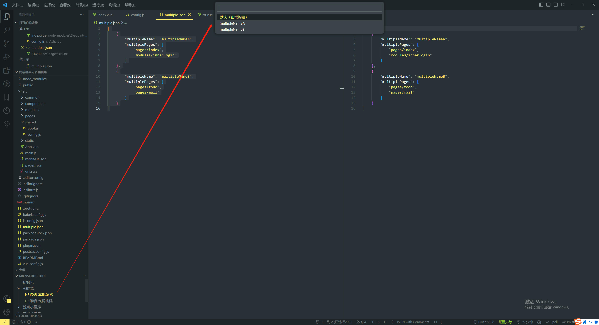

# 移动前端框架H5多模块构建

## 背景

项目产品在开发建设过程中提出希望H5构建能指定模块构建，而不是整个项目构建功能。便于将没有强关联的模块分开构建，便于更新维护。

## 版本支持：

移动跨端框架在`v8.3.11`版本中新增了多模块构建支持。

## 配置方式：

H5多模块构建需要2个配置:

 - config.js中开启配置项`isH5Multiple`;
 - 工程根目录新增`multiple.json`指定多模块名称与对应的具体模块。

 通过配置指定需要一起构建的模块，便于维护。

### config.js配置：

在`src/shared/config.js`中新增了`isH5Multiple`配置项，用于是否开启多模块构建支持。

```js
/**
 * H5下是否开启多模块构建
 */
isH5Multiple: true,
```

### multiple.json配置：

代码工程新增 multiple.json 配置文件，用于定义多模块构建的名称与模块路径：

```json
[
    {
        "multipleName": "multipleNameA",
        "multiplePages": [
            "pages/index",
            "modules/innerlogin"
        ]
    },
    {
        // ...
    }
]
```

`multipleName`为这个多模块的名称，用于构建时选择；
`multiplePages`为这个多模块包含的具体模块，填写`src/pages`或`src/modules`下需要一起构建的模块名称。


## 构建方式：
### VSCode开发插件支持

配置好后，使用VSCode开发插件进行H5应用构建时，会自动识别多模块配置，弹出选择框，选择需要构建的模块，进行构建。



### npm命令行构建：

同样可以使用npm命令构建，新增`multipleName`参数：

本地调试：
```bash
npm run dev:h5 -- --multipleName=multipleNameA --buildType=dev --moduleType=h5
```

本地构建：

```bash
npm run build:h5 -- --multipleName=multipleNameA --buildType=build --moduleType=h5
```

## 构建后资源：
构建后资源仍然在dist目录下，目录结构与正常构建一致。仅会在dist目前下新增一份`multiple.json`文件说明当前构建的多模块信息。

### 批量构建多模块

在`8.3.13`版本中，增加了npm命令：`npm run multiple:all`。用于批量构建配置在`multiple.json`中的多模块。

命令执行后，会自动根据配置的multipleName运行构建脚本，构建后的文件以zip压缩包的形式存放在`dist/build/multiple`目录下。

#### 批量构建zip目录层级
`multiple.json`配置支持配置多模块zip目录层级，配置项为`options.zipDirectory`，用于压缩zip多一层模块层级。配置示例：

```
[
    {
        "multipleName": "multipleNameA",
        "multiplePages": [
            "module"
        ],
        "options": {
            "zipDirectory": "multipleNameA"
        }
    },
    {
        "multipleName": "multipleNameB",
        "multiplePages": [
            "todo",
            "mail"
        ],
        "options": {
            "zipDirectory": "multipleNameB"
        }
    }
]
```
___
## 多模块优缺点：

### 优点：
多模块之间相互隔离，避免改动的内容影响到其他模块。
多模块之间配置内容独立，不影响其他模块。
做到构建相对独立的模块不会互相影响其他多模块的一切功能。

### 缺点：
多模块构建后，在服务端的部署形式，一般变为不同多模块/index.html的形式，例如：

```
frame/H5
  |—— multipleNameA
  |   |—— —— static
  |   |    |—— —— js
  |   |        |—— —— chunk-vendors.[hash].js
  |   |        |—— —— index.[hash].js
  |   |—— —— index.html
  |   |—— —— multiple.json
  |—— multipleNameB
  |   |—— —— ...
  |   |—— —— index.html
  |   |—— —— multiple.json
  |—— multipleNameC
  |   |—— —— ...
  |   |—— —— index.html
  |   |—— —— multiple.json
```

开发人员在开发过程需要理解多模块分包构建后的资源结构形式：
- 多模块之间如果存在页面跳转，需要跳转到对应的多模块目录下的index.html页面搭配对应模块路由地址。
- 当应用为history路由跳转模式时，根据规范要求：
  - 构建时需要指定完整url路由的配置，例如：
    - 当构建多模块multipleNameA时，构建需要指定
      - publicPath为http://ip:port/xx/H5/multipleNameA
      - VueRouter的base为xx/H5/multipleNameA
    - 当构建多模块multipleNameB时，构建需要指定
      - publicPath为http://ip:port/xx/H5/multipleNameB
      - VueRouter的base为xx/H5/multipleNameB
  - 访问不同多模块下的页面，需要服务端响应不同多模块的index.html资源，例如：
    - 当访问http://ip:port/xx/H5/multipleNameA/module/helloworld，服务端需要响应multipleNameA/index.html资源
    - 当访问http://ip:port/xx/H5/multipleNameB/todo/list，服务端需要响应multipleNameB/index.html资源

相比以往H5开发流程，为了多模块互相隔离，一定程度上增加了开发人员的心智负担。即使做成配置项自动生成，仍然需要增加配置开关，开发需要理解了解如何配置完整url前缀，理解改动为多模块相比以往的差异等。

***需要项目产品负责人根据实际情况，权衡多模块构建的优缺点，决定是否使用多模块构建。***

___
如果仅需要更新时只更新修改模块，而不是整个项目，可以考虑使用路由懒加载。将模块路由配置文件router.js中开启分包模式即可。