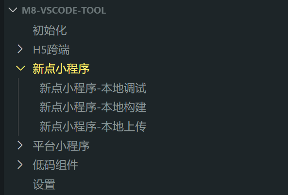
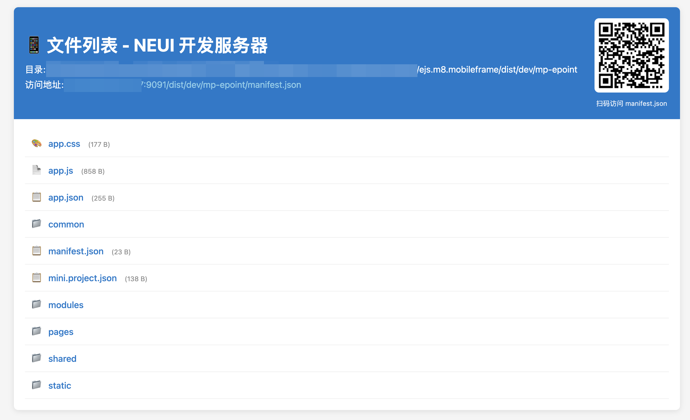

# neui 应用构建

移动前端端框架版本`v8.4.3-beta.0`开始，支持构建新点小程序`neui`应用。

<!-- 移动前端端框架版本`v8.3.11`开始，对接新点小程序 2.0 的 weex 端。`Util`工具库及部分跨端 UI 组件支持 weex 端调用，`EJS`支持 weex 端调用。

## weex 开发注意

与传统 H5 开发相同，跨端框架构建的`weex`应用 css 宽度基准值为`375`，表示根据`750px`的设计稿开发时，css 单位需要除 2。（原生开发需要注意）

跨端框架构建的`weex`应用支持`ejs.page.open`路由跳转，支持`Vuex`进行状态管理。

路由定义、状态管理、组件使用方式、Util使用方式、EJS使用方式与正常开发跨端应用一致。 -->

### NEUI 开发：

NEUI 开发请参考 [NEUI 应用开发指南](https://app.epoint.com.cn/autodeploy/api/7VvmI3)

<!-- 由于移动前端跨端框架基于标准 weex 能力进行构建并且与新点小程序 2.0 容器标准 weex 环境对接，所以不支持 uniapp 特有功能。 -->

<!-- | 组件               | 支持情况 | 备注                                                                                 |
| :----------------- | :------- | :----------------------------------------------------------------------------------- |
| `uniapp`内置组件   | 不支持   |                                                                                      |
| `uniapp`内置 JSSDK | 不支持   |                                                                                      |
| `uniapp`生命周期   | 不支持   |                                                                                      |
| `weex`内置组件     | 支持     | [`weex`官方文档](https://weexapp.com/zh/docs/components/a.html)                      |
| `weex`内置 API     | 支持     |                                                                                      |
| `weex`生命周期     | 支持     |                                                                                      |
| 跨端框架 UI 组件   | 部分支持 | 支持情况[weex 计划表](https://epointfe.feishu.cn/sheets/shtcnbVWr62tIxDWR0XwJFmOd3f) |
| 跨端框架 Util 工具 | 支持     |                                                                                      |
| 跨端框架 ejsapi    | 支持     | [ejsv4 跨端文档](http://app.epoint.com.cn/ejs4mpdoc/index/index.php#page=changelog)  | -->

<!-- ### 条件编译

使用条件编译时，weex 端的平台名称为`app-plus`。 -->

---

## 构建调试

<!-- ### 基于新点小程序 2.0 构建调试 weex 端

跨端框架已内置了 weex 端的示例模块`src/pages/weexapp`，开发者可参考该模块进行开发。 -->

跨端框架构建至新点小程序端已支持新点小程序neui模式，需要在工程根目录下的 `plugin.json` 配置文件中，将模块 miniH5Type 设置为 neui 。

```json
[
    {
        "moduleName": "neui",
        "indexURL": "pages/page1/index",
        "multiplePages": [
            "pages/index",
            "pages/page1"
        ],
        "appId": "neui-appId",
        "miniH5Type": "neui"
    }
]
```

moduleName： 为 neui 应用的构建名称，开发者可自定义，用于 VSCode 插件构建时选择

indexURL： 为 neui 应用的首页地址

multiplePages： 为 neui 应用的需要构建的模块范围，填写的模块路径会收集该模块下的 router 配置进行构建

appId： 为 neui 应用的应用 ID，为 neui 应用的唯一标识。暂时未使用。

miniH5Type 为 neui 应用的类型，固定为 neui

### 插件启动命令

编写完 neui 页面后，使用VSCode开发插件运行新点小程序相关命令，如果小程序plugin.json配置为neui模式，会自动启动 neui 端调试。

#### 调试 && 构建：



构建时仍然选择 新点小程序 下的命令。

选择调试命令构建后，会自动在浏览器中弹出预览二维码。通过支持 neui 应用的 APP 扫描预览。修改代码后会自动增量编译，需要重新刷新 APP 页面访问。



### 手动执行命令

不使用插件的情况下，可以使用以下命令进行编译：

#### 调试：
```
npm run dev:mp-epoint --  --moduleType=mp-epoint-neui  --moduleName=neui --buildType=dev
```

#### 构建：
```
npm run build:mp-epoint --  --moduleType=mp-epoint-neui  --moduleName=neui --buildType=build
```

#### 条件编译

可以使用`uniapp`提供的[条件编译](https://uniapp.dcloud.net.cn/tutorial/platform.html#%E4%BD%BF%E7%94%A8%E6%96%B9%E6%B3%95)功能，在构建时根据不同的平台配置不同的代码，在`neui`应用中可以使用`MP_EPOINT`变量来判断当前平台。

```js
// #ifdef MP-EPOINT
    xxx
// #endif
```

在`neui`应用中，`%PLATFORM%`变量的值为`MP-EPOINT`，表示当前平台为NEUI新点小程序。

