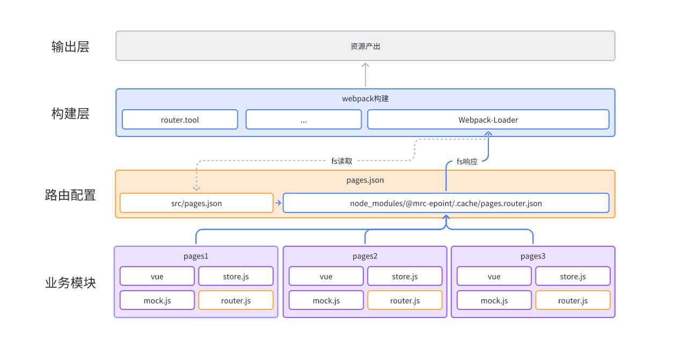

# 多人协同pages.json冲突解决方案

移动前端跨端框架`v8.3.10`支持

## 1. 背景

产品项目反馈，在使用跨端框架开发过程中，跨端框架的路由管理文件pages.json是根据各模块下的router.js自动编译合并的。
当多人一起重构新模块时，每个人本地模块不同，pages.json编译的不一样，当有人提交这个pages.json，代码拉取、提交会导致冲突。

## 2. 解决方案

- pages.json不再生成路由pages和分包路由subPackages信息。路由配置仍然根据各模块下router.js配置生效。
- 在构建流程之前框架会预处理路由文件，单独生成至node_modules/@epoint-mrc/.cache/pages.router.json。不对代码工程版本管理暴露。开发过程仍然保持响应模块下的router.js改动自动生成。
- 对构建过程中的fs引用代理，监听如果读取src/pages.json内容时响应node_modules/@epoint-mrc/.cache/pages.router.json内容。

## 3. 示意图：

