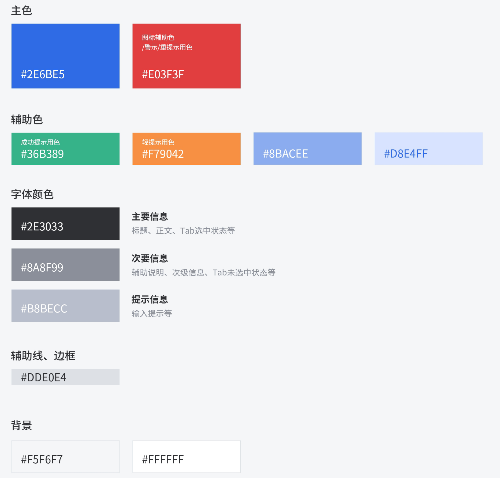

# SCSS变量

    跨端框架scss变量位置为src/uni.scss

M8移动前端框架默认已经引用，可以直接在scss样式中使用。

文件的用途是为了方便整体控制应用的风格。比如按钮颜色、边框风格。文件里根据移动设计规范2.0，定义了一scss变量预置。

跨端框架内置的UI组件都使用了这些变量。

## 定义scss变量文件路径：

```
ejs.m8.project
    ├── src
    │   ├── uni.scss                         scss变量定义
```

## scss变量：

```scss
/* 颜色变量 */

/* 行为相关颜色 */
$uni-color-primary: #2e6be5;
$uni-color-success: #36B389;
$uni-color-warning: #f79042;
$uni-color-error: #e03f3f;
$black: #000;

/* 文字基本颜色 */
$uni-text-color:#2E3033;//基本色
$uni-text-color-inverse:#fff;//反色
$uni-text-color-grey:#999;// 辅助灰色，如加载更多的提示信息
$uni-text-color-placeholder: #b8becc;
$uni-text-color-disable:#8a8f99;

/* 背景颜色 */
$uni-bg-color:#ffffff;
$uni-bg-color-grey:#f5f6f7;
$uni-bg-color-hover:#f1f1f1;//点击状态颜色
$uni-bg-color-mask:rgba(0, 0, 0, 0.6);//遮罩颜色
$uni-bg-color-blue: #d8e4ff; //基座常用辅助色


/* 边框颜色 */
$uni-border-color:#dde0e4;

/* 尺寸变量 */

/* 文字尺寸 */
$uni-font-size-sm:12px;
$uni-font-size-base:14px;
$uni-font-size-lg:16px;

$font-weight-bold: 500;
$line-height-xs: 14px;
$line-height-sm: 18px;
$line-height-md: 20px;
$line-height-lg: 22px;

/* 图片尺寸 */
$uni-img-size-sm:20px;
$uni-img-size-base:26px;
$uni-img-size-lg:40px;

/* Padding */
$padding-base: 4px;
$padding-xs: $padding-base * 2;
$padding-sm: $padding-base * 3;
$padding-md: $padding-base * 4;
$padding-lg: $padding-base * 6;
$padding-xl: $padding-base * 8;

/* Border Radius */
$uni-border-radius-sm: 2px;
$uni-border-radius-base: 3px;
$uni-border-radius-lg: 6px;
$uni-border-radius-circle: 50%;

/* 水平间距 */
$uni-spacing-row-sm: 5px;
$uni-spacing-row-base: 10px;
$uni-spacing-row-lg: 15px;

/* 垂直间距 */
$uni-spacing-col-sm: 4px;
$uni-spacing-col-base: 8px;
$uni-spacing-col-lg: 12px;

/* 透明度 */
$uni-opacity-disabled: 0.3; // 组件禁用态的透明度

/* 文章场景相关 */
$uni-color-title: #2C405A; // 文章标题颜色
$uni-font-size-title:20px;
$uni-color-subtitle: #555555; // 二级标题颜色
$uni-font-size-subtitle:18px;
$uni-color-paragraph: #3F536E; // 文章段落颜色
$uni-font-size-paragraph:15px;

// Animation，组件库额外添加的变量，动画相关
$animation-duration-base: 0.3s;
$animation-duration-fast: 0.2s;
$animation-timing-function-enter: ease-out;
$animation-timing-function-leave: ease-in;

```

## scss变量使用

直接在vue组件的style标签中使用：

```html
<!-- css部分 -->
<style lang="scss" scoped>
h1 {
    color: $baseBlue
}
</style>

```

## 颜色规范



<style>
img {
    width: 900px
}
</style>
