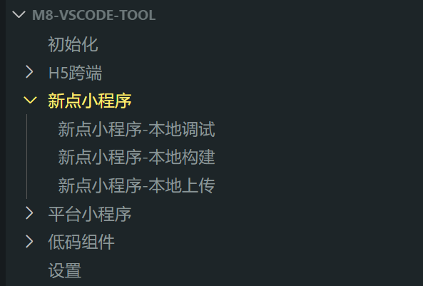

# weex 应用构建

移动前端端框架版本`v8.3.9`开始，支持构建标准`weex`应用。

移动前端端框架版本`v8.3.11`开始，对接新点小程序 2.0 的 weex 端。`Util`工具库及部分跨端 UI 组件支持 weex 端调用，`EJS`支持 weex 端调用。

## weex 开发注意

与传统 H5 开发相同，跨端框架构建的`weex`应用 css 宽度基准值为`375`，表示根据`750px`的设计稿开发时，css 单位需要除 2。（原生开发需要注意）

跨端框架构建的`weex`应用支持`ejs.page.open`路由跳转，支持`Vuex`进行状态管理。

路由定义、状态管理、组件使用方式、Util使用方式、EJS使用方式与正常开发跨端应用一致。

### 框架能力支持情况：

由于移动前端跨端框架基于标准 weex 能力进行构建并且与新点小程序 2.0 容器标准 weex 环境对接，所以不支持 uniapp 特有功能。

| 组件               | 支持情况 | 备注                                                                                 |
| :----------------- | :------- | :----------------------------------------------------------------------------------- |
| `uniapp`内置组件   | 不支持   |                                                                                      |
| `uniapp`内置 JSSDK | 不支持   |                                                                                      |
| `uniapp`生命周期   | 不支持   |                                                                                      |
| `weex`内置组件     | 支持     | [`weex`官方文档](https://weexapp.com/zh/docs/components/a.html)                      |
| `weex`内置 API     | 支持     |                                                                                      |
| `weex`生命周期     | 支持     |                                                                                      |
| 跨端框架 UI 组件   | 部分支持 | 支持情况[weex 计划表](https://epointfe.feishu.cn/sheets/shtcnbVWr62tIxDWR0XwJFmOd3f) |
| 跨端框架 Util 工具 | 支持     |                                                                                      |
| 跨端框架 ejsapi    | 支持     | [ejsv4 跨端文档](http://app.epoint.com.cn/ejs4mpdoc/index/index.php#page=changelog)  |

### 条件编译

使用条件编译时，weex 端的平台名称为`app-plus`。

---

## 构建调试

### 基于新点小程序 2.0 构建调试 weex 端

跨端框架已内置了 weex 端的示例模块`src/pages/weexapp`，开发者可参考该模块进行开发。

跨端框架构建至新点小程序端已支持新点小程序2.0-weex模式，需要在工程根目录下的 `plugin.json` 配置文件中，将模块 miniH5Type 设置为 weex 。

```json
[
    {
        "moduleName": "weexapp",
        "indexURL": "index.js",
        "appId": "weex-38922651",
        "version": "0.0.1",
        "miniH5Type": "weex"
    }
]
```

### 插件启动命令

编写完 weex 页面后，使用VSCode开发插件运行新点小程序相关命令，如果小程序plugin.json配置为weex模式，会自动启动 weex 端调试。

#### 调试 && 构建：



### 手动执行命令

不使用插件的情况下，可以使用以下命令进行编译：

#### 调试：
```
npm run dev:app-plus --  --moduleType=mp-epoint-weex  --moduleName=weexapp --buildType=dev
```

#### 构建：
```
npm run build:app-plus --  --moduleType=mp-epoint-weex  --moduleName=weexapp --buildType=build
```

编译完成后会自动在浏览器中弹出预览二维码，可通过 [Weex Playground](https://weexapp.com/zh/guide/playground.html) 进行扫码预览。也支持使用公司的测试 OA 进行扫码预览，在公司 OA 中预览时，需要在工程根目录下的 `plugin.json` 配置文件中，设置应用的相关信息，尤其是`appid`。

调试时，可参照 weex 官方介绍的调试工具进行调试：[weex debug](https://weexapp.com/zh/guide/debug/debug.html)

### 纯 weex 应用构建调试

如果需要开发纯weex应用（非对接的新点小程序2.0weex端），仅能使用纯weex相关功能和跨端UI组件功能。

| 组件               | 支持情况 | 备注                                                                                 |
| :----------------- | :------- | :----------------------------------------------------------------------------------- |
| `weex`内置组件     | 支持     | [`weex`官方文档](https://weexapp.com/zh/docs/components/a.html)                      |
| `weex`内置 API     | 支持     |                                                                                      |
| `weex`生命周期     | 支持     |
| 跨端框架 UI 组件   | 部分支持 | 支持情况[weex 计划表](https://epointfe.feishu.cn/sheets/shtcnbVWr62tIxDWR0XwJFmOd3f) |

(由于当前跨端框架内置的其他模块不符合 weex 写法，编译到 weex 端无法正常预览，当前需要指定模块编译，排除其他模块干扰)

使用以下命令进行编译：

#### 调试：
```
npm run dev:app-plus -- --moduleName=weexapp --moduleType=weex
```

#### 构建：
```
npm run build:app-plus -- --moduleName=weexapp --moduleType=weex
```