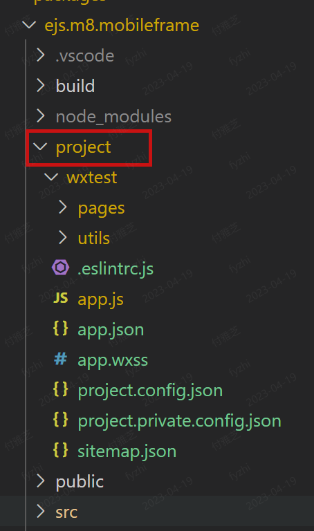
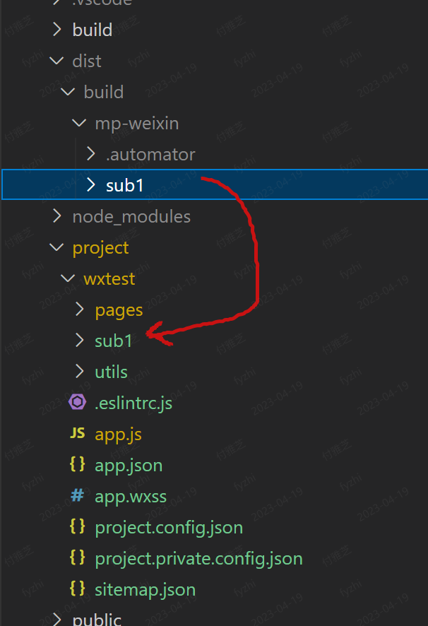
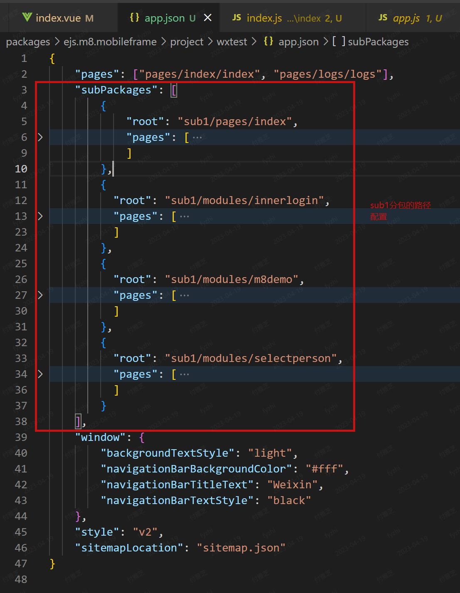
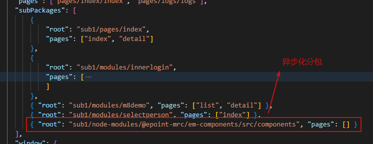

# 与原生小程序项目融合

## 背景：

有些老项目是由小程序原生代码开发，现在需要做新增功能并且同时接入第三方，这种情况下为了方便跨端开发的新功能可以正常接入老项目，需要能够把老的原生小程序整合到跨端框架里，保持一套代码。

## 支持的平台项目

- 原生微信小程序项目

- 原生支付宝小程序项目

## 步骤

总体方案就是将跨端框架开发的项目作为老项目的一个分包接入。

以下以一个微信小程序示例进行介绍：

1. 首先在项目根目录新建`project`目录，用于存放原生老项目：



2. 然后运行以下命令，将跨端项目打包为一个微信小程序分包:

其中`sub1`为分包名，可自行定义

```
npm run build:mp-weixin -- --subpackage=sub1
```

3. 打包完成后，将该分包拷贝至老项目根目录下：



4. 手动将分包配置添加到老项目的`app.json`中:



注意，如果项目开启了异步化分包，需要额外在`app.json`中添加异步化分包的路径：



默认的跨端组件库异步分包路径为(以微信小程序为例, `${sub-name}`为项目分包名)：

`${sub-name}/node-modules/@epoint-mrc/em-components/src/components`

`${sub-name}/node-modules/@epoint-mrc/em-components/src/sub_components`

5. 用微信开发者工具打开该老项目测试效果。

## 注意

1. 跨端项目打包成一个分包后，`App.vue`中的`onLaunch`会在首次进入该分包时触发。

2. 跨端开发时需要将资源(图片，css，js等)、页面的绝对路径调整为相对路径，否则打包到原生小程序中时，可能出现路径查找错误。

3. 最后请注意下融合后的项目是否符合各家小程序平台对包大小的限制：

  - 微信小程序：整个小程序所有分包大小不超过 20M，单个分包/主包大小不能超过 2M

  - 支付宝小程序：整个小程序所有分包大小不超过 8MB，单个分包或主包大小不能超过 2MB。
