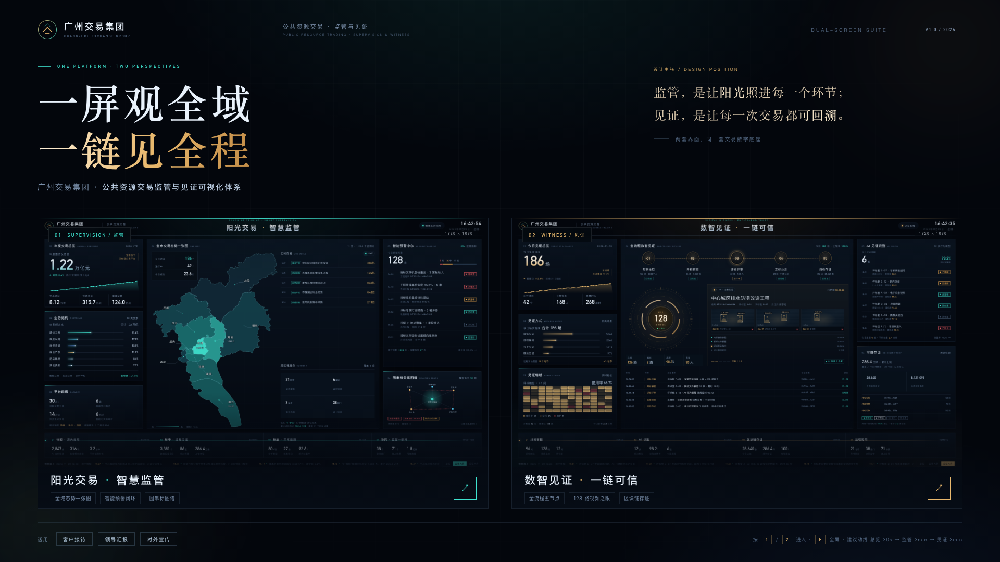

# 广州交易集团 · 监管与见证双大屏

> 来源：微信文件（2026-11-09），`归档.zip`（初版）+ `归档(1).zip`（完善版）。
> 用途：**设计思路参考案例**——后续做交易/监管/见证类大屏没思路时，先看这里。

## 一句话

两套 1920×1080 大屏：监管屏讲**全域监管**（阳光隐喻，冷青），见证屏讲**全程见证**（镜头/眼睛隐喻，暖金），统一深墨底色与栅格，面向客户接待、领导汇报、对外宣传。

## 文件导航

| 内容 | 位置 | 说明 |
|---|---|---|
| 完善版原型（推荐先看） | [原型-v2-完善版/index.html](原型-v2-完善版/index.html) | 双击打开，F 全屏；截图加 `?static=1` 关动画 |
| 完善版设计说明 | [原型-v2-完善版/README.md](原型-v2-完善版/README.md) | 设计主张、信息结构、视觉系统、演示脚本、数据口径 |
| 监管大屏截图 | [原型-v2-完善版/screenshots/regulatory.png](原型-v2-完善版/screenshots/regulatory.png) | 阳光交易 · 智慧监管 |
| 见证大屏截图 | [原型-v2-完善版/screenshots/witness.png](原型-v2-完善版/screenshots/witness.png) | 数智见证 · 一链可信 |
| 初版设计方案（docx） | [原型-v1-初版/监管大屏与见证大屏设计方案.docx](原型-v1-初版/监管大屏与见证大屏设计方案.docx) | **标杆案例对标表、指标口径表、落地五步**最有价值 |
| 初版原型（科技蓝风格） | [原型-v1-初版/index.html](原型-v1-初版/index.html) | 单文件离线 HTML，可对比两版设计演进 |

## 可复用的设计思路（没思路时看这里）

### 1. 定位与叙事
- **一屏一主题**：监管屏讲"规模 + AI 治理成效"，见证屏讲"全链条零盲区 + 可信追溯"，两屏不做成同一套图表。
- **双隐喻一眼区分**：监管=阳光（冷青 `#3fe3cf`）、见证=镜头/眼睛（暖金 `#e9b96e`）；底色/字号/栅格/页头页脚完全一致 → 观众一眼知道是"一套系统"。
- **信息架构优先于视觉**：先列领导/客户高频问题，再定指标与下钻路径，避免"大屏堆图"。

### 2. 结构套路（可直接套用）
- **一张图**（监管屏中栏地图）：回答"空间上发生了什么"。
- **一条链**（见证屏五节点：专家抽取→开标解密→评标评审→定标公示→归档存证）：回答"流程走到哪一步"。
- **一个闭环**（底部能力条：标前→标中→标后→协同 / 预警→核实→整改→应用）：回答"发现问题之后怎么办"。
- 每一栏只回答一个问题：家底（年度总览）、钱从哪来（业务结构）、平台多强（能级）、风险怎么发现（预警中心）、围串标怎么识别（关系图谱）。

### 3. 反同质化避坑清单
公共资源交易大屏的通病：蓝紫渐变、3D 城市、指标堆砌、流光粒子、"科技感"牺牲可读性。本案例反向处理：
- 深墨底 `#03060c` + 单一强调色，做"精密仪表盘"不做"晚会舞台"；
- 用真实行政区边界（DataV GeoJSON 简化）做平面热力，不做 3D；
- 动效只用三种（扫描线、脉冲、刻度环），全部服务于"正在发生"。

### 4. 数据口径纪律（防汇报翻车）
- **数据属性三色标签**：每个面板右上角固定标注"实际成效（绿）/ 方案能力（蓝）/ 版式示意（琥珀）"，防止把演示数据误读为真实统计。
- 口径不可混用：集团官网全要素口径（累计 14 万亿+、30 万+主体）与粤公平公共资源口径分开标注来源。
- 演示值内部关系自洽（如 96+42+30+18=186 场、126 在线+2 离线=128 路），README 附"接真实数据时改哪里"的字段级对照表（`data-to`/`data-w`/`districts`/`.live-row`/`.ticker-track`）。

### 5. 合规与工程细节
- **演示模式 / 实战模式双开关**：对外接待默认演示模式；音视频画面、专家姓名轨迹、投标主体信息按权限脱敏，保留查看与下钻留痕。
- 1920×1080 固定舞台 `transform: scale()` 等比缩放；`?static=1` 关闭动画写终值保证截图一致；单文件/无 CDN 依赖可离线；数字用 DIN/等宽 + `tabular-nums`；3 米可读字号；页脚事件 ticker + 实时时钟。

### 6. 演示脚本（5 分钟动线）
开场 30s（总览页"两块屏回答两个问题"）→ 监管屏 2min（家底→结构→地图一张图→预警讲围串标→底部闭环收尾）→ 见证屏 2min（今日场次→五节点链→见证之眼→当前见证"正在发生"→上链存证"改不了赖不掉"）→ 收尾 30s（"监管讲全域、见证讲全程；一个用阳光、一个用镜头"）。

### 7. 上线五步（初版方案）
数据接入（字段级血缘、统一时间口径）→ 口径校准（12 类"示意"图表换真实数据）→ 权限与脱敏 → 交互深化（三视角独立页 + 下钻穿透）→ 现场实测（拼接缝/亮度/3米字号/讲解动线）。

## 对标案例速查（做别家大屏可直接翻）

| 案例 | 可借鉴点 |
|---|---|
| 南阳 数字智慧指挥舱 | 三视角切换（总览/项目/现场）、场地使用频率、电子见证书+二维码 |
| 湖北鹤峰 | 驾驶舱+大屏+子系统三件套、1800㎡ 四区三室 21 机位 |
| 湖北咸宁 | 数据固化—活动见证—智能预警—在线出证—大屏可视 五模块闭环 |
| 南昌 | 语音转文字抓倾向性言论、人脸+轨迹、开标 30→15 分钟 |
| 焦作 招标人服务舱 | "一室两屏三人"：展示屏讲效果、控制屏讲能力 |
| 鄂尔多斯 | 专家轨迹实时滚动、三重核验、方言识别 |
| 常州武进 GUI 专利 | 关联图谱+冒烟分值量化风险、20+ 指标一屏收敛 |
| 山东临清 | 项目/金额/地域/行业结构图表化 |
| 河南/江苏/浙江/山东/包头 | 见证方式四分类、异常行为模型、跨部门协同、一图统管、AI+人工复核 |

## 关键参考口径（v2 README 摘录）

- 公开可核对：历史累计 14 万亿+、活跃主体 30 万+、场所 6 万㎡+、六级服务；2026 年 1-10 月增值 124.03 亿、节约 315.67 亿；异常行为平台 80+ 预警指标、3381 个项目；AI 合规检测 137 检测点+22 提醒点、3-5 分钟出报告；穗智链+广智链 38 部门 71 场景。
- 注意：大屏当前数字均为**演示数据**，"年度累计 1.22 万亿"为估算演示值，接实时接口后替换。

## 已知边界（v2 README）

未接真实业务库与视频流（占位帧）；16:9 固定缩放，超宽屏留黑边；Chrome 已验证，Firefox/Safari 未测。上生产优先三件事：接实时数据、接视频流、预警工单闭环打通。
