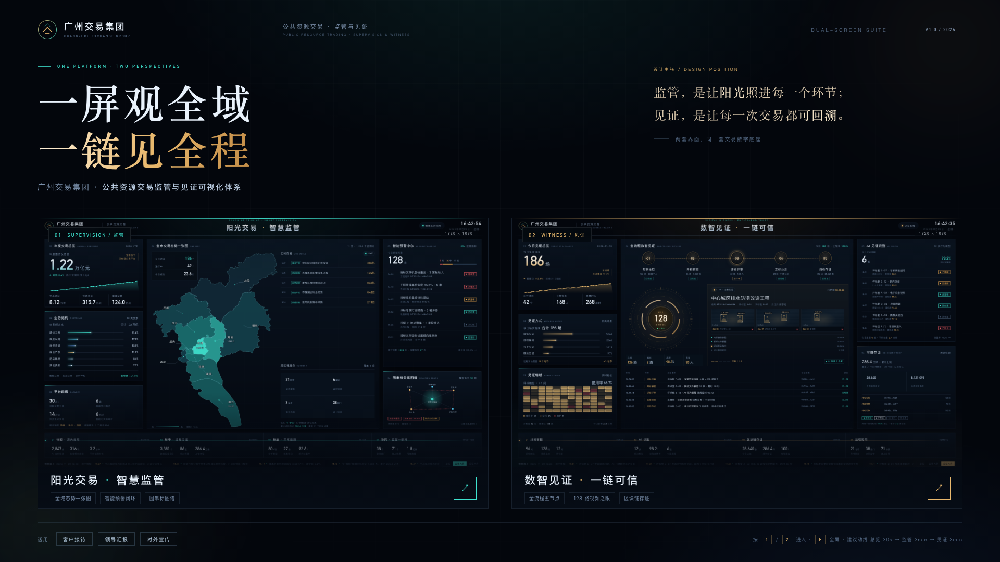
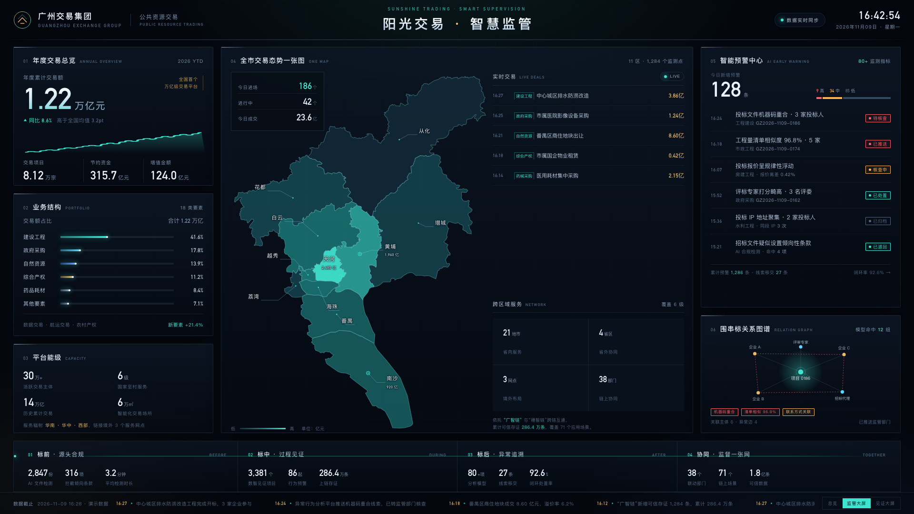
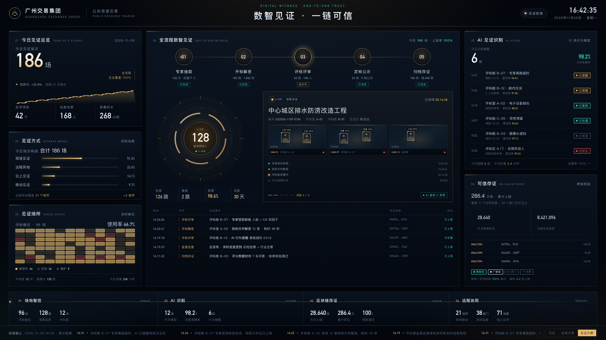

# 广州交易集团 · 监管与见证双屏

两套 1920×1080 可视化界面，一套讲**全域监管**，一套讲**全程见证**。
共用深墨底色与同一套数据叙事，面向客户接待、领导汇报与对外宣传。

- `index.html` — 双屏总览 / 接待开场
- `regulatory-dashboard.html` — 阳光交易 · 智慧监管
- `witness-dashboard.html` — 数智见证 · 一链可信



---

## 一、怎么看

直接双击 `index.html`，建议用 Chrome / Edge。

| 操作 | 作用 |
| --- | --- |
| 点击卡片 / 按 `1` | 进入监管大屏 |
| 点击卡片 / 按 `2` | 进入见证大屏 |
| `F` | 全屏 / 退出全屏 |
| 底部 `总览 / 监管大屏 / 见证大屏` | 三页互跳 |

交付截图时在 URL 后加 `?static=1`，会关闭所有入场动画并直接写入终值，保证每次截图一致：

```text
regulatory-dashboard.html?static=1
witness-dashboard.html?static=1
```

现场演示不要加 `static`，数字滚动、扫描线、光圈旋转和底部 ticker 才会动。

---

## 二、设计主张

### 1. 两个隐喻，一眼区分

| | 监管大屏 | 见证大屏 |
| --- | --- | --- |
| 隐喻 | **阳光** | **镜头 / 眼睛** |
| 主色 | 冷青 `#3fe3cf` | 暖金 `#e9b96e` |
| 核心图形 | 广州 11 区热力地图 | 128 路视频之眼 |
| 叙事 | 全域态势 + 风险闭环 | 全流程节点 + 链上存证 |
| 一句话 | 让阳光照进每一个环节 | 让每一次交易都可回溯 |

两屏放在一起，冷青与暖金形成互补，但底色、字号、栅格、页头页脚完全一致，观众一眼知道是"一套系统"。

### 2. 反同质化

公共资源交易领域的大屏，常见问题是：蓝紫渐变、3D 城市、指标堆砌、流光粒子、为了"科技感"牺牲可读性。

本项目刻意反向处理：

- **不用蓝紫**：深墨底 `#03060c` + 单一强调色，接近精密仪表盘，而不是晚会舞台。
- **不做 3D**：用真实行政区边界做平面热力，信息密度更高，领导看得懂。
- **不堆指标**：每一栏只回答一个问题，指标之间有业务关系。
- **装饰克制**：只有扫描线、脉冲、刻度环三种动效，全部服务于"正在发生"。

### 3. 三个统一结构

- **一张图**：监管屏的广州地图，回答"空间上发生了什么"。
- **一条链**：见证屏的五节点，回答"流程上走到哪一步"。
- **一个闭环**：两屏底部的能力条，回答"发现问题之后怎么办"。

---

## 三、监管大屏



### 信息结构

```text
页头：品牌 / 标题 / 数据同步状态 / 实时时钟
左栏：01 年度交易总览   02 业务结构   03 平台能级
中栏：04 全市交易态势一张图（地图 + KPI + 实时交易 + 跨区域服务）
右栏：05 智能预警中心   06 围串标关系图谱
底部：标前合规 → 标中见证 → 标后追溯 → 协同监督（四段闭环）
页脚：数据截止 + 实时事件 ticker + 三页导航
```

### 每一栏回答什么

- **01 年度总览**：家底有多大。年度累计交易额、项目数、节约资金、增值金额，加一条 12 个月趋势线。
- **02 业务结构**：钱从哪里来。建设工程、政府采购、自然资源、综合产权、药品耗材、其他要素的占比。
- **03 平台能级**：平台有多强。30 万+ 活跃主体、国家省市县镇村六级服务、14 万亿历史累计、6 万㎡ 场所。
- **04 一张图**：空间上在哪里。11 区热力、今日进场/进行中/成交、5 条实时交易、21 地市/4 省区/3 网点/38 部门。
- **05 预警中心**：风险怎么发现。今日 128 条，高/中/低分布，6 条具体事件，闭环率 92.6%。
- **06 关系图谱**：围串标怎么识别。投标人、评委、代理机构之间的关系边，命中"机器码重合 / 清单相似 96.8% / 联系方式关联"。

### 关键设计细节

- 地图用真实广州 11 区边界（DataV GeoJSON 简化），不是手绘轮廓；天河默认高亮，配脉冲点表示"当前焦点"。
- 地图标签用暗色投影而不是描边，避免小字号被描边吃掉字芯。
- 预警行的标题与副标题强制两行，副标题带项目编号，保证"事件可追"。
- 底部四段不是普通统计，而是按**标前 / 标中 / 标后 / 协同**的时间逻辑排列，和监管业务流程一一对应。

---

## 四、见证大屏



### 信息结构

```text
页头：品牌 / 标题 / 见证在线状态 / 实时时钟
左栏：01 今日见证总览   02 见证方式   03 见证场所
中栏：04 全流程数智见证
      ├─ 五节点链：专家抽取 → 开标解密 → 评标评审 → 定标公示 → 归档存证
      ├─ 见证之眼：128 路视频接入，126 在线 / 2 离线，98.6% 高清
      ├─ 当前见证：中心城区排水防涝改造工程，3 路 CAM + 人形检测框 + 节点日志
      └─ 存证记录：5 条哈希、状态
右栏：05 AI 见证识别   06 可信存证
底部：场地智控 / AI 识别 / 区块链存证 / 远程协同（四段能力）
页脚：数据截止 + 实时事件 ticker + 三页导航
```

### 每一栏回答什么

- **01 今日总览**：今天见证了多少。186 场、42 个在评、168 位在舱专家、268 小时录像，加 21 日增长曲线。
- **02 见证方式**：怎么见证。现场 96、远程异地 42、云上 30、移动 18，四类场景一眼看清结构。
- **03 见证场所**：在哪里见证。96 个评标舱位点阵（64 使用 / 24 空闲 / 8 维护），12 间开标室、128 路摄像头。
- **04 全流程**：凭什么可信。五个节点 + 当前项目 + 视频画面 + 存证表，把"一场交易"完整讲完。
- **05 AI 识别**：机器看到了什么。6 起提醒、98.2% 准确率，专家离舱超时、舱内交谈、电子设备疑视、摄像头遮挡等。
- **06 可信存证**：数据怎么不可篡改。286.4 万条累计、今日 28,640 条、区块高度 8,421,096，穗智链 + 广智链跨链。

### 关键设计细节

- **见证之眼**是整个屏的视觉记忆点：同心刻度环 + 三段金弧 + 中心 128 路视频接入，像镜头，也像光圈。
- 当前见证卡片里的 3 路 CAM 不是静态图，而是带**人形检测框、扫描线、时间戳、录像红点**的"正在发生"。
- 五节点链的 03 节点处于"进行中"，用金色脉冲和"进行中"标签，其他节点"已完成"，形成时间感。
- 右栏 AI 提醒用"行为 + 置信度 + 状态"三件套，避免只报一个红点。
- 存证表的哈希值做截断（`0x7f3a…9c21`），既真实又不喧宾夺主。

---

## 五、视觉系统

### 色彩

| Token | 值 | 用途 |
| --- | --- | --- |
| `--bg-0` | `#03060c` | 全屏底色 |
| `--teal` | `#3fe3cf` | 监管主色、在线、已处置 |
| `--gold` | `#e9b96e` | 见证主色、进行中、关键数字 |
| `--red` | `#ff6168` | 高风险、待核查 |
| `--amber` | `#ffb454` | 中风险、核查中 |
| `--green` | `#4ade9b` | 正常、已上链、0 异常 |
| `--ink` | `#e9f2fc` | 主文字 |
| `--muted` | `#7f95b1` | 次级文字 |
| `--dim` | `#536883` | 辅助说明 |

### 字体与数字

- 中文：PingFang SC / 思源黑体，字重 400–500，标题字距略放大。
- 数字：DIN Alternate / Bahnschrift，等宽感，适合大字号 KPI。
- 主 KPI 52–62px，区块标题 15px，正文 10–12px，标签 8–9px。大屏上"远看有重点，近看有细节"。

### 栅格

- 固定舞台 1920×1080，`transform: scale(min(vw/1920, vh/1080))` 等比缩放。
- 页头 84px，主区 812px，页脚 46px，栏间距 24px，面板内边距 16–20px。
- 左栏 420px，右栏 420px，中栏自适应；中栏内部再用 1.55 : 1 分"眼睛 / 当前见证"。

### 动效

- 数字滚动：`countUp`，1.4s ease-out。
- 条形生长：`[data-w]` 宽度过渡。
- 扫描线：当前见证画面自上而下 6s 循环。
- 光圈旋转：见证之眼三层不同速度反向旋转。
- ticker：页脚事件循环滚动。
- `?static=1` 会关闭全部动画并写入终值，用于截图与评审。

---

## 六、数据说明（重要）

**当前所有数字均为演示数据**，按公开资料与合理业务比例构造，用于界面设计与汇报演示，不应作为真实经营数据对外披露。

可核对的公开口径：

- 历史累计交易额 14 万亿元+、活跃交易主体 30 万家+、场所面积 6 万㎡+、服务国家/省/市/区（县）/镇（街）/村六级。
- 2026 年 1–10 月：增值金额 124.03 亿元、节约资金 315.67 亿元。
- 广州招投标异常行为分析平台：80 余项预警指标、2025 年以来 3,381 个电子评标项目检测。
- AI 合规检测平台：137 个合规检测点 + 22 个关键信息提醒点、3–5 分钟出审查报告。
- "穗智链"+"广智链"：38 个政府部门、71 个应用场景。

演示值中需要特别注意的：

- 监管屏"年度累计交易额 1.22 万亿元"是按公开增速与区域结构估算的**年度演示值**，不是官方发布值；接入实时接口后应替换。
- 地图 11 区数值合计 1.22 万亿，与年度总览对齐；各区比例参考经济总量与交易活跃度，非真实分区统计。
- 见证屏 186 场、96 舱位、128 路摄像头、286.4 万条存证为演示口径，但内部关系自洽（96+42+30+18=186，64+24+8=96，126 在线+2 离线=128）。

### 接真实数据时改哪里

| 数据 | 位置 | 方式 |
| --- | --- | --- |
| 大 KPI | 带 `data-to` 的元素 | 改 `data-to` / `data-dec`，或接口写入后调用 `countUp` |
| 条形 | `[data-w]` | 改百分比 |
| 地图 | `assets/gz-map.js` + 页面内 `districts` 数组 | 替换 `value` / `projects` |
| 实时交易 / 预警 / 存证 | 页面内 `<div class="live-row">`、`.alert-row`、`.rec-row` | 模板渲染 |
| ticker | `.ticker-track` | 消息总线追加 |
| 视频 | `.cam` 占位帧 | 换成 `<video>` + hls.js / WebRTC |

---

## 七、演示脚本（建议 5 分钟）

### 0:00–0:30 开场（总览页）

> "广州交易集团服务国家、省、市、区、镇、村六级，历史累计交易额超过 14 万亿。今天用两块屏，回答两个问题：**监管，怎么让阳光照进每一个环节；见证，怎么让每一次交易都可回溯。**"

### 0:30–2:30 监管屏

1. 先看左上"年度累计交易额 1.22 万亿"——家底。
2. 再看业务结构——建设工程 41.6%、政府采购 17.8%、自然资源 13.9%，说明这是全要素平台。
3. 目光移到地图——11 区热力、今日进场 186、进行中 42、成交 23.6 亿，"一张图看全市"。
4. 右栏预警——今日 128 条，高 9 条，点一条"机器码重合"，说明 AI 怎么发现围串标。
5. 最后指底部——标前、标中、标后、协同，**发现不是终点，闭环才是**。

### 2:30–4:30 见证屏

1. 左上 186 场——今天正在见证的交易。
2. 中间五节点——专家抽取、开标解密、评标评审、定标公示、归档存证，"一场交易，五个节点，全程留痕"。
3. 见证之眼——128 路视频接入，126 在线，AI 识别 12 类行为，98.2% 准确率。
4. 当前见证——中心城区排水防涝改造工程，3 路画面、人形检测框、节点日志，"这不是录像，是正在发生的见证"。
5. 右下存证——286.4 万条上链、区块高度 842 万，穗智链 + 广智链跨链，"改不了、赖不掉"。

### 4:30–5:00 收尾

> "监管屏讲**全域**，见证屏讲**全程**；一个用阳光，一个用镜头。两屏合起来，就是广州交易集团'阳光、规范、智慧、高效'的数字表达。"

---

## 八、设计对标

| 案例 | 借鉴点 | 本项目处理 |
| --- | --- | --- |
| 河南"数字见证 + 云见证" | 见证方式分类 | 现场 / 远程 / 云上 / 移动四类，占比 + 场次 |
| 湖北黄石闭环见证 | 全流程闭环 | 五节点链 + 存证表 + 底部能力条 |
| 江苏"阳光四季" | 异常行为模型 | 机器码、清单相似度、报价规律性、IP 聚集 |
| 山东"云智"监管 | 一图统管 | 广州 11 区真实边界 + 实时交易流 |
| 浙江"平台+信用+联动" | 跨部门协同 | 38 部门 / 71 场景 / 1.8 亿条 |
| 包头"人机协同" | AI + 人工复核 | AI 提醒 + 见证员 + 监督席三级 |

没有照搬的：蓝紫渐变、3D 城市、环形指标墙、无意义的粒子和流光。

---

## 九、文件结构

```text
output/
├── index.html                  双屏总览
├── regulatory-dashboard.html   监管大屏
├── witness-dashboard.html      见证大屏
├── assets/
│   ├── theme.css               色彩、面板、表格、ticker、动效
│   ├── core.js                 缩放、时钟、数字滚动、sparkline、键盘
│   └── gz-map.js               广州 11 区真实边界
├── screenshots/
│   ├── index.png
│   ├── regulatory.png
│   └── witness.png
└── README.md
```

---

## 十、参考

- 广州市纪委监委 · 广州公共资源交易"制度+科技"监管实践：<https://www.gzjjjc.gov.cn/ljgzw/ztzl/gcjsxmzbtbzdggjd/zhhztbjg/content/post_262988.html>
- 广州交易集团官网（集团简介、业务布局、交易数据）：<https://www.gzexgrp.com/>
- 广州市政府 · 国有企业基本信息：<https://www.gz.gov.cn/zwgk/zdly/gqxx/jbxx/content/post_8451446.html>
- 中国政府采购报 · 公共资源交易大屏与数字见证案例：<http://cgpnews.cn/articles/72538>

---

## 十一、已知边界

- 数据为演示值，未接真实业务库；视频为占位帧，未接流媒体。
- 按 16:9 固定舞台缩放，超宽屏会留黑边；未做移动端竖屏版。
- 已在 Chrome 验证；Firefox / Safari 未逐一测试。
- 地图为行政区边界简化版，不用于测绘或正式地理分析。

下一步如果要上生产，优先做三件事：接实时数据、接视频流、把预警工单闭环打通。
